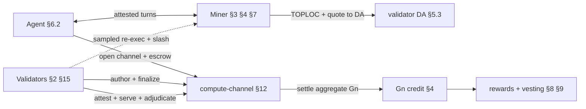

## 0. 적합성 및 읽기 안내

**규범적 키워드.** 키워드 **MUST**, **MUST NOT**, **REQUIRED**, **SHALL**, **SHALL NOT**,
**SHOULD**, **SHOULD NOT**, **RECOMMENDED**, **MAY**, **OPTIONAL**은 대문자로 표기된 경우에, 그리고 오직 그 경우에만
RFC 2119 / RFC 8174에 따라 해석한다. 소문자 사용은 규범적
효력을 갖지 않는다. 키워드가 없는 문장은 서술적 맥락이며 요구사항이 아니다.

**규범적 범위.** 번호가 매겨진 절 본문(§1–§15), 부록 A(파라미터 참조),
부록 F(메시지 및 스토리지 형식), 부록 G(익스트린식 색인), 부록 I(팰릿 색인
참조)는 규범적이다. 부록 B
(출처), C(마이너 생애주기 — 실제 사례 안내), D(수수료 및 수익 맵 — 파생 요약),
E(미결 항목), H(적합성 및 상태 매트릭스)는 규범적 규칙을 다시 서술하며 그 원 절을 인용하는 경우를
제외하고 정보 제공용이다.

**절 골격.** 각 프로토콜 절은 다음과 같이 구성된다:
1. **요구사항** — 규범적 규칙(MUST/SHOULD/MAY).
2. **데이터 구조** — 필드 · 타입 · 인코딩 · 제약(또는 부록 F로의 포인터).
3. **인터페이스** — 익스트린식/함수: 시그니처 · 오리진 · 전제조건 · 오류 · 이벤트(또는
   부록 G로의 포인터).
4. **상태 기계** — 해당 절이 상태 기계를 정의하는 경우, 상태와 전이 표.
5. **근거 및 출처** *(비규범적)* — 설계가 그러한 이유, 결정 ID, 선행 연구,
   형식 증명 인용. 구현자는 이 트레일러를 MAY 무시할 수 있다.

모든 절이 모든 부분을 필요로 하는 것은 아니며, 각 부분은 내용이 있는 경우에만 존재한다.

**파라미터 읽기.** 모든 프로토콜 상수는 부록 A에 명명되어 있으며, 부록 A는
`params/flop-protocol-params.yaml`(기계 검사되는 단일 소스로, `scripts/check_params.py`가
게이트한다)에서 생성된다. 본문에 명명된 파라미터는 생성된 `#param-<name>` 앵커로 링크된다.
본문에 인라인으로 등장하는 구체적 수치는 실제 사례 예시이며, 기준 값은
항상 부록 A이다.

**구현 상태는 대역 외에 있다.** 이 명세는 코드베이스의 스냅숏이 아니라 FLOP이 목표로 하는
프로토콜을 기술한다. 각 요구사항의 구축 상태 — 구현 완료, 진행 중, 설계 단계 — 는
코드 경로 및 추적 이슈와 함께 오직 [부록 H](#appendix-h--conformance--implementation-status-matrix)에서만
추적된다. 본문에는 `[LIVE]`/`[PARTIAL]`/`[PLANNED]` 태그나
커밋/PR 참조가 없으므로, 코드가 반영되더라도 요구사항의 문구는 변하지 않는다.

**신뢰 도메인 원칙.** FLOP의 검증 아키텍처는 §3, §7, §11, §12 전반에 걸쳐 반복되는 명시적 규칙에
기반한다: **폴백 검증 계층은 그것이 뒷받침하는 고속 경로와 다른 신뢰 도메인을 MUST 점유해야
한다.** 특히, 프로토콜 건전성은 어떤 단일 하드웨어 신뢰 루트에도 **MUST NOT** 의존해서는 안 된다.
TEE 어테스테이션은 하나의 보증 티어(§3.3)이며 **OPTIONAL**로서,
참여나 정산의 전제조건이 아니다; 필수 실행 무결성 하한은
활성값 커밋먼트, 샘플링 재실행, 슬래싱으로 구성된 TEE 독립 스택이다(§3.4–§3.5). 이는
`D-0432`로 비준되었으며, 비TEE(SOFT) 티어의 종단 간 정의는 미결 항목
[E.33](#appendix-e--open-specification-items)이다.

**용어와 클록.** §1은 표기법, 역할 용어집, 그리고 결합 불변식을 포함한 정식 프로토콜 클록
표를 확정한다. 모든 지속 시간은 1초 블록을 가정한다.

### 0.1 시스템 아키텍처(정보 제공용 읽기 지도)

FLOP은 **검증된 추론(verified-inference) 정산 계층**이다: 자율 에이전트가
마이너에게 어테스테이션된 추론에 대해 지불하고, 검증자가 이를 파이널라이즈하고 감시하며, 토큰 경제는
*유용하고, 검증되고, 수요가 있는* 작업에 게이트되는 Substrate/FRAME 체인이다. 행위자는 다음과 같다:

| 행위자 | 역할 | 명세 위치 |
|-------|------|--------------|
| **에이전트** | 세션을 열고, 에스크로를 지불하고, 추론을 소비한다; 종종 상한이 설정된 위임 대리인(delegate)이다 | §6.2, §12 |
| **마이너** | 모델을 실행하고, 어테스테이션된 턴을 스트리밍하며, 정산 수익 + 작업 게이트 보상을 얻는다 | §3, §4, §7, §8, §12 |
| **검증자** | 블록 생성(BABE) + 파이널라이즈(AlephBFT), 증명 어테스테이션, DA 호스팅 | §2, §3.6, §5.3, §15 |
| **퍼블리셔** | 모델과 그 측정 루트를 등록한다; 가중치 스토리지를 임대한다 | §3.3, §5.3 |
| **위임자** | 보상 지분을 대가로 마이너/검증자 스테이크를 뒷받침한다 | §6.1, §15 |

**종단 간 정상 경로(happy path)**(하나의 유료 세션):

**절들의 구성 방식**(각 절이 의존하는 것):

- **§2 합의**는 기반이다: BABE가 블록을 생성하고 AlephBFT가 파이널라이즈한다. 어디서든 모든 비가역적 행위는
  그 **파이널라이즈된 프리픽스**를 읽는다 — 정산(§12), HTLC 환불(§10), 슬래싱(§11), DA 프루닝(§5.3).
- **§15 검증자**는 §2를 *실행하고*, §3.6 어테스테이션을 수행하며, §5.3 DA를 호스팅하는 스테이킹된 집합이다;
  그 위원회 게이트(§2.3)는 §3의 검증된 작업 신호를 필요로 한다.
- **§7 캘리브레이션**은 **§4 계량**, **§6.1 마이너 스테이크**,
  **§8 베스팅**, **§11** 정산 게이트가 소비하는 `B_p` / 서빙 상한을 산출한다.
- **§3 검증**은 *무엇이 크레딧될 수 있는지*를 결정한다; §7 상한, §5.3 DA(증거), §12
  트랜스크립트를 소비한다. **§4 계량**은 §8, §9, §11, §12가 모두 기준으로 삼는 `G_n` 단위를 정의한다.
- **§12 세션**은 정산 핫 패스이다 — §2 파이널리티, §3 검증, §4 `G_n`, §5.3
  DA, §7 상한을 읽고 — §8/§9(경제)에 공급한다. **§5.3 DA**는 §3/§12 분쟁이 가져오는 증거를 저장한다.
- **§9 발행 / §8 베스팅**은 수요가 있고 검증된 §4 작업에 게이트된 경제적 산출물이다; **§10 HTLC**는
  체인 간 가치를 안팎으로 이동시킨다. **§14 거버넌스**는 위의 모든 것에 대한 파라미터/업그레이드를 통제한다.
- **§11 불변식**과 **§13 실패 의미론**은 모든 절을 횡단한다; **§6**은
  전체 시스템의 토대가 되는 계정, 키, 에스크로 프리미티브를 제공한다(암호/계정: §6.5).

부록은 참조 표면이다: **A** 파라미터 · **F** 메시지/스토리지 형식 · **G** 익스트린식 ·
**H** 적합성/상태 · **I** 런타임 구성(팔레트 인덱스). 동반 문서
[`yellowpaper-attribution.md`](yellowpaper-attribution.md)는 각 요구사항을 그 증명 + 코드에 매핑한다.

---
