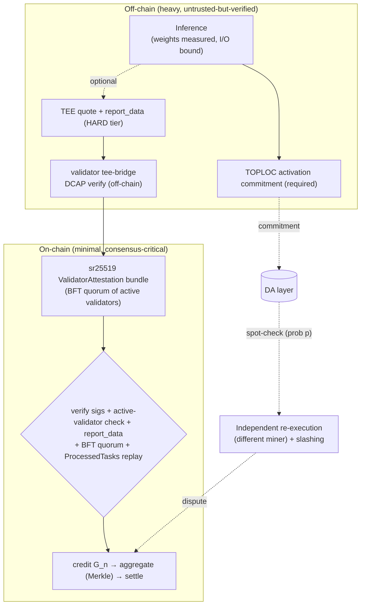

## 3. 유용한 추론 증명 — 검증 아키텍처

PoUI는 다음 질문에 답한다: *마이너가 주장한 컴퓨트를 사용하여 주장한 추론(inference)(이 모델, 이 출력)을 실제로 실행했는가, 아니면 더 저렴한 것으로 속였는가?* 어떤 단일 프리미티브도 이를 저렴하게 수행하지 못하므로, FLOP는 **계층형 하이브리드(tiered hybrid)**를 사용하며, 그 핵심 규칙은 **폴백 계층이 고속 경로와 다른 신뢰 도메인을 점유한다**는 것이다(§0). 순전파(forward pass)를 ZK로 증명하는 것은 범위 밖이다: 증명자 비용은 증명되는 FLOP에 비례하여 10³–10⁶× 증폭되기 때문이다 — ***저렴한* 검사를 증명하라, 순전파는 절대 증명하지 말라.**

### 3.1 요구사항

- **R3.1 — 실행 무결성 하한(TEE 독립적, 필수).** 정산되는 모든 세션은 그 턴들에 대한 TOPLOC 활성값 커밋먼트(§3.4)를 **MUST** 포함해야 한다. 요구되는 증거가 누락되면 정산은 **MUST** 닫힌 상태로 실패(fail closed)해야 한다; TOPLOC 없는 정산 레인은 존재하지 않는다.
- **R3.2 — TEE는 선택 사항이다.** TEE 어테스테이션(§3.3)은 세션을 뒷받침**MAY** 할 수 있으며, 존재하는 경우 해당 세션의 보증 티어(HARD)와 허용 가치 상한을 높인다. 프로토콜의 건전성(soundness)은 TEE 무결성에 **MUST NOT** 의존해서는 안 된다: TEE 쿼트(quote)가 위조되었거나 그 신뢰 루트가 실패한 경우에도, 수락은 여전히 명시된 오류 한계를 가진 독립적으로 강제되는 폴백을 **MUST** 요구해야 한다. 한계 오류 확률(marginal error probability)을 곱셈으로 결합하는 것은 정당화된 조건부 독립 모델을 **MUST** 요구해야 한다; 그것이 없다면 두 개의 강제 게이트는 일반 교집합 한계 `min(ε_tee, ε_fallback)`만을 뒷받침한다. 비TEE(SOFT) 마이너 클래스는 일급(first-class) 참여자이다(`D-0432`; 그 종단 간(end-to-end) 정의는 미결 항목 [E.33](#appendix-e--open-specification-items)이다).
- **R3.3 — 독립 재실행.** 침해된 고속 경로에 대한 보안은 다른 신뢰 도메인에서의 낙관적 재실행(§3.5)으로부터 **MUST** 나와야 하며, 회수 가능한 담보와 총 노출이 명시된 `p_effective` 억지 조건(E.45)을 충족해야 한다.
- **R3.4 — 정산 게이트.** 직접 PoUI 증명 레일에서의 크레딧 부여는 서로 다른 활성 검증자들의 BFT 쿼럼(§3.6)을 **MUST** 요구해야 한다: `ceil(active_count × validator_attestation_threshold).max(1)`.
- **R3.5 — 바인딩.** 수락된 증명/어테스테이션은 최소한 `task_hash`, 미터링된 `gn_weight`, 측정된 `model_hash`, 그리고 `output_hash`를 **MUST** 바인딩해야 한다; 바인딩된 필드 중 어느 하나라도 불일치하면 **MUST** 거부해야 한다(`OutputHashMismatch` / 루트 불일치).
- **R3.6 — 재전송(replay).** 각 `task_hash`는 최대 한 번만 크레딧 가능**MUST** 해야 한다(`ProcessedTasks` 가드).

### 3.2 검증 스택



| 티어 | 얻는 것 | 필수 여부 |
|------|----------|-----------|
| 1 — TEE 어테스테이션된 결정론적 실행 | 진정한 HW 환경 + 측정된 모델/I-O 바인딩; HARD 보증 티어와 더 높은 가치 상한을 해제 | **선택** (R3.2) |
| 2 — TOPLOC 활성값 커밋먼트 | 커밋된 프리필 활성값에 대한 모델/프롬프트/정밀도 교체의 저렴한 *탐지*; 디코드 단계 커버리지는 미결이다(E.43) | **모든 세션에 필수** (R3.1) |
| 3 — 독립 낙관적 재실행 + 슬래싱 / 세션 분쟁 게임 | 침해된 고속 경로에 대한 실질적 방어 | **필수** (R3.3) |
| 4 — 온체인 정산 + ZK 집계 + 검증자 BFT 쿼럼 | 탈중앙화된 어테스테이션 하의 간결한 파이널라이즈 | **필수** (R3.4) |

### 3.3 티어 1 — TEE 어테스테이션 및 `model_hash` 측정 *(선택 / HARD 티어)*

세션이 기밀 컴퓨팅(confidential computing) 하에서 실행되는 경우, NVIDIA CC(H100/H200/Blackwell) + Intel TDX 호스트 CVM이 진정한 디바이스, CC 모드/VRAM 암호화, 그리고 펌웨어/RTMR 측정값을 어테스테이션한다; 호스트 쿼트(MRTD, RTMR0-3, `report_data`)는 DCAP / `dcap-qvl`로 검사된다. 이 어테스테이션은 *환경*을 증명하는 것이며, **어떤 모델이 실행되었는지는 증명하지 않는다** — 따라서 티어 2/3 하한을 절대 대체하지 못한다.

**`model_hash` 측정.** TEE 세션이 모델을 주장할 때, 로드된 가중치에 대한 커밋먼트는 전달받은 체크섬이 아니라 *측정된* dm-verity 머클 루트여야 **MUST** 한다:

1. 모든 가중치 샤드 + 인덱스 + 설정을 dm-verity 머클 트리(4 KB 블록)를 가진 하나의 읽기 전용 EROFS 이미지로 패킹한다. **루트 해시**가 커밋먼트이다; 커널은 읽기 시 모든 블록을 검증하고 불일치 시 폴트를 발생시키므로, 엔진은 커밋된 가중치만 읽을 수 있다. 재현 가능한 패커는 `[tools/modelpack]`이다.
2. 마이너 CVM은 루트를 TDX 이벤트 로그 항목으로서 RTMR3로 확장해야 **MUST** 하며, 그래야 서명된 쿼트에 나타나고 `report_data`로 흘러 들어간다. 다른 어떤 레지스터나 측정 경로도 수락되지 않는다.
3. 체인은 `(model, precision)`별 기대 루트를 `pallet_model_registry`에 저장하며, 쿼트의 측정 루트 ∈ 레지스트리인 경우에만 TEE 증명을 **MUST** 수락해야 한다(fail-closed `Vk::V3`; dstack 검증기는 TDX 이벤트 로그를 파싱하고, 이를 쿼트의 RTMR3로 재생(replay)하며, RTMR3 이벤트 중에 레지스트리 루트가 있을 것을 요구한다). 양자화는 바이트를 바꾸고 → 루트를 바꾸므로, 각 정밀도 변형은 별개의 커밋먼트이다(TOPLOC 정밀도 탐지와 일관됨).

**출력 바인딩.** `report_data`는 또한 `output_hash`를 **MUST** 커밋해야 한다; 검증자는 불일치를 **MUST** 거부해야 한다. **디코드 정책 바인딩.** `report_data`는 `decode_policy_hash` — `greedy`/temperature/top-p/top-k/seed와 transform id에 대한 정규(canonical) 다이제스트 — 를 **MUST** 커밋해야 한다. 거버넌스는 레지스트리에서 모델을 허용된 디코드 정책 집합에 고정(pin)**MAY** 할 수 있다(≤ [`max_decode_policies_per_model`](#param-max_decode_policies_per_model)); 고정이 없으면 정책 롤아웃은 차단되지 않는다. 전체 바인딩 프리이미지(preimage)는 [Appendix F](#appendix-f--message--storage-formats)에 있다.

### 3.4 티어 2 — TOPLOC 활성값 커밋먼트 *(필수 하한)*

TOPLOC은 각 토큰의 마지막 은닉 상태(hidden state)의 상위 128개 값+인덱스를 커밋하며, 이를 다항식 인코딩하여 32 토큰당 약 258바이트로 만든다. 검증기는 단일 프리필을 재실행하고 지수(exponent) 교집합을 비교한 뒤, 가수(mantissa) 오차를 `(model, precision)`별 거버넌스 캘리브레이션 밴드와 비교한다. 커밋되는 레인과 재실행되는 단계는 프리필이다; 디코드 단계를 커버하고 이를 과금된 토큰 id(`h_ids`)에 바인딩하는 커밋먼트와 검사는 E.43에서 미결이다.

- **R3.4a.** TOPLOC 커밋먼트는 모든 세션에 대해 **MUST** 존재해야 하며(R3.1) 티어 3에 공급하기 위해 DA에 게시되어야 한다. 암호학적 탐지 한계는 추가로 커밋먼트가 챌린지 대상 활성값 벡터를 바인딩하고, 챌린지 난수가 커밋먼트 이후에 고정되며, 오프닝(opening)이 그 커밋먼트에 대해 검사될 것을 요구한다; 종단 간 프로토콜 브리지는 [E.43](#appendix-e--open-specification-items)이다.
- **R3.4b.** 밴드 판정(adjudication)은 `(model, precision, backend, GPU)` 셀별로 **MUST** 닫힌 상태로 실패해야 한다: 셀의 이기종 하드웨어 활성화 게이트가 통과되기 전까지, 해당 셀은 커밋먼트 필수이지만 판정 비활성(adjudication-inert)이다(묵시적 수락 없음). 두 임계값 정책은 수락 / 에스컬레이션 / 슬래시이다; 중간의 *에스컬레이션* 판정은 [`channel_toploc_escalation_window_blocks`](#param-channel_toploc_escalation_window_blocks) 이내에 에스컬레이션 생애주기로 **MUST** 라우팅되어야 하며, 절대 묵시적 수락으로 가서는 안 된다.
- **R3.4c.** 승인되지 않은 모델/정밀도/프롬프트/디코드/수치 대체는 분쟁 가능한 실행 사기로 **MUST** 취급되어야 한다. TOPLOC의 탐지 주장은 검증된 셀과 E.43의 커밋먼트, 챌린지, 판정 가정에 한정된다. 답변 **품질**은 **프로토콜 범위 밖**이다 — 시장/평판에 의한 구제이며, 결코 프로토콜 사기 판정이 아니다. 이 경계는 규범적이다.

허용 밴드(tolerance band) 공식은 정직한 발산(honest-divergence) 모델과 비밀 챌린지 투영(secret-challenge projection) 모델을 결합한다; 커밋된 셀별 상수(`kappa_profile_hash`, `band_tau_accept`, `band_tau_slash`, …)는 Appendix A에 있다. 이 공식들은 명시된 분포 하에서 조건부 수학적 한계를 제공한다. 이들은 모든 모델/백엔드/GPU 셀에 대한 경험적 탐지를 확립하지 않으며, 배포된 커밋먼트, 챌린지, 오프닝, 감사, 판정 경로가 그러한 가정을 강제한다는 것을 증명하지도 않는다. TEE가 깨진 상황에서, 추상 AND 결합자(combinator)는 제공된 폴백 한계를 유지한다; 그 한계는 [E.43](#appendix-e--open-specification-items)에서 독립적으로 확립된 폴백과 운영 브리지만큼만 강하다.

### 3.5 티어 3 — 독립 낙관적 재실행 및 슬래싱

침해된 고속 경로에 대한 보안은 **다른 신뢰 도메인**에서의 효과적인 재실행을 조건으로 한다. 샘플링 증명(Proof-of-Sampling) 게임은 무작위 비율을 대상으로 한다: 결과는 본드 하에 게시되고 다른 마이너가 샘플링된 작업을 재실행한다. 고정된 모니터링과 신뢰할 수 있고 회수 가능한 페널티 하의 위험 중립적 마이너에 대해, 필요 억지 부등식은 다음과 같다

```
p_effective · collectible_penalty  >  total_profitable_exposure
```

- **R3.5a.** 정직한 상시 챌린저(standing challenger)가 ≥1 **MUST** 존재해야 한다 — §12.1에 따라 세션 에이전트(자신의 채널에 대해) 또는 활성 검증자(모든 채널에 대해).
- **R3.5b.** 슬래시 가능한 담보는 단일 작업이 아니라 총 동시 노출을 **MUST** 커버해야 한다; 고가치 작업은 ZK 스팟 증명(§3.6)으로 **SHOULD** 에스컬레이션되어야 한다. 예약 및 보수(payoff) 모델은 [E.45](#appendix-e--open-specification-items)에서 미해결이다.
- **R3.5c.** 분쟁은 마이너의 호스트 외부에서 이용 가능한 데이터에 대해 **MUST** 해결되어야 한다. 검증자가 호스팅하는 DA는 마이너 단독 보관(custody)을 제거하지만 검증자 연합(coalition)으로부터 독립적이지는 않다(§5.3). 분쟁 이분 탐색은 `O(n²)` Freivalds 스팟 검사를 MAY 사용할 수 있으며, 그러면 리프에서 단일 레이어/GEMM만 재실행된다.
- **R3.5d — 재실행 레인.** 샘플링되거나 챌린지된 턴의 재실행은 마이너와 다른 신뢰 도메인에 있는 본드를 낸 **체커(checker)**에 의해 **MUST** 수행되어야 하며, 절대 검증자에 의해 수행되어서는 안 된다. 하한은 턴당 세 명의 체커 — 마이너와도 서로 간에도 구별되는 운영자, VRF로 배정 — 가 **만장일치** 판정을 반환하는 것이다; 어떠한 불일치, 또는 증거·모델·용량의 이용 불가는 **MUST** 에스컬레이션되어야 하며(§12.1) 묵시적 수락이 되어서는 **MUST NOT** 안 된다. 재실행에 대한 TEE 어테스테이션을 포함하는 체커 판정은 판정의 보증 티어와 허용 가치 상한을 높이는 OPTIONAL 강화이다; 이는 하한을 낮추어서는 **MUST NOT** 안 된다. §3.6 임계값에서 불일치 또는 클리어(clear) 쿼럼에 공동 서명하기 전에, 검증자는 배정, 체커들의 본드, 서명의 커밋먼트 및 턴에 대한 바인딩, 그리고 만장일치를 **MUST** 검증해야 한다. 체커 신원은 §2.4의 캘리브레이션된 마이너 신원 — 용량 비례 자기 스테이크, 수락된 캘리브레이션 상한, 독립적으로 어테스테이션된 하드웨어 핑거프린트 — 에 체커 본드를 더한 것이어야 **MUST** 한다; 단순히 본드만 낸 계정은 체커 자격이 없다. 배정은 세션 마이너의 계정과 핑거프린트를 제외한 해당 풀에 대한 스테이크 가중 VRF 샘플링이어야 **MUST** 하며, 배정된 세 체커는 쌍별로 서로 다른 핑거프린트를 **MUST** 가져야 한다. 따라서 풀의 선택 가중치 중 지분 `q`를 보유한 공격자가 세 자리를 모두 차지할 확률은 최대 `q³`이며, 이는 §2.4의 시빌 비용에 의해 한계가 정해진다. 만장일치 수락은 최종이 아니다: R12.1f 챌린지 윈도우 내에 어떤 상시 챌린저든 이를 MAY 에스컬레이션할 수 있으며, 그 경우 첫 배정과 겹치지 않는 새 배정이 이루어지고, 판정이 뒤집힌 체커는 본드를 **MUST** 몰수당해야 한다. 판정 필드와 체커 지급은 E.53이다.

여기서 `p_effective`는 확률 체인
`P(selected) · P(data | selected) · P(challenge | selected,data) ·
P(included | selected,data,challenge) · P(upheld | selected,data,challenge,included) ·
P(collectible | selected,data,challenge,included,upheld)`이다. 모든 인자는 선행하는 모든 사건을 조건으로 한다; 이것은 연쇄 법칙(chain rule)이며, 독립 가정이나 마르코프 가정이 아니다. 이 부등식만으로는 챌린저, 연합, 매수(bribery), 또는 비잔틴 행위자에 대한 내시 균형(Nash equilibrium)을 확립하지 못한다. 슬래싱은 `pallet_miner_slashing`이다; 세션 분쟁 게임은 §12.1이다.

### 3.6 티어 4 — 온체인 정산, ZK 집계 및 검증자 BFT 쿼럼

직접 **증명별 레일(per-proof rail)**은 합성/고스트, 캘리브레이션, 시뮬레이터 작업을 정산한다; **유료 에이전트 세션은 컴퓨트 채널을 통해 정산되며**(§12.1), 그곳에서 검증자 쿼럼은 크레딧별 게이트키퍼가 아니라 분쟁 해결자로 작동한다. 직접 레일에서는:

- **R3.6a.** 마이너는 `submit_stark_batch(...)`를 통해 증명을 제출하며, 이는 재전송 보호(`ProcessedTasks[task_hash]`)와 함께 `PendingVerifications`에 기록된다.
- **R3.6b.** 크레딧 부여는 검증자 BFT 쿼럼을 **MUST** 요구해야 한다. 검증자는 DCAP/dstack TEE 쿼트 검증을 오프체인에서 실행하고 `submit_validator_attestations`를 통해 서명된 `ValidatorAttestation` 번들을 제출한다. 체인은 **MUST** 다음을 수행해야 한다: 각 sr25519 서명을 검증한다; 모든 서명자가 활성 검증자인지 확인한다(`pallet_validators::ActiveValidators`); 번들 전체에 걸쳐 `(task_hash, gn_weight, latency_ms, model_hash, output_hash, decode_policy_hash, tee_type,
  quote_verified, event_log_verified, hardware_id_hash)`에 대한 일치를 강제한다; 두 검증 불리언(boolean)이 모두 참일 것을 요구한다; 그리고 `ceil(active_count × validator_attestation_threshold).max(1)`명의 서로 다른 검증자를 요구한다(기본 임계값 [`validator_attestation_threshold`](#param-validator_attestation_threshold) = 2/3, 루트 거버넌스로 조정 가능).
- **R3.6c.** 쿼럼이 달성되면 체인은 `report_data` 바인딩 + `output_hash` 일치를 **MUST** 검증하고, `gn_weight`를 크레딧하며, `OnProofVerified`를 발생시켜야 한다.

별도의 오라클 레지스트리는 **없다**; 어테스테이션 권한은 이미 합의를 보호하고 있는 활성 검증자들의 BFT 쿼럼이다. **Aggregate 팔레트**는 검증된 스테이트먼트 해시(`keccak256`)를 도메인별 머클 루트로 수집하여 크로스체인 디스패치에 사용한다; 정산 검증기(Groth16-161 … EZKL-169, TEE-170)는 **zkVerify 집계이며 — 추론을 증명하지 않는다.** 선택적 ZK 스팟 증명은 최고 가치 작업을 커버한다.

### 근거 및 출처 *(비규범적)*

이 스택은 공개된 메커니즘과 프로토타입에 기반한다(TEE 기밀 추론 — Azure CVMs, Phala, Tinfoil; dm-verity 모델 측정 — Tinfoil Modelpack; TOPLOC 활성값 커밋먼트 — Prime Intellect, arXiv:2501.16007; TEE 고속 경로 + 샘플링 재실행 + 슬래싱 — VeriLLM ~1% 비용 arXiv:2509.24257, SPEX arXiv:2503.18899, *결정론적* 추론으로 FP 노이즈 밴드를 제거하는 EigenAI arXiv:2602.00182, Optimistic TEE-Rollups arXiv:2512.20176; 가중치-어테스테이션 바인딩 — Laminator arXiv:2406.17548, Attestable Audits arXiv:2506.23706). TEE 선택화 재정립은 기계 검증된 `sessionVerifier_survives_broken_tee`(추상 AND 결합자는 위조된 쿼트 하에서도 제공된 폴백 한계를 유지한다)와 SOFT 티어 설계(E.33)에 근거한다. 후속 커밋먼트 스킴(TensorCommitments arXiv:2602.12630, DiFR arXiv:2511.20621, log-prob 추적 arXiv:2512.03816)은 측정된 (ε, φ) 점으로 끼워 넣어진다 — 이들의 이득은 검증 *비용*이며, 보증이 아니다.

워크스루: ELI5 ·
Feynman ·
session-lifecycle-runbook.md. 계층형 허브:
verification-architecture.md, verification.md,
verification-economics-bounds.md,
dispute-reexecution-tradeoffs.md,
formal-to-implementation-bridge.md. 밴드 유도:
toploc-band-derivation.md; 운영 R1–R4:
toploc-r1-r4-research.md; R3.4c 대비 디코드 측 적합성 공백:
decode-substitution-gap.md. 티어 3 프리미티브:
freivalds-bisection-spec.md,
commodity-reexecution-reference.md(GPU 선택적 리프 재실행기 후보로서의 tinygrad + Colibri),
distribution-audit-tier-design.md,
cheap-miner-hardware-profiles.md,
claim-then-audit-image-commitments.md. GPU 작업
측정 + 프리미엄 인증 레인: gpu-work-measurement-verification-study.md,
batch-work-certificates-spike.md,
gemm-certificate-format-spec.md,
kv-commitment-carryover-design.md,
zk-prover-overhead-audit-lane.md,
zk-audit-settlement-design.md(ZK로 감싼 감사 판정 + 정산 장부 처리, 설계 스파이크); 스택 거버넌스
verification-scheme-registry.md. 신뢰 표면:
`docs/trust-surface.md`. 리뷰 증거 및 가정 분류:
[prepublication-evidence.md](research/prepublication-evidence.md). 조건부 감사 보수, 공유
담보, 회수 경로 증거: [audit-economics-evidence.md](research/audit-economics-evidence.md).
출처(provenance): `D-0404`(측정된
`model_hash`), `D-0406`/`D-0414`(어테스테이션 권한), `D-0431`(TOPLOC 필수), `D-0501`
(주장 범위 및 조건부 보증). 형식 검증:
`FlopSpecs/Crypto.lean`,
`FlopSpecs/TeeAttestationFlow.lean`,
`FlopSpecs/Verification.lean`,
`FlopSpecs/VerificationComparison.lean`,
`verification/proof-verification.qnt`. 상태:
[Appendix H](#appendix-h--conformance--implementation-status-matrix).

---
