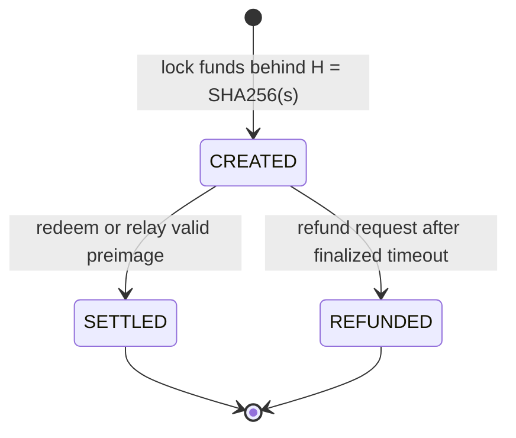

## 10. HTLC 아토믹 스왑

`has-station`은 `create/redeem/refund_htlc`와 `create_cross_chain_htlc`를 구현한다.

### 10.1 요구사항

- **R10.1 — 로컬 원자성 및 보존.** 각 FLOP 레그 해시락 `H = SHA256(s)`는 **MUST** redeem/refund 중 최대
  하나만 허용하고, 잠긴 자금을 보존하며, 이중 청구를 금지해야 한다. 출시된
  [`htlc_burn_share_ppt`](#param-htlc_burn_share_ppt)는 0이다; 이 설정 하에서 타임아웃 해소는 잠긴 원금 전액을
  보존한다. 엔드투엔드 크로스체인 완료는
  §10.2–§10.3에 명시된 해당 페어의 파이널리티, 포함(inclusion), 프리이미지, 타임아웃, 신원, 수수료,
  릴레이어 가정에 조건부이며, 무조건적인 원자성 보장이 아니다.
- **R10.2 — 타임락 대칭성.** 외부 체인의 기간을 1초 단위 FLOP 블록으로 변환한 후, `T_FLOP`는 **MUST**
  `T_FLOP ≥ T_other + max(ceil(T_other × p / 100), max_finality_stall + current_finality_lag)`를
  만족해야 한다. 여기서 `p`는
  [`htlc_timelock_symmetry_safety_margin_percent`](#param-htlc_timelock_symmetry_safety_margin_percent)
  이고, `max_finality_stall`은 [`max_finality_stall`](#param-max_finality_stall)이며,
  `current_finality_lag`는 어드미션을 평가하는 블록이 파이널라이즈된 프리픽스(`FinalizedPrefix`, R2.2)를
  앞서는 블록 수, 즉 그 블록에서 읽은 `block_number − finalized_number`이다. `create_cross_chain_htlc`와
  크로스체인 `create_htlc_commit`은 이 관계를 평가하기 전에 파이널리티 개설 게이트를 **MUST** 적용해야 한다:
  `current_finality_lag`가 [`finality_freeze_threshold`](#param-finality_freeze_threshold) 이상이면 개설이 거부된다.
  따라서 이 관계는 지연이 그 임계값 미만일 때에만 평가된다. 이 관계는
  어드미션 시점에 평가되며 등호도 허용된다: 우변과 정확히 같은 `T_FLOP`는 수락된다. 이 마진은 필요한
  어드미션 조건이며, 그 자체로 적시 포함(timely inclusion)을 보장하는 것은 아니다.
- **R10.3 — 환불의 리오그 안전성.** 환불은 팁(tip)이 아니라 AlephBFT **파이널라이즈된** 헤드를 기준으로
  **MUST** 게이트되어야 한다(팁 기준 환불은 리오그에 안전하지 않다).
- **R10.4 — 릴레이어 신뢰.** `relay_preimage`는 **MUST** 권한 제한(permissioned)되어야 한다(루트가 관리하는
  허용 목록, `register_relayer` / `RegisteredRelayers`): 릴레이어는 유효한 프리이미지에 대해 이미 잠긴
  HTLC를 자기 자신에게만 해제한다. 배포 환경은 추가로, 주문 수신자가 런타임 호출에 바인딩되지 않으므로
  이 허용 목록에 등록된 계정이 의도된 거래상대방이라고 가정한다.
- **R10.5 — 멀티 블록 정산.** 긴 생성(generation)은 **MUST** 추정 최대치 `G_n`을 잠그고, 상환(redemption)
  시점에 어테스테이션된 토큰 수로부터 실제 금액을 정산해야 한다; 타임아웃 시 자동 환불된다.

휴면 상태의 0이 아닌 타임아웃 소각 구현은 제안(D-0523)이며, 비준과 별도의 런타임 업그레이드를 기다리고 있다.
이는 활성화된 경제 규칙이나 수수료 하한 보장이 아니다.

### 10.2 체인 페어 적격성

FLOP 레그 상태 기계와 각 상대 체인 구성 요소는 서로 별개다. 페어 수준의 완료는 방향, 체인/자산/참여자
바인딩, 레그별 파이널리티와 관측, 타임아웃 방향과 마진, 복구, 트랜잭션 포함에 관한 미해결 선택에
의존한다. E.48이 이러한 선택과 특정 페어를 적격으로 판정하는 데 필요한 증거를 추적하며, 부록 H가
구현 상태를 기록한다.

FLOP/네이티브 BTC, FLOP/네이티브 NEAR, FLOP/NEAR 상의 NEP-141에 대한 최초 공개 시점의 주장은
상대 체인 공개(reveal) → FLOP 릴레이 방향에서 **목표에 한정(target-only)** 된다. 타임아웃은 환불을 가능하게 할 뿐,
그 자체로 해시락 청구를 소멸시키지는 않는다. 따라서 완료 및 환불 목표는 두 체인의 포함 및 종단 전이 순서에
의존하며, 늦은 청구 이전의 상대 측 환불도 이에 포함된다. 배포된 체인 페어의 완료 보장은 주장하지 않는다.

### 10.3 인센티브 강건성

단순 HTLC는 공격 비용이 낮다(MAD-HTLC): 합리적 거래상대방은 수수료 극대화 블록 작성자에게 뇌물을 주어
타임락이 전환될 때까지 정직한 redeem/refund를 보류하게 할 수 있다. 파이널라이즈된 프리픽스 기준 환불은
로컬 재구성(reorganization) 위험 하나를 제거하지만, redeem이 기한 전에 포함됨을 보장하지는 않는다.
로컬 컨트랙트는 그 상태 기계 하에서 redeem/refund 전이 중 최대 하나만 성공함을 증명한다. 크로스체인
원자성은 추가로 레그별 파이널리티, 적시 포함, 올바른 타임아웃 방향, 프리이미지 가용성, 릴레이어 복구를
가정한다. 수수료 하한 억지 정리(theorem)는 정직한 수수료가 결탁 집단의 잔여 추출 가능 가치 이상이라는
조건에 의존한다. 그 전제를 충족하기 위해 필요한 수수료 및 포함 설계는 E.48에서 미결 상태로 남아 있다.

### 근거 및 출처 *(비규범적)*

선행 연구: MAD-HTLC (arXiv:2006.12031), 결탁 경로의 일부를 *소각*하는 He-HTLC (ePrint 2022/546).
출처(provenance): formal-to-implementation-bridge.md의 HTLC 형식 모델→팔레트 매핑;
`trust-manifest.toml`의 신뢰 주장 `htlc.counter_chain_bribery_residual`;
브리지 옵션 `docs/bridge/settlement.md`. 검토 가정:
[prepublication-evidence.md](research/prepublication-evidence.md). 출처 명확화: `D-0501`.
내부 적격성 증거: 체인 페어 HTLC 증거.
형식 명세:
`FlopSpecs/Temporal.lean` (`htlc_atomic`,
`refund_within_tlock`), `FlopSpecs/HtlcIncentives.lean`
(`collusion_deterred`, `no_burn_floor`),
`FlopSpecs/HtlcRefundFinality.lean`
(`refund_final_safe`), `htlc-atomic-swap.qnt`. 상태:
[부록 H](#appendix-h--conformance--implementation-status-matrix).

---
