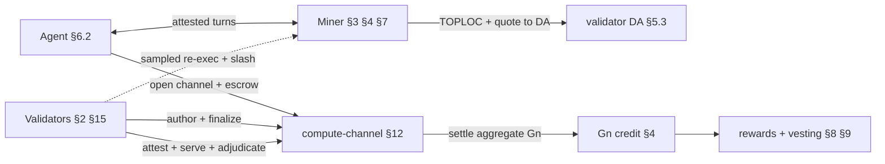
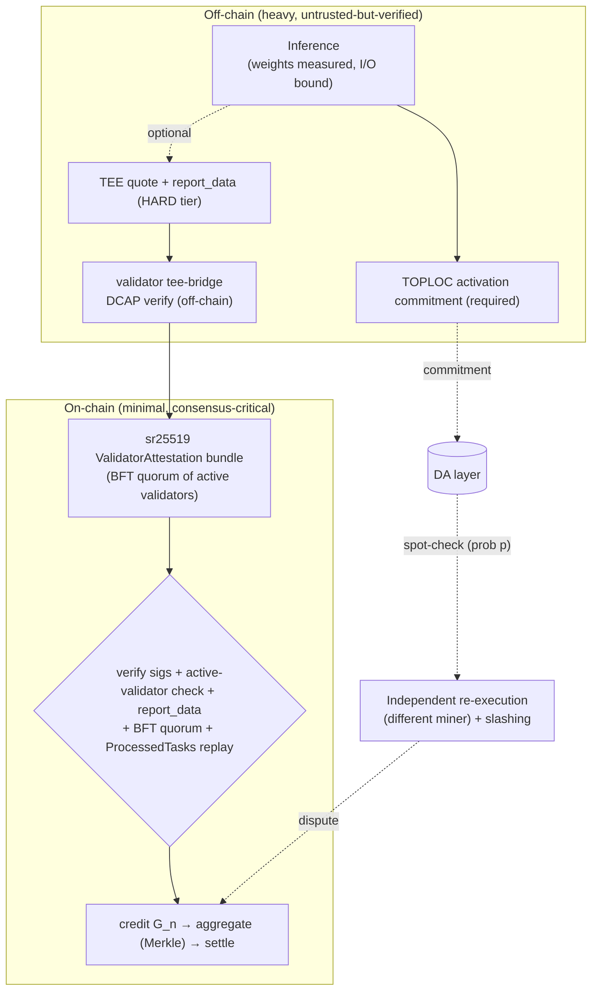
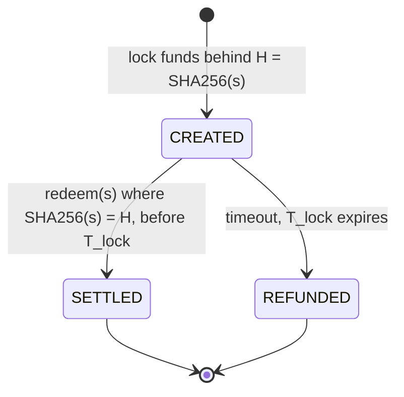

<!-- 비공식 한국어 번역. 정본은 영문 원문이다. 자세한 내용은 README.md 참조. -->

<!-- Published mirror of the FLOP yellowpaper — generated by scripts/publish_yellowpaper.py from flop-labs/flop-core@db51f991. Do not edit here. -->
> **공개 미러 — 0.5.0 (draft)** (소스 `flop-core@db51f991`). 이 파일은 자동 생성된다; 수정은 업스트림에서 이루어진 뒤 다시 공개된다. 공개 시점에 스펙에 세 가지 변환이 적용된다: 부록 H의 `Code path · tracker` 열이 제거되고, 로컬 링크는 공개된 경로/앵커로 재지정되거나 대상 파일이 미공개인 경우 평문으로 펼쳐지며, 기계 판독용 `<!-- cite: -->` 게이트 주석이 제거된다. 규범적 텍스트는 변경되지 않는다. `#NNN` 형식의 트래커 참조는 이 저장소의 이슈가 아니라 FLOP의 내부 엔지니어링 트래커를 가리킨다. 피드백: 이슈를 열어 주기 바란다.

<div class="cover">
  <p class="kicker">FLOP Network · 옐로 페이퍼</p>
  <h1 class="mission"><em>FLOP 프로토콜</em>의 규범적 명세.</h1>
  <div class="meta">
    <span>버전<b>0.5.0 (draft)</b></span>
    <span>상태<b>구현 스펙 — 반복 개정 중</b></span>
    <span>갱신일<b>2026-09-05</b></span>
  </div>
</div>

> FLOP Network의 **구현 명세(implementation specification)**: 표기법, 메시지 및 스토리지 형식,
> 익스트린식 인터페이스, 상태 기계, 알고리즘, 프로토콜 불변식을 다룬다. 구현자가 기준으로 삼아 구축하는
> 권위 있는 참조 문서이다. 화이트페이퍼(개념)와 라이트페이퍼(개요)에 대응하는
> 수학/스펙 동반 문서이다.
>
> **이 문서를 읽는 방법 — 먼저 [§0](#0-conformance--reading-guide)을 참조한다.** 각 절의 본문은
> **규범적**이며, RFC 2119 키워드(**MUST**/**SHOULD**/**MAY**)를 사용하여 *목표 프로토콜*을 기술한다.
> 구현자가 적합성을 충족하기 위해 필요한 모든 내용은 번호가 매겨진 절과
> 부록 A(파라미터), F(메시지 및 스토리지 형식), G(익스트린식 색인)에 담겨 있다. 요구사항이
> *아닌* 모든 것 — 설계 근거, 결정 출처, 선행 연구, 형식 증명 인용 — 은
> 각 절 말미의 **근거 및 출처(Rationale & sources)** 트레일러와 부록 B에 한정된다.
> **구현 상태**(무엇이 구축되었고 무엇이 설계 단계인지)는 규범적 본문에 실리지 *않으며*,
> 단 한 곳, [적합성 및 상태 매트릭스(부록 H)](#appendix-h--conformance--implementation-status-matrix)에만 기록된다.
> **미해결 값/메커니즘**은
> [부록 E — 미결 명세 항목](#appendix-e--open-specification-items)에 번호가 매겨진 스텁으로 존재하며, 본문은
> 미결 논쟁을 다시 서술하지 않고 해당 스텁을 참조한다.
>
> **결정 출처.** 비준된 입장은
> [`decisions/v0.4.md`](decisions/v0.4.md)에 한 번만 기록된다(`D-04xx`, MADR 형식, 병합 후 불변, 이후 버전에서
> ID로 대체). 규범적 규칙이 `D-id`를 인용하는 경우 그 인용은 *출처 표시에 한정*되며 —
> 규칙 자체는 본문에 완전히 서술되어 있으므로, 독자가 구현을 위해 결정 기록을 참조할 필요는 없다.

---

## 0. 적합성 및 읽기 안내

**규범적 키워드.** 키워드 **MUST**, **MUST NOT**, **REQUIRED**, **SHALL**, **SHALL NOT**,
**SHOULD**, **SHOULD NOT**, **RECOMMENDED**, **MAY**, **OPTIONAL**은 대문자로 표기된 경우에, 그리고 오직 그 경우에만
RFC 2119 / RFC 8174에 따라 해석한다. 소문자 사용은 규범적
효력을 갖지 않는다. 키워드가 없는 문장은 서술적 맥락이며 요구사항이 아니다.

**규범적 범위.** 번호가 매겨진 절 본문(§1–§15), 부록 A(파라미터 참조),
부록 F(메시지 및 스토리지 형식), 부록 G(익스트린식 색인)는 규범적이다. 부록 B
(출처), C(마이너 생애주기 — 실제 사례 안내), D(수수료 및 수익 맵 — 파생 요약),
E(미결 항목), H(적합성 및 상태 매트릭스)는 규범적 규칙을 다시 서술하며 그 원 절을 인용하는 경우를
제외하고 정보 제공용이다.

**절 골격.** 각 프로토콜 절은 다음과 같이 구성된다:
1. **요구사항** — 규범적 규칙(MUST/SHOULD/MAY).
2. **데이터 구조** — 필드 · 타입 · 인코딩 · 제약(또는 부록 F로의 포인터).
3. **인터페이스** — 익스트린식/함수: 시그니처 · 오리진 · 전제조건 · 오류 · 이벤트(또는
   부록 G로의 포인터).
4. **상태 기계** — 해당 절이 상태 기계를 정의하는 경우, 상태와 전이 표.
5. **근거 및 출처** *(비규범적)* — 설계가 그러한 이유, 결정 ID, 선행 연구,
   형식 증명 인용. 구현자는 이 트레일러를 MAY 무시할 수 있다.

모든 절이 모든 부분을 필요로 하는 것은 아니며, 각 부분은 내용이 있는 경우에만 존재한다.

**파라미터 읽기.** 모든 프로토콜 상수는 부록 A에 명명되어 있으며, 부록 A는
`params/flop-protocol-params.yaml`(기계 검사되는 단일 소스로, `scripts/check_params.py`가
게이트한다)에서 생성된다. 본문에 명명된 파라미터는 생성된 `#param-<name>` 앵커로 링크된다.
본문에 인라인으로 등장하는 구체적 수치는 실제 사례 예시이며, 기준 값은
항상 부록 A이다.

**구현 상태는 대역 외에 있다.** 이 명세는 코드베이스의 스냅숏이 아니라 FLOP이 목표로 하는
프로토콜을 기술한다. 각 요구사항의 구축 상태 — 구현 완료, 진행 중, 설계 단계 — 는
코드 경로 및 추적 이슈와 함께 오직 [부록 H](#appendix-h--conformance--implementation-status-matrix)에서만
추적된다. 본문에는 `[LIVE]`/`[PARTIAL]`/`[PLANNED]` 태그나
커밋/PR 참조가 없으므로, 코드가 반영되더라도 요구사항의 문구는 변하지 않는다.

**신뢰 도메인 원칙.** FLOP의 검증 아키텍처는 §3, §7, §11, §12 전반에 걸쳐 반복되는 명시적 규칙에
기반한다: **폴백 검증 계층은 그것이 뒷받침하는 고속 경로와 다른 신뢰 도메인을 MUST 점유해야
한다.** 특히, 프로토콜 건전성은 어떤 단일 하드웨어 신뢰 루트에도 **MUST NOT** 의존해서는 안 된다.
TEE 어테스테이션은 하나의 보증 티어(§3.3)이며 **OPTIONAL**로서,
참여나 정산의 전제조건이 아니다; 필수 실행 무결성 하한은
활성값 커밋먼트, 샘플링 재실행, 슬래싱으로 구성된 TEE 독립 스택이다(§3.4–§3.5). 이는
`D-0432`로 비준되었으며, 비TEE(SOFT) 티어의 종단 간 정의는 미결 항목
[E.33](#appendix-e--open-specification-items)이다.

**용어와 클록.** §1은 표기법, 역할 용어집, 그리고 결합 불변식을 포함한 정식 프로토콜 클록
표를 확정한다. 모든 지속 시간은 1초 블록을 가정한다.

### 0.1 시스템 아키텍처(정보 제공용 읽기 지도)

FLOP은 **검증된 추론(verified-inference) 정산 계층**이다: 자율 에이전트가
마이너에게 어테스테이션된 추론에 대해 지불하고, 검증자가 이를 파이널라이즈하고 감시하며, 토큰 경제는
*유용하고, 검증되고, 수요가 있는* 작업에 게이트되는 Substrate/FRAME 체인이다. 행위자는 다음과 같다:

| 행위자 | 역할 | 명세 위치 |
|-------|------|--------------|
| **에이전트** | 세션을 열고, 에스크로를 지불하고, 추론을 소비한다; 종종 상한이 설정된 위임 대리인(delegate)이다 | §6.2, §12 |
| **마이너** | 모델을 실행하고, 어테스테이션된 턴을 스트리밍하며, 정산 수익 + 작업 게이트 보상을 얻는다 | §3, §4, §7, §8, §12 |
| **검증자** | 블록 생성(BABE) + 파이널라이즈(AlephBFT), 증명 어테스테이션, DA 호스팅 | §2, §3.6, §5.3, §15 |
| **퍼블리셔** | 모델과 그 측정 루트를 등록한다; 가중치 스토리지를 임대한다 | §3.3, §5.3 |
| **위임자** | 보상 지분을 대가로 마이너/검증자 스테이크를 뒷받침한다 | §6.1, §15 |

**종단 간 정상 경로(happy path)**(하나의 유료 세션):



**절들의 구성 방식**(각 절이 의존하는 것):

- **§2 합의**는 기반이다: BABE가 블록을 생성하고 AlephBFT가 파이널라이즈한다. 어디서든 모든 비가역적 행위는
  그 **파이널라이즈된 프리픽스**를 읽는다 — 정산(§12), HTLC 환불(§10), 슬래싱(§11), DA 프루닝(§5.3).
- **§15 검증자**는 §2를 *실행하고*, §3.6 어테스테이션을 수행하며, §5.3 DA를 호스팅하는 스테이킹된 집합이다;
  그 위원회 게이트(§2.3)는 §3의 검증된 작업 신호를 필요로 한다.
- **§7 캘리브레이션**은 **§4 계량**, **§6.1 마이너 스테이크**,
  **§8 베스팅**, **§11** 정산 게이트가 소비하는 `B_p` / 서빙 상한을 산출한다.
- **§3 검증**은 *무엇이 크레딧될 수 있는지*를 결정한다; §7 상한, §5.3 DA(증거), §12
  트랜스크립트를 소비한다. **§4 계량**은 §8, §9, §11, §12가 모두 기준으로 삼는 `G_n` 단위를 정의한다.
- **§12 세션**은 정산 핫 패스이다 — §2 파이널리티, §3 검증, §4 `G_n`, §5.3
  DA, §7 상한을 읽고 — §8/§9(경제)에 공급한다. **§5.3 DA**는 §3/§12 분쟁이 가져오는 증거를 저장한다.
- **§9 발행 / §8 베스팅**은 수요가 있고 검증된 §4 작업에 게이트된 경제적 산출물이다; **§10 HTLC**는
  체인 간 가치를 안팎으로 이동시킨다. **§14 거버넌스**는 위의 모든 것에 대한 파라미터/업그레이드를 통제한다.
- **§11 불변식**과 **§13 실패 의미론**은 모든 절을 횡단한다; **§6**은
  전체 시스템의 토대가 되는 계정, 키, 에스크로 프리미티브를 제공한다(암호/계정: §6.5).

부록은 참조 표면이다: **A** 파라미터 · **F** 메시지/스토리지 형식 · **G** 익스트린식 ·
**H** 적합성/상태 · **I** 런타임 구성(팔레트 인덱스). 동반 문서
[`yellowpaper-attribution.md`](yellowpaper-attribution.md)는 각 요구사항을 그 증명 + 코드에 매핑한다.

---

## 1. 표기법, 규약 및 용어집

별도 언급이 없으면 온체인 수량은 정확한 정수이다; 유리수는 고정소수점(백만분율
`ppm`, 또는 천분율 `ppt`)을 사용한다. FLOP 잔고는 18 소수 자릿수를 가진다; `VFY`는 10¹⁸ 기본 단위
상수를 나타낸다(1 VFY = 1 FLOP). `‖`는 연결(concatenation)을 나타낸다; `SHA256`과 `blake2_256`은 각각 해당
32바이트 해시를 나타낸다.

### 1.1 용어집 — 역할과 소프트웨어의 구분

**노드**는 소프트웨어이며, 아래의 다른 모든 용어는 *스테이킹되거나 위임된 역할*이다. 검증자와 마이너는
각각 노드와 역할별 서비스를 실행한다. 이 용어들은 문서 전체에서 정확히 이 의미로 사용된다.

| 용어 | 정의 |
|------|-----------|
| **노드** | 소프트웨어 프로세스(`relay-node` / `zkv-service` + 역할 서비스). 역할이 아니다: 검증자와 마이너 모두 노드를 실행한다. |
| **검증자** | 스테이킹된 합의 역할: 블록을 생성하고(BABE), 샘플링된 위원회에서 BFT 파이널리티를 실행하며(§2), 서브-오어-슬래시(serve-or-slash) 하에 DA 샤드를 저장·서빙하고(§5), 마이너의 증명(§3.6)과 체커 판정(§3.5)을 어테스테이션한다. GPU나 TEE를 필요로 하지 않으며 추론을 결코 실행하지 않는다(§15.1). 검증자 블록 보상 지분을 얻는다. 최소 자기 스테이크는 부록 A를 따른다([`validator_min_stake`](#param-validator_min_stake), 복리; 가치 결합 하한 `max(baseline, k·V_booked)`). |
| **마이너**(컴퓨트 제공자) | 스테이킹된 컴퓨트 역할: 추론을 실행하고 세션 정산 수익과 작업 게이트 보상을 얻는다(§4, §8). 최소 자기 스테이크 [`min_miner_self_stake`](#param-min_miner_self_stake)에 용량 비례 항을 더한다(§6.1). *아무것도 "채굴"되지 않는다; 이 명칭은 관용적 표현이다.* |
| **에이전트** | 컴퓨트 소비자: 세션을 열고, 수수료를 지불하고, FLOP을 보유하는 자율 계정(종종 세션 키를 통해 위임됨, §6.2). |
| **검증자 리더** | 검증자의 에포크별 순환 하위 역할: 암호화된 고스트 태스크를 발행한다(§8.1). 별개의 스테이크나 영구적 특권이 아니다. |
| **위임자** | 보상 지분을 대가로 검증자 또는 마이너의 스테이크를 뒷받침하는 FLOP 보유자(마이너: 자기 스테이크의 ≤10×). |
| **퍼블리셔** | 모델을 등록하는 계정: 가중치 스토리지 임대 보증금과 레지스트리 보증금을 지불한다; 모델의 저자일 필요는 없다. |

*어테스테이션 권한.* **별도의 오라클 역할은 없다.** 활성 검증자가 TEE 쿼트(quote)를
오프체인에서 검증하고 서명된 `ValidatorAttestation` 번들을 제출한다; 활성 검증자의 BFT 쿼럼
(§3.6, §13.3)이 온체인 어테스테이션 권한이다.

| 기호 | 정의 |
|--------|-----------|
| `F_eff` | **유효 FLOPs(Effective-FLOPs)** — 실행 입력으로부터 결정론적으로 산출되는 참조 작업량 회계(§4); 물리적 명령어 수와는 구별된다. |
| `G_n` | `F_eff / 10⁹`; 계량/과금 단위. |
| `P`, `P_active`, `N`, `n_ctx`, `d` | 파라미터 수; 활성 파라미터 수(MoE); 생성 토큰 수; 컨텍스트 길이; 은닉 차원. |
| `G_n_max`, `B_p`, `R_p`, `E_c` | 캘리브레이션 최대값; 플레지 베이스라인(Pledge Baseline); 플레지 비율(Pledge Ratio) `G_n/B_p`; 효율 계수(Efficiency Coefficient). |
| `model_hash` | 로드된 가중치에 대한 **측정된** 커밋먼트(dm-verity 머클 루트). |
| `report_data` | TEE 쿼트 바인딩 프리이미지(부록 F): `SHA256(task_hash ‖ gn_weight ‖ latency_ms ‖ model_hash ‖ output_hash ‖ decode_policy_hash ‖ tee_type)`. |
| `output_hash` | 추론 출력에 대한 커밋먼트로, `report_data`와 서명된 `ValidatorAttestation`에 바인딩된다. |
| `task_hash` | `blake2_256(agent ‖ nonce ‖ model_hash ‖ payload_hash ‖ commit_hash)`. |
| `p` | 챌린지 샘플링 확률(낙관적 검증). |
| `H`, `s`, `T_lock` | 해시락 `SHA256(s)`; 프리이미지; HTLC 타임락. |

### 1.2 프로토콜 클록 — 정식 표

보안 논증이 의존하는 모든 시간 상수를 한 곳에 모았다. **결합 불변식**은
클록들을 일관되게 유지하는 규칙이다; 강제되는 결합은 코드에서 검사되고, 원칙적 결합은
리뷰 규칙이다. 모든 지속 시간은 1초 블록을 가정한다. 기준 값은 부록 A에 있다.

| 클록 | 값 | 클록 대상 | 결합 / 불변식 |
|---|---|---|---|
| 블록 시간 | **1 s**(BABE 블록 생성) | 포함, 웨이트 예산 | — |
| 파이널리티 | AlephBFT, 헤드보다 수 초 뒤 | 모든 비가역적 행위(지급, 만료, 슬래시, 프루닝)는 팁이 아니라 `FinalizedPrefix`를 읽는다 | **파이널리티 정지는 구조적으로 경제적 기한을 MUST 동결해야 한다**(§13 F1); 운영 클록은 자금을 해제하지 않는 경우에만 계속 진행할 수 있다 |
| 에포크 / 위원회 로테이션 | **1 h** 프로덕션(`EpochDurationInBlocks`; fast-dev에서는 1 min) | BABE 랜덤성 에포크; `pallet_aleph`가 매 에포크 PoUI 게이트 파이널리티 위원회를 다시 스냅숏한다 | 시간당 로테이션은 연 8,760회 추첨을 제공한다; 위원회 장악 경계를 적격 집합 집중도와 결합한다(§15) |
| PoUI 속도 제한 에포크 | **1 day**([`poui_max_submissions_epoch`](#param-poui_max_submissions_epoch) 윈도) | 마이너별 제출 속도 리셋 | — |
| `force_open` 확인(ack) 윈도 | **~10 min**([`channel_ack_window_blocks`](#param-channel_ack_window_blocks) = 600) | 무허가 개설에 대한 마이너의 비준 | 확인 누락 ⇒ 슬래시가 아니라 평판 반영; 더스트 하한이 카운터를 게이트한다 |
| 분쟁 응답 윈도 | **~2 h**([`channel_dispute_response_window_blocks`](#param-channel_dispute_response_window_blocks) = 7,200) | 지명된 계쟁 턴에 마이너가 응답할 윈도 | 누락 ⇒ 사기 디폴트 |
| 어테스테이션 중단 일시정지 상한 | **4 h**(14,400 블록) | 어테스테이션 의존 클록의 채널별 최대 일시정지(§13 O1) | 범위가 한정된 일시정지이며, 결코 전역 정지가 아니다 |
| 캘리브레이션 버스트 | **10 min**([`calibration_min_burst_blocks`](#param-calibration_min_burst_blocks) = 600) | 마이너 집계 호스트 진입 측정 | 활성 갱신형 상한이 서빙을 게이트한다(§7) |
| 챌린지 / 분쟁 윈도 | **7 days**([`channel_dispute_window_blocks`](#param-channel_dispute_window_blocks) = 604,800) | 강제 정산 계쟁 | **DA 보존 기간 이하로 MUST 유지되어야 한다** — 빌드 시 `integrity_test`로 강제된다. 분쟁 *개시*까지의 시간만 포괄한다; ~1 d로의 조정은 분석되었으나 보류되었다 |
| 마이너 언본딩 | **7 days**([`miner_unbonding_blocks`](#param-miner_unbonding_blocks)) | 마이너 스테이크 퇴출 | 세션/분쟁이 활성인 동안 차단된다; 스테이크가 계쟁 기간보다 오래 존속하도록 분쟁 윈도 이상으로 MUST 유지되어야 한다 |
| DA 보존(Ephemeral) | **14 days**([`da_ephemeral_retention_blocks`](#param-da_ephemeral_retention_blocks)) | 트랜스크립트/쿼트 검색 가능성 | **챌린지 윈도 이상으로 MUST 유지되어야 한다**(강제됨); 임계값을 넘는 손실 ⇒ 저하 모드의 페일 클로즈드(fail-closed) 환불, 디폴트 판정 없음(§13.0) |
| 체크포인트 | **매일**; 라이트 클라이언트 신선도 **21 days** | 약한 주관성(weak-subjectivity) 앵커 | 고가치 퇴출은 다음 체크포인트까지 SHOULD 냉각되어야 한다(§15) |
| 검증자 언본딩 | **21 days**([`validator_unbonding_blocks`](#param-validator_unbonding_blocks)) | 검증자/위임자 스테이크 퇴출 | 의무를 높이는 모든 거버넌스 변경은 이 값 이상의 시행 지연을 SHOULD 가져야 한다(E.9) |
| 세션 키 수명 | **≤ 864,000 blocks**(`SessionKeysMaxDuration`; 중단 없는 1 s 목표 주기에서 ~10일) | 위임된 에이전트 권한 | 예산 + 팔레트 범위가 피해 범위를 한정한다. *(일부 코드 주석의 "60일" 수치는 6 s 블록 기준의 오래된 해석이다; [`session_key_expiry_days`](#param-session_key_expiry_days) 참조.)* |
| 반감 에라 | **~730 days**([`halving_interval_blocks`](#param-halving_interval_blocks); 5회 반감 + 하한) | 발행 단계; Labs/재단 보조금은 보상과 함께 반감되며 에라 5 하한에서 종료된다 | 반감마다의 이탈 방지 경계 조건이 96→48 참여자 단계를 헤지한다 |

**읽기 규칙(규범적 리뷰 게이트).** 더 짧은 클록은 자신이 보호하는 더 긴 클록을 **MUST NOT** 고립시킬 수
있어서는 안 된다: 분쟁은 보존 기간 안에 들어가고, 스테이크는 분쟁보다 오래 존속하며, 체크포인트는 퇴출보다 오래 존속하고, 시행은
언본딩보다 오래 존속한다. 이 값들 중 하나라도 변경하면 결합 열을 MUST 재검토해야 한다.

### 1.3 약어 및 기술 용어

이 스펙에서 사용되는 모든 약어와 자명하지 않은 기술 용어를 한 번씩 풀어 쓴다. 프로토콜 내부
식별자(`open_channel`, `report_data`, …)는 사용 지점과 부록 F–G에서 정의된다;
역할/기호는 §1.1에 있다.

**합의 및 런타임**

| 용어 | 전개 / 의미 |
|------|--------------------|
| **BABE** | *Blind Assignment for Blockchain Extension* — Substrate의 슬롯 기반 블록 생성 엔진 |
| **AlephBFT** | FLOP이 채택한 비동기 BFT 아토믹 브로드캐스트 파이널리티 프로토콜(Aleph, AFT 2019) |
| **BFT** | *Byzantine Fault Tolerant/Tolerance*(비잔틴 장애 허용) — AlephBFT 안전성은 엄격히 `< ⅓`의 비잔틴 위원회 시트를 가정한다 |
| **DAG** | *Directed Acyclic Graph*(유향 비순환 그래프) — 위원회가 순서를 정하는 유닛 그래프 |
| **BFT-DAG** | 비잔틴 합의 프로토콜로 순서가 정해지는 DAG(결정론적 파이널리티) |
| **VRF** | *Verifiable Random Function*(검증 가능 무작위 함수) — 위원회 샘플링의 시드가 되는 BABE 에포크 랜덤성 |
| **FRAME** | Substrate의 런타임 프레임워크(팔레트/런타임 프로그래밍 모델); 실행/상태 계층 |
| **WASM** | *WebAssembly* — `set_code`로 교체되는 온체인 런타임 바이트코드 |
| **SCALE** | 스토리지/익스트린식 페이로드를 위한 Substrate의 정식 바이너리 코덱 |
| **Perbill** | Substrate의 십억분율 고정소수점 타입(예: 어테스테이션 임계값) |
| **RPC / P2P** | 원격 프로시저 호출 인터페이스 / 피어 투 피어 네트워킹 |
| **FinalizedPrefix** | AlephBFT가 파이널라이즈한 블록 프리픽스를 노출하는 엔진 독립적 인터페이스 |

**PoUI 및 검증**

| 용어 | 전개 / 의미 |
|------|--------------------|
| **PoUI** | *Proof of Useful Inference*(유용한 추론 증명) — FLOP의 작업 검증/보상 메커니즘 |
| **TEE** | *Trusted Execution Environment*(신뢰 실행 환경) — 하드웨어 격리 기밀 실행(선택적 HARD 티어, §3.3) |
| **CC** | *Confidential Computing*(기밀 컴퓨팅) — NVIDIA GPU CC 모드(VRAM 암호화 + 어테스테이션) |
| **CVM** | *Confidential Virtual Machine*(기밀 가상 머신) — 어테스테이션된 호스트 VM |
| **TDX** | *Intel Trust Domain Extensions* — 호스트 CPU TEE |
| **DCAP** | *Data Center Attestation Primitives* — Intel의 쿼트 검증 스택(`dcap-qvl` = 그 검증 라이브러리) |
| **dstack** | 런타임이 온체인에서 사용하는 기밀 컴퓨팅 어테스테이션/검증기 스택 |
| **MRTD / RTMR** | TDX 쿼트 내의 *Measurement of Root of Trust for Domain* / *Runtime Measurement Registers*(RTMR0–3) |
| **dm-verity** | Linux 디바이스 매퍼 블록 무결성 타깃; 그 머클 루트가 측정된 `model_hash`이다 |
| **EROFS** | *Enhanced Read-Only File System* — dm-verity가 보호하는 패킹된 읽기 전용 가중치 이미지 |
| **VRAM** | GPU 비디오 메모리(CC 하에서 암호화됨) |
| **TOPLOC** | 활성값 커밋먼트 검증 방식(arXiv:2501.16007); 필수 Tier-2 하한 |
| **RA-TLS** | *Remote-Attestation TLS* — 세션을 인클레이브 키에 바인딩하는 어테스테이션된 전송 계층 |
| **ZK / zkVerify** | *Zero-Knowledge*(영지식) 증명 / 정산 증명 집계 계층(Groth16/PLONK/STARK/RISC0/EZKL 검증기) |
| **GEMM** | *General Matrix Multiply*(일반 행렬 곱) — Freivalds 스폿 체크 분쟁에서 재실행되는 리프 |
| **Freivalds** | Freivalds의 `O(n²)` 확률적 행렬 곱 검증 |
| **KAT** | *Known-Answer Test*(정답 기지 테스트) — 연산 수 엔진을 해석적 연산 수에 고정하는 테스트 |
| **SDC** | *Silent Data Corruption*(무증상 데이터 손상) — 검출되지 않은 하드웨어 연산 오류(드리프트 시그니처) |
| **MLPerf** | 업계 ML 벤치마크 스위트(타당성 상한 참조) |
| **CUPTI / DCGM / nvml** | 인클레이브 내에서 읽는 NVIDIA CUDA 프로파일링 / 데이터센터 GPU 매니저 / 관리 라이브러리 카운터 |
| **MoE** | *Mixture of Experts*(전문가 혼합) — *활성* 파라미터 기준으로 과금되는 모델 |
| **LLM** | *Large Language Model*(대규모 언어 모델) |
| **QKV / FFN** | 어텐션 Query/Key/Value 프로젝션 / 트랜스포머 Feed-Forward Network(연산 수 항) |
| **FP16 / INT8 / INT4** | 16비트 부동소수점 / 8비트 / 4비트 정수 수치 정밀도 |
| **SKU** | *Stock-Keeping Unit* — 여기서는 특정 어테스테이션된 GPU 모델(HARD 티어 상한) |
| **EWMA** | *Exponentially-Weighted Moving Average*(지수 가중 이동 평균) — 드리프트/지연 베이스라인 |
| **SLA** | *Service-Level Agreement*(서비스 수준 협약) — 세션 지연 정책 |

**데이터 가용성 및 스토리지**

| 용어 | 전개 / 의미 |
|------|--------------------|
| **DA** | *Data Availability*(데이터 가용성) — 소버린 검증자 호스팅 스토리지 계층(§5.3) |
| **RS / Reed–Solomon** | 레이트 ½ 소거 부호(`R`=6 샤드, 임의의 `k`=3으로 복원) |
| **Merkle** | 머클 해시 트리/루트(트랜스크립트 누산기, dm-verity, 집계) |
| **SHA256 / blake2_256 / keccak256** | 바인딩 / 신원 / 집계에 사용되는 32바이트 해시 함수 |
| **고스트 태스크(Ghost Task)** | 암호화된 고정 시드 정답 기지 카나리 태스크(라이브니스 + 정확성 + 수요 하한, §8.1) |

**경제, 거버넌스 및 암호**

| 용어 | 전개 / 의미 |
|------|--------------------|
| **HTLC** | *Hashed Timelock Contract*(해시 타임락 계약) — 아토믹 스왑 프리미티브(§10); **MAD-HTLC**는 수수료 매수 공격 모델이다 |
| **MEV** | *Maximal Extractable Value*(최대 추출 가능 가치) — 순서/타이밍 가치 추출(여기서는 컴퓨트 상의 MEV) |
| **FIP** | *FLOP Improvement Proposal* — 레퍼렌덤에 결부된 번호 부여 오프체인 설계 문서 |
| **OpenGov** | FLOP이 채택한 Substrate/Polkadot 온체인 거버넌스 프레임워크 |
| **MADR** | *Markdown Architectural Decision Record* — `D-04xx` 결정 로그의 형식 |
| **FOCIL** | *Fork-Choice-enforced Inclusion Lists*(EIP-7805) — V6를 위한 검열 방지 접근법 |
| **TUF** | *The Update Framework* — 모델 퍼블리싱을 위한 공급망 출처 모델(P3) |
| **TWAP / BOM / EV** | *Time-Weighted Average Price*(시간 가중 평균 가격) / *Bill of Materials*(자재 명세서) / *Expected Value*(기대값) |
| **UCAN** | *User-Controlled Authorization Networks* — 감쇠 가능한 권한(capability) 모델(향후 §6.4 계층) |
| **PQ** | *Post-Quantum*(양자 내성) — PQ 프리미티브가 로드맵에 오르기 전까지 범위 외인 암호(§12.4) |
| **sr25519 / ed25519 / secp256k1** | 서명 방식(각각 체인 / NEAR / Bitcoin-NEAR-MPC) |
| **SS58** | Substrate 계정 주소 형식(`flop_account = SS58(derived_pubkey)`) |
| **NEP-141** | NEAR 대체 가능 토큰 표준(브리지된 자산은 동일한 HTLC를 통해 정산된다) |
| **MPC / MITM / P2SH** | *Multi-Party Computation*(다자간 계산) / *Man-in-the-Middle*(중간자) / Bitcoin *Pay-to-Script-Hash* |

**위협 모델 프레임워크(참조만 하며 여기서 정의하지 않음):** OWASP Agentic Top-10, ATFAA, STRIDE,
MITRE ATLAS는 §12.3에서 인용되는 외부 카탈로그이다.

---

## 2. 합의

FLOP의 합의는 Substrate/FRAME 런타임 하의 **BFT-DAG(AlephBFT 계열)**이다. 스테이크 가중,
PoUI 게이트 샘플러가 서로 다른 위원회 신원을 선택하며, 선택된 신원은
AlephBFT에서 위원회 **시트(seat)**로 참여한다. **BABE가 블록을 생성하고 AlephBFT가 파이널라이즈한다** — GRANDPA
(Substrate의 기본 파이널리티 가젯)는 사용하지 않는다. BABE의 1초 슬롯은 고정이다; E.46이 공개된 워크로드와
토폴로지 하에서 측정되기 전까지는 파이널리티 지연이나 처리량 프로파일을 명시하지 않는다.

### 2.1 요구사항

- **R2.1 — 블록 생성.** 블록은 고정된 **1 s** 간격으로 BABE에 의해 **MUST** 생성되어야 한다.
- **R2.2 — 파이널리티.** 블록은 AlephBFT 파이널라이즈된 프리픽스 안에 들어온 뒤에만 비가역적인 것으로
  **MUST** 취급되어야 한다. 모든 자금 해제, 만료, 슬래싱 또는 프루닝 행위는
  체인 팁이 아니라 `hp_consensus::FinalizedPrefix`(`pallet_aleph::LastFinalized`를 통해
  AlephBFT가 뒷받침)를 통해 파이널라이즈된 프리픽스를 **MUST** 읽어야 한다.
- **R2.3 — 비잔틴 허용.** 선택된 구성원은 동일한 투표 가중치로 서명하므로, AlephBFT 안전성은 비잔틴 위원회
  **시트** 기준으로 **MUST** 평가되어야 한다. 안전성 전제는
  엄격히 3분의 1 미만의 비잔틴 시트로 **MUST** 설정되어야 한다: `3f < n`, 여기서 `f`는 비잔틴 시트 수이고 `n`은
  실현된 위원회 크기이다. 적격 집합 또는 실현된 위원회의 스테이크 비율이
  이 시트 경계를 **MUST NOT** 대체해서는 안 된다.
- **R2.4 — 위원회 게이트.** 파이널리티 위원회 구성원 자격은 PoUI 게이트 집합으로 **MUST** 제한되어야 한다:
  유효 최소치 이상의 스테이크 **및** 최근 수락된 검증 의무(R15.4c;
  `hp_consensus::select_committee`; §2.3, §15.4). 자격 요건은 검증자가
  추론을 실행하거나, PoUI 증명을 생성하거나, GPU 또는 TEE를 보유할 것을 **MUST NOT** 요구해서는 안 된다. 부트스트랩 예외 또는
  최소 안전 크기 프로파일은 해당 모드가 적합성을 주장할 수 있기 전에 **MUST** 비준되어야 한다(E.42).
- **R2.5 — 위원회 크기.** 파이널라이즈 위원회는 BABE-VRF 에포크 랜덤성으로 시드되어, 적격 집합에서
  비복원 추출로 뽑은 [`finality_committee_size`](#param-finality_committee_size)명의 서로 다른 구성원으로 이루어진
  스테이크 가중 무작위 샘플로 **MUST** 구성되어야 한다(§15.4).
- **R2.6 — 엔진 격리.** 파이널리티를 가정하는 팔레트는 오직
  `hp_consensus::FinalizedPrefix` 인터페이스에만 **MUST** 의존해야 하며, 그래야 해당 팔레트를 건드리지 않고
  파이널리티 엔진을 교체할 수 있다. FRAME은 유일한 실행/상태 계층으로 **MUST** 유지되어야 한다.
- **R2.7 — 바이트 예산.** 주장되는 처리량/파이널리티 프로파일은 허용된 바이트 및
  웨이트 예산을 **MUST** 명시해야 하며, 공개된 워크로드와 네트워크 토폴로지 하에서 이를 검증해야 한다(§5.2, E.46).

### 2.2 목표 파라미터

| 파라미터 | 값 |
|-----------|-------|
| 블록 간격 | 1초(고정) |
| 파이널리티 | 순서가 정해지면 결정론적 BFT; 지연 목표 없음(AlephBFT; BABE가 1 s 블록 생성) |
| 비잔틴 허용 | 엄격히 `< ⅓`의 비잔틴 위원회 **시트**(`3f < n`) |
| 위원회 선택 | PoUI 게이트: 스테이크 + 최근 수락된 검증 의무(`hp_consensus::select_committee`; R15.4c) |
| 위원회 크기 | [`finality_committee_size`](#param-finality_committee_size) = 100 |
| 용량/지연 프로파일 | 없음; E.46은 미결 상태 |

위원회 상한 100은 비용에서 도출된 값이다. 원래의 1.5 FLOP 하한에서 검증자 보상 풀은
약 112개의 베어메탈 검증자를 유지할 수 있었고, 상한 100은 여기에 맞추어 산정되었다. D-0436이
하한을 3 FLOP/block으로 두 배로 올렸으므로, 이제 그 풀은 **~224**개를 유지한다: 상한은 천장에 맞닿아 있는 것이 아니라
대략 2.2배 안쪽에 위치하며, 검증자 비용은 더 이상 위원회 크기의 구속 제약이 아니다.
장악 분석은 실현된 위원회 크기로 파라미터화된다; `N=100` 경계를
과소 크기 위원회에 **MUST NOT** 적용해서는 안 된다. 부트스트랩 및 최소 안전 크기 동작은 E.42이다.

### 2.3 안전성 — 세 가지 하위 증명

PoUI는 해시파워가 아니라 **스테이크 + 검증된 유용한 작업**으로 생산을 게이트하므로, 최장 체인 나카모토
안전성 정리는 적용되지 않으며 이에 **MUST NOT** 의존해서는 안 된다. 안전성은 대신 각각 고유한 신뢰 도메인에 있는
세 개의 독립적인 하위 증명으로 분해된다:

1. **시빌 비용.** 각 위원회 신원은 스테이크 본드 + 어테스테이션된 실리콘(주장되는 경우) +
   수락된 캘리브레이션 상한 및 배경 고스트 태스크 노출(§2.4)의 비용이 든다. 이는 공격자가 단위 자본당
   축적할 수 있는 스테이크를 한정한다. 별도의 샘플링 분석이 그 비용을 (2)의
   정직 시트 전제에 연결해야 한다.
2. **정직 시트 하의 BFT 순서 안전성.** `< ⅓`의 비잔틴 위원회 시트가 주어지면, AlephBFT 아토믹
   브로드캐스트가 합의 및 전순서 결과를 제공한다(AlephBFT에서 채택; 여기서 다시 증명하지 않음).
   PoUI/스테이크 게이트는 자격을 제약하지만 그 자체로 이 실현된 시트 전제를 확립하지는 않는다.
3. **검증 무결성.** 위원회 자격은 최근의 *수락된 검증 의무*를 요구하며
   (R15.4c — 어테스테이션, 판정, 감사; 증명 생성은 결코 아님), 보상/정산은
   계층화된 검증 스택(§3)에 의해 게이트된다. 게이트와
   검증 브리지의 실제 시행을 조건으로(E.42–E.44, E.52), 이는 스테이크만에 의한 자격과 검증되지 않은 보상
   크레딧을 제약한다. 이는 정직한 합의 행동을 증명하지는 않는다.

적격 집합 구성에서 실현된 시트 전제로 이어지는 확률적 브리지는 미해결이다
([E.42](#appendix-e--open-specification-items)). 특히, 스테이크가 서로 다른 개별 신원들에 대한 가중 샘플링은
공격자 총 스테이크에 의한 이항 샘플링이 아니다. Lean 모델의 `SelectionTailDominated`는
구현된 샘플러에 관한 정리가 아니라 명시적 가설이다. 장악 분석은
실제 적격 신원, 그 가중치, 비복원 추출, 스테이크 분할, 소규모
적격 풀, 반복되는 에포크, BABE-VRF 시드 영향을 모델링해야 한다.

### 2.4 시빌 모델 — 안전성 하위 증명 (1)

생산이 (해시파워가 아니라) **스테이크 + 어테스테이션된 하드웨어**로 게이트되는 상황에서, 시빌은 추가 보상, 투표 가중치
또는 처벌 회피를 노리는 *다수의 신원*이다. 신원당 비용은 **삼중 방벽(triple moat)**이다:

```
Sybil cost(N identities) = N · (stake bond ≥ min_miner_self_stake)
                         + N · (genuine attested silicon, where a HARD/TEE cap is claimed)
                         + N · (accepted burst cap + background Ghost-Task exposure)
```

잔여 공격과 필요한 완화책:

| 공격 | 완화책(규범적) |
|--------|------------------------|
| **스테이크 분할**(신원당 손실 상한 설정) | 신원별 슬래싱 + [`min_miner_self_stake`](#param-min_miner_self_stake) 자기 스테이크 하한 |
| **하드웨어 시간 분할**(하나의 장치를 여러 신원에 걸쳐 사용) | 신원은 쿼트 내의 *고유한* 장치 측정값에 **MUST** 바인딩되어야 하며(HARD 티어) **그리고** 암호화된 고스트 태스크 라이브니스(§8.1)를 갖추어야 한다: 시간 분할된 장치는 두 신원에 대한 동시 챌린지에 응답할 수 없다 |
| **공모 / 가중치 복사 풀** | 독립 재실행(§3.5); 최초의 유효한 어테스테이션에만 보상 |

*삼중 방벽의 TEE 항은 신원이 별개의 어테스테이션된 장치에 바인딩되는 **HARD 티어에서** 결정적이다.
SOFT(비TEE) 신원은 대신 스테이크 + 캘리브레이션 + 스폿 체크
노출로 한정된다; 그 신원별 수요 하한 배제는 E.33이다.*

### 근거 및 출처 *(비규범적)*

합의는 비준된 스테이크 BFT-DAG이다(Q1 = D2). DAG 내에서의 선택은 파이널리티 모델이다:
GHOSTDAG는 확률적 파이널리티와 정직 *해시파워* 가정을 대가로 처리량을 얻는데,
PoUI는 이 가정을 제거한다; BFT-DAG는 비잔틴 합의로 DAG의 순서를 정하므로 커밋된 프리픽스는
`< ⅓` 비잔틴 시트 전제 하에서 커밋 시점에 비가역적이다. 스테이크는 자격과 샘플링
가중치를 지배하는 반면, 현재의 서명 검증기는 시트를 계수한다; 이들은 별개의 수량이다.
FRAME 선례가 직접 존재하는 유일한 DAG 옵션은 Aleph Zero이다. 이전의 PoW-GHOSTDAG 포크는 삭제되었다
(미통합; PoUI 하에서 그 안전성 증명은 무효). 선행 연구: BABE 생성 / AlephBFT 파이널라이즈 분리는
가용성-파이널리티(Ebb-and-Flow, arXiv:2009.04987) 해법이다; AlephBFT
(arXiv:1908.05156 / 2312.14506)는 기대 상수 라운드 비동기 합의를 제공한다; 블록 DAG에서의 결정론적
BFT(arXiv:2102.09594; Shoal++ arXiv:2405.20488; Lemonshark arXiv:2604.03974). 이 분해는
비PoW 최장 체인 규칙이 안전하지 않을 수 있다는 결과(arXiv:2505.14891)와
최적화 PoUW가 PoW의 정직 다수 요건을 상속한다는 결과(arXiv:2405.19027)로 확인된다 —
둘 모두 최장 체인 규칙을 사용하지 않음으로써 회피된다.

작성된 하위 증명: `q14-sybil-cost-proof.md`,
`q14-bft-ordering-safety.md`,
`q14-useful-work-integrity.md`; 옵션 분석
consensus-runtime-composition.md; 구현 기록
alephbft-integration-plan.md; 시빌 비용 모델
`sybil-mitigation.qnt`. 위원회 샘플링
리스크 브리지는
`FlopSpecs/CommitteeSampling.lean`에서 기계 검사되며; 그 테일
경계는 `SelectionTailDominated`를 조건으로 한다.
유한 쿼럼 교차 및 인증서 비분기(nonforking) 논증은
`FlopSpecs/Consensus.lean`의
`Committee.quorum_inter_gt_third`와 `FinalCtx.nonforking`에서 증명된다. AlephBFT의 동일 시트 위원회에 대해서는
모델의 가중치 함수를 시트당 1로 인스턴스화한다: 장애 전제는 `3f < n`이고 쿼럼은
`3q > 2n`명의 서로 다른 서명자를 가진다. `n = 100`인 경우, 이는 최대 33개의 비잔틴 시트를 허용하고
67개의 서명을 요구한다. 이 증명은 쿼럼 인증 파이널라이즈와 정직한 비이중서명(non-equivocation)을 가정한다; 샘플러의
정직 시트 전제나 실행 중인 프로토콜의 라이브니스를 확립하지는 않는다.
리뷰 증거 및 반례:
[prepublication-evidence.md](research/prepublication-evidence.md). 정확한 모집단 열거 및
실제 샘플러 회귀 범위: [committee-sampler-evidence.md](research/committee-sampler-evidence.md).
현재 샘플러는 100 이하의 비어 있지 않은 적격 풀의 모든 구성원을 반환한다; 최근 작업이 있는 활성
검증자가 없으면 런타임은 스테이크만의 집합으로 재시도한다. 이러한 모드는 구현
상태이며 안전성 증거가 아니다; 부록 H와 E.42가 적합성 격차를 추적한다.
출처: `D-0401`, [`D-0501`](decisions/v0.5.md#d-0501--public-claim-scope-and-reproducible-evidence)
(시트 수 전제 및 조건부 샘플링 브리지). 상태:
[부록 H](#appendix-h--conformance--implementation-status-matrix).

---

## 3. 유용한 추론 증명 — 검증 아키텍처

PoUI는 다음 질문에 답한다: *마이너가 주장한 컴퓨트를 사용하여 주장한 추론(inference)(이 모델, 이 출력)을 실제로 실행했는가, 아니면 더 저렴한 것으로 속였는가?* 어떤 단일 프리미티브도 이를 저렴하게 수행하지 못하므로, FLOP는 **계층형 하이브리드(tiered hybrid)**를 사용하며, 그 핵심 규칙은 **폴백 계층이 고속 경로와 다른 신뢰 도메인을 점유한다**는 것이다(§0). 순전파(forward pass)를 ZK로 증명하는 것은 범위 밖이다: 증명자 비용은 증명되는 FLOP에 비례하여 10³–10⁶× 증폭되기 때문이다 — ***저렴한* 검사를 증명하라, 순전파는 절대 증명하지 말라.**

### 3.1 요구사항

- **R3.1 — 실행 무결성 하한(TEE 독립적, 필수).** 정산되는 모든 세션은 그 턴들에 대한 TOPLOC 활성값 커밋먼트(§3.4)를 **MUST** 포함해야 한다. 요구되는 증거가 누락되면 정산은 **MUST** 닫힌 상태로 실패(fail closed)해야 한다; TOPLOC 없는 정산 레인은 존재하지 않는다.
- **R3.2 — TEE는 선택 사항이다.** TEE 어테스테이션(§3.3)은 세션을 뒷받침**MAY** 할 수 있으며, 존재하는 경우 해당 세션의 보증 티어(HARD)와 허용 가치 상한을 높인다. 프로토콜의 건전성(soundness)은 TEE 무결성에 **MUST NOT** 의존해서는 안 된다: TEE 쿼트(quote)가 위조되었거나 그 신뢰 루트가 실패한 경우에도, 수락은 여전히 명시된 오류 한계를 가진 독립적으로 강제되는 폴백을 **MUST** 요구해야 한다. 한계 오류 확률(marginal error probability)을 곱셈으로 결합하는 것은 정당화된 조건부 독립 모델을 **MUST** 요구해야 한다; 그것이 없다면 두 개의 강제 게이트는 일반 교집합 한계 `min(ε_tee, ε_fallback)`만을 뒷받침한다. 비TEE(SOFT) 마이너 클래스는 일급(first-class) 참여자이다(`D-0432`; 그 종단 간(end-to-end) 정의는 미결 항목 [E.33](#appendix-e--open-specification-items)이다).
- **R3.3 — 독립 재실행.** 침해된 고속 경로에 대한 보안은 다른 신뢰 도메인에서의 낙관적 재실행(§3.5)으로부터 **MUST** 나와야 하며, 회수 가능한 담보와 총 노출이 명시된 `p_effective` 억지 조건(E.45)을 충족해야 한다.
- **R3.4 — 정산 게이트.** 직접 PoUI 증명 레일에서의 크레딧 부여는 서로 다른 활성 검증자들의 BFT 쿼럼(§3.6)을 **MUST** 요구해야 한다: `ceil(active_count × validator_attestation_threshold).max(1)`.
- **R3.5 — 바인딩.** 수락된 증명/어테스테이션은 최소한 `task_hash`, 미터링된 `gn_weight`, 측정된 `model_hash`, 그리고 `output_hash`를 **MUST** 바인딩해야 한다; 바인딩된 필드 중 어느 하나라도 불일치하면 **MUST** 거부해야 한다(`OutputHashMismatch` / 루트 불일치).
- **R3.6 — 재전송(replay).** 각 `task_hash`는 최대 한 번만 크레딧 가능**MUST** 해야 한다(`ProcessedTasks` 가드).

### 3.2 검증 스택



| 티어 | 얻는 것 | 필수 여부 |
|------|----------|-----------|
| 1 — TEE 어테스테이션된 결정론적 실행 | 진정한 HW 환경 + 측정된 모델/I-O 바인딩; HARD 보증 티어와 더 높은 가치 상한을 해제 | **선택** (R3.2) |
| 2 — TOPLOC 활성값 커밋먼트 | 모델/프롬프트/정밀도/디코드 교체에 대한 저렴한 *탐지* | **모든 세션에 필수** (R3.1) |
| 3 — 독립 낙관적 재실행 + 슬래싱 / 세션 분쟁 게임 | 침해된 고속 경로에 대한 실질적 방어 | **필수** (R3.3) |
| 4 — 온체인 정산 + ZK 집계 + 검증자 BFT 쿼럼 | 탈중앙화된 어테스테이션 하의 간결한 파이널라이즈 | **필수** (R3.4) |

### 3.3 티어 1 — TEE 어테스테이션 및 `model_hash` 측정 *(선택 / HARD 티어)*

세션이 기밀 컴퓨팅(confidential computing) 하에서 실행되는 경우, NVIDIA CC(H100/H200/Blackwell) + Intel TDX 호스트 CVM이 진정한 디바이스, CC 모드/VRAM 암호화, 그리고 펌웨어/RTMR 측정값을 어테스테이션한다; 호스트 쿼트(MRTD, RTMR0-3, `report_data`)는 DCAP / `dcap-qvl`로 검사된다. 이 어테스테이션은 *환경*을 증명하는 것이며, **어떤 모델이 실행되었는지는 증명하지 않는다** — 따라서 티어 2/3 하한을 절대 대체하지 못한다.

**`model_hash` 측정.** TEE 세션이 모델을 주장할 때, 로드된 가중치에 대한 커밋먼트는 전달받은 체크섬이 아니라 *측정된* dm-verity 머클 루트여야 **MUST** 한다:

1. 모든 가중치 샤드 + 인덱스 + 설정을 dm-verity 머클 트리(4 KB 블록)를 가진 하나의 읽기 전용 EROFS 이미지로 패킹한다. **루트 해시**가 커밋먼트이다; 커널은 읽기 시 모든 블록을 검증하고 불일치 시 폴트를 발생시키므로, 엔진은 커밋된 가중치만 읽을 수 있다. 재현 가능한 패커는 `[tools/modelpack]`이다.
2. 마이너 CVM은 루트를 RTMR3로 확장해야(또는 커널 cmdline을 통해 MRTD로 측정해야) **MUST** 하며, 그래야 서명된 쿼트에 나타나고 `report_data`로 흘러 들어간다.
3. 체인은 `(model, precision)`별 기대 루트를 `pallet_model_registry`에 저장하며, 쿼트의 측정 루트 ∈ 레지스트리인 경우에만 TEE 증명을 **MUST** 수락해야 한다(fail-closed `Vk::V3`; dstack 검증기는 TDX 이벤트 로그를 파싱하고, 이를 쿼트의 RTMR3로 재생(replay)하며, RTMR3 이벤트 중에 레지스트리 루트가 있을 것을 요구한다). 양자화는 바이트를 바꾸고 → 루트를 바꾸므로, 각 정밀도 변형은 별개의 커밋먼트이다(TOPLOC 정밀도 탐지와 일관됨).

**출력 바인딩.** `report_data`는 또한 `output_hash`를 **MUST** 커밋해야 한다; 검증자는 불일치를 **MUST** 거부해야 한다. **디코드 정책 바인딩.** `report_data`는 `decode_policy_hash` — `greedy`/temperature/top-p/top-k/seed와 transform id에 대한 정규(canonical) 다이제스트 — 를 **MUST** 커밋해야 한다. 거버넌스는 레지스트리에서 모델을 허용된 디코드 정책 집합에 고정(pin)**MAY** 할 수 있다(≤ [`max_decode_policies_per_model`](#param-max_decode_policies_per_model)); 고정이 없으면 정책 롤아웃은 차단되지 않는다. 전체 바인딩 프리이미지(preimage)는 [Appendix F](#appendix-f--message--storage-formats)에 있다.

### 3.4 티어 2 — TOPLOC 활성값 커밋먼트 *(필수 하한)*

TOPLOC은 각 토큰의 마지막 은닉 상태(hidden state)의 상위 128개 값+인덱스를 커밋하며, 이를 다항식 인코딩하여 32 토큰당 약 258바이트로 만든다. 검증기는 단일 프리필을 재실행하고 지수(exponent) 교집합을 비교한 뒤, 가수(mantissa) 오차를 `(model, precision)`별 거버넌스 캘리브레이션 밴드와 비교한다.

- **R3.4a.** TOPLOC 커밋먼트는 모든 세션에 대해 **MUST** 존재해야 하며(R3.1) 티어 3에 공급하기 위해 DA에 게시되어야 한다. 암호학적 탐지 한계는 추가로 커밋먼트가 챌린지 대상 활성값 벡터를 바인딩하고, 챌린지 난수가 커밋먼트 이후에 고정되며, 오프닝(opening)이 그 커밋먼트에 대해 검사될 것을 요구한다; 종단 간 프로토콜 브리지는 [E.43](#appendix-e--open-specification-items)이다.
- **R3.4b.** 밴드 판정(adjudication)은 `(model, precision, backend, GPU)` 셀별로 **MUST** 닫힌 상태로 실패해야 한다: 셀의 이기종 하드웨어 활성화 게이트가 통과되기 전까지, 해당 셀은 커밋먼트 필수이지만 판정 비활성(adjudication-inert)이다(묵시적 수락 없음). 두 임계값 정책은 수락 / 에스컬레이션 / 슬래시이다; 중간의 *에스컬레이션* 판정은 [`channel_toploc_escalation_window_blocks`](#param-channel_toploc_escalation_window_blocks) 이내에 에스컬레이션 생애주기로 **MUST** 라우팅되어야 하며, 절대 묵시적 수락으로 가서는 안 된다.
- **R3.4c.** 승인되지 않은 모델/정밀도/프롬프트/디코드/수치 대체는 분쟁 가능한 실행 사기로 **MUST** 취급되어야 한다. TOPLOC의 탐지 주장은 검증된 셀과 E.43의 커밋먼트, 챌린지, 판정 가정에 한정된다. 답변 **품질**은 **프로토콜 범위 밖**이다 — 시장/평판에 의한 구제이며, 결코 프로토콜 사기 판정이 아니다. 이 경계는 규범적이다.

허용 밴드(tolerance band) 공식은 정직한 발산(honest-divergence) 모델과 비밀 챌린지 투영(secret-challenge projection) 모델을 결합한다; 커밋된 셀별 상수(`kappa_profile_hash`, `band_tau_accept`, `band_tau_slash`, …)는 Appendix A에 있다. 이 공식들은 명시된 분포 하에서 조건부 수학적 한계를 제공한다. 이들은 모든 모델/백엔드/GPU 셀에 대한 경험적 탐지를 확립하지 않으며, 배포된 커밋먼트, 챌린지, 오프닝, 감사, 판정 경로가 그러한 가정을 강제한다는 것을 증명하지도 않는다. TEE가 깨진 상황에서, 추상 AND 결합자(combinator)는 제공된 폴백 한계를 유지한다; 그 한계는 [E.43](#appendix-e--open-specification-items)에서 독립적으로 확립된 폴백과 운영 브리지만큼만 강하다.

### 3.5 티어 3 — 독립 낙관적 재실행 및 슬래싱

침해된 고속 경로에 대한 보안은 **다른 신뢰 도메인**에서의 효과적인 재실행을 조건으로 한다. 샘플링 증명(Proof-of-Sampling) 게임은 무작위 비율을 대상으로 한다: 결과는 본드 하에 게시되고 다른 마이너가 샘플링된 작업을 재실행한다. 고정된 모니터링과 신뢰할 수 있고 회수 가능한 페널티 하의 위험 중립적 마이너에 대해, 필요 억지 부등식은 다음과 같다

```
p_effective · collectible_penalty  >  total_profitable_exposure
```

- **R3.5a.** 정직한 상시 챌린저(standing challenger)가 ≥1 **MUST** 존재해야 한다 — §12.1에 따라 세션 에이전트(자신의 채널에 대해) 또는 활성 검증자(모든 채널에 대해).
- **R3.5b.** 슬래시 가능한 담보는 단일 작업이 아니라 총 동시 노출을 **MUST** 커버해야 한다; 고가치 작업은 ZK 스팟 증명(§3.6)으로 **SHOULD** 에스컬레이션되어야 한다. 예약 및 보수(payoff) 모델은 [E.45](#appendix-e--open-specification-items)에서 미해결이다.
- **R3.5c.** 분쟁은 마이너의 호스트 외부에서 이용 가능한 데이터에 대해 **MUST** 해결되어야 한다. 검증자가 호스팅하는 DA는 마이너 단독 보관(custody)을 제거하지만 검증자 연합(coalition)으로부터 독립적이지는 않다(§5.3). 분쟁 이분 탐색은 `O(n²)` Freivalds 스팟 검사를 MAY 사용할 수 있으며, 그러면 리프에서 단일 레이어/GEMM만 재실행된다.
- **R3.5d — 재실행 레인.** 샘플링되거나 챌린지된 턴의 재실행은 마이너와 다른 신뢰 도메인에 있는 본드를 낸 **체커(checker)**에 의해 **MUST** 수행되어야 하며, 절대 검증자에 의해 수행되어서는 안 된다. 하한은 턴당 세 명의 체커 — 마이너와도 서로 간에도 구별되는 운영자, VRF로 배정 — 가 **만장일치** 판정을 반환하는 것이다; 어떠한 불일치, 또는 증거·모델·용량의 이용 불가는 **MUST** 에스컬레이션되어야 하며(§12.1) 묵시적 수락이 되어서는 **MUST NOT** 안 된다. 재실행에 대한 TEE 어테스테이션을 포함하는 체커 판정은 판정의 보증 티어와 허용 가치 상한을 높이는 OPTIONAL 강화이다; 이는 하한을 낮추어서는 **MUST NOT** 안 된다. §3.6 임계값에서 불일치 또는 클리어(clear) 쿼럼에 공동 서명하기 전에, 검증자는 배정, 체커들의 본드, 서명의 커밋먼트 및 턴에 대한 바인딩, 그리고 만장일치를 **MUST** 검증해야 한다. 체커 신원은 §2.4의 캘리브레이션된 마이너 신원 — 용량 비례 자기 스테이크, 수락된 캘리브레이션 상한, 독립적으로 어테스테이션된 하드웨어 핑거프린트 — 에 체커 본드를 더한 것이어야 **MUST** 한다; 단순히 본드만 낸 계정은 체커 자격이 없다. 배정은 세션 마이너의 계정과 핑거프린트를 제외한 해당 풀에 대한 스테이크 가중 VRF 샘플링이어야 **MUST** 하며, 배정된 세 체커는 쌍별로 서로 다른 핑거프린트를 **MUST** 가져야 한다. 따라서 풀의 선택 가중치 중 지분 `q`를 보유한 공격자가 세 자리를 모두 차지할 확률은 최대 `q³`이며, 이는 §2.4의 시빌 비용에 의해 한계가 정해진다. 만장일치 수락은 최종이 아니다: R12.1f 챌린지 윈도우 내에 어떤 상시 챌린저든 이를 MAY 에스컬레이션할 수 있으며, 그 경우 첫 배정과 겹치지 않는 새 배정이 이루어지고, 판정이 뒤집힌 체커는 본드를 **MUST** 몰수당해야 한다. 판정 필드와 체커 지급은 E.53이다.

여기서 `p_effective`는 확률 체인
`P(selected) · P(data | selected) · P(challenge | selected,data) ·
P(included | selected,data,challenge) · P(upheld | selected,data,challenge,included) ·
P(collectible | selected,data,challenge,included,upheld)`이다. 모든 인자는 선행하는 모든 사건을 조건으로 한다; 이것은 연쇄 법칙(chain rule)이며, 독립 가정이나 마르코프 가정이 아니다. 이 부등식만으로는 챌린저, 연합, 매수(bribery), 또는 비잔틴 행위자에 대한 내시 균형(Nash equilibrium)을 확립하지 못한다. 슬래싱은 `pallet_miner_slashing`이다; 세션 분쟁 게임은 §12.1이다.

### 3.6 티어 4 — 온체인 정산, ZK 집계 및 검증자 BFT 쿼럼

직접 **증명별 레일(per-proof rail)**은 합성/고스트, 캘리브레이션, 시뮬레이터 작업을 정산한다; **유료 에이전트 세션은 컴퓨트 채널을 통해 정산되며**(§12.1), 그곳에서 검증자 쿼럼은 크레딧별 게이트키퍼가 아니라 분쟁 해결자로 작동한다. 직접 레일에서는:

- **R3.6a.** 마이너는 `submit_stark_batch(...)`를 통해 증명을 제출하며, 이는 재전송 보호(`ProcessedTasks[task_hash]`)와 함께 `PendingVerifications`에 기록된다.
- **R3.6b.** 크레딧 부여는 검증자 BFT 쿼럼을 **MUST** 요구해야 한다. 검증자는 DCAP/dstack TEE 쿼트 검증을 오프체인에서 실행하고 `submit_validator_attestations`를 통해 서명된 `ValidatorAttestation` 번들을 제출한다. 체인은 **MUST** 다음을 수행해야 한다: 각 sr25519 서명을 검증한다; 모든 서명자가 활성 검증자인지 확인한다(`pallet_validators::ActiveValidators`); 번들 전체에 걸쳐 `(task_hash, gn_weight, latency_ms, model_hash, output_hash, decode_policy_hash, tee_type,
  quote_verified, event_log_verified, hardware_id_hash)`에 대한 일치를 강제한다; 두 검증 불리언(boolean)이 모두 참일 것을 요구한다; 그리고 `ceil(active_count × validator_attestation_threshold).max(1)`명의 서로 다른 검증자를 요구한다(기본 임계값 [`validator_attestation_threshold`](#param-validator_attestation_threshold) = 2/3, 루트 거버넌스로 조정 가능).
- **R3.6c.** 쿼럼이 달성되면 체인은 `report_data` 바인딩 + `output_hash` 일치를 **MUST** 검증하고, `gn_weight`를 크레딧하며, `OnProofVerified`를 발생시켜야 한다.

별도의 오라클 레지스트리는 **없다**; 어테스테이션 권한은 이미 합의를 보호하고 있는 BFT 위원회이다. **Aggregate 팔레트**는 검증된 스테이트먼트 해시(`keccak256`)를 도메인별 머클 루트로 수집하여 크로스체인 디스패치에 사용한다; 정산 검증기(Groth16-161 … EZKL-169, TEE-170)는 **zkVerify 집계이며 — 추론을 증명하지 않는다.** 선택적 ZK 스팟 증명은 최고 가치 작업을 커버한다.

### 근거 및 출처 *(비규범적)*

이 스택은 공개된 메커니즘과 프로토타입에 기반한다(TEE 기밀 추론 — Azure CVMs, Phala, Tinfoil; dm-verity 모델 측정 — Tinfoil Modelpack; TOPLOC 활성값 커밋먼트 — Prime Intellect, arXiv:2501.16007; TEE 고속 경로 + 샘플링 재실행 + 슬래싱 — VeriLLM ~1% 비용 arXiv:2509.24257, SPEX arXiv:2503.18899, *결정론적* 추론으로 FP 노이즈 밴드를 제거하는 EigenAI arXiv:2602.00182, Optimistic TEE-Rollups arXiv:2512.20176; 가중치-어테스테이션 바인딩 — Laminator arXiv:2406.17548, Attestable Audits arXiv:2506.23706). TEE 선택화 재정립은 기계 검증된 `sessionVerifier_survives_broken_tee`(추상 AND 결합자는 위조된 쿼트 하에서도 제공된 폴백 한계를 유지한다)와 SOFT 티어 설계(E.33)에 근거한다. 후속 커밋먼트 스킴(TensorCommitments arXiv:2602.12630, DiFR arXiv:2511.20621, log-prob 추적 arXiv:2512.03816)은 측정된 (ε, φ) 점으로 끼워 넣어진다 — 이들의 이득은 검증 *비용*이며, 보증이 아니다.

워크스루: ELI5 ·
Feynman ·
session-lifecycle-runbook.md. 계층형 허브:
verification-architecture.md, verification.md,
verification-economics-bounds.md,
dispute-reexecution-tradeoffs.md,
formal-to-implementation-bridge.md. 밴드 유도:
toploc-band-derivation.md; 운영 R1–R4:
toploc-r1-r4-research.md. 티어 3 프리미티브:
freivalds-bisection-spec.md,
distribution-audit-tier-design.md,
cheap-miner-hardware-profiles.md,
claim-then-audit-image-commitments.md. GPU 작업
측정 + 프리미엄 인증 레인: gpu-work-measurement-verification-study.md,
batch-work-certificates-spike.md,
gemm-certificate-format-spec.md,
kv-commitment-carryover-design.md,
zk-prover-overhead-audit-lane.md; 스택 거버넌스
verification-scheme-registry.md. 신뢰 표면:
`docs/trust-surface.md`. 리뷰 증거 및 가정 분류:
[prepublication-evidence.md](research/prepublication-evidence.md). 조건부 감사 보수, 공유
담보, 회수 경로 증거: [audit-economics-evidence.md](research/audit-economics-evidence.md).
출처(provenance): `D-0404`(측정된
`model_hash`), `D-0406`/`D-0414`(어테스테이션 권한), `D-0431`(TOPLOC 필수), `D-0501`
(주장 범위 및 조건부 보증). 형식 검증:
`FlopSpecs/Crypto.lean`,
`FlopSpecs/TeeAttestationFlow.lean`,
`FlopSpecs/Verification.lean`,
`FlopSpecs/VerificationComparison.lean`,
`verification/proof-verification.qnt`. 상태:
[Appendix H](#appendix-h--conformance--implementation-status-matrix).

---

## 4. 유효 FLOP 미터링

### 4.1 요구사항

- **R4.1 — 단위.** 작업은 버전이 부여된 참조 작업 단위(reference-work unit) `F_eff`로 **MUST** 회계 처리되어야 하며, `G_n = floor(F_eff / 10⁹)`이다. 이는 결정론적 프로토콜 회계 규약이다; 물리적 FP16/INT8/INT4 명령어 수, 에너지, 지연, 인증서 가중치와는 구별된다.
- **R4.2 — 참조 작업 회계.** `G_n`은 공유 결정론적 `no_std` 프리미티브(`hp_poui::flop_meter`, `tee-bridge/inference/attestor/flop_meter.py`에 미러링됨)에 의해 실행 입력으로부터 **MUST** 계산되어야 하며, 단순한 `2·P·N`으로부터 도출되어서는 안 된다. 입력에는 프롬프트/컨텍스트 길이, 생성 토큰 수, 활성 파라미터/MoE 항, 그리고 참조 공식이 정의하는 어텐션 항이 포함된다. 미터를 TEE 내부에서 실행하는 것이 미터를 물리적 명령어 카운터로 만들거나, 모델링되지 않은 라우팅, 캐시, 배칭, 추측 디코딩(speculative decoding) 작업을 확립하는 것은 아니다.
- **R4.3 — 트립와이어는 거부 전용이다.** 건전성(sanity) 트립와이어는 암시된 처리량 `gn·1000/latency_ms`가 [`throughput_tripwire_gflops_per_sec`](#param-throughput_tripwire_gflops_per_sec)를 초과하는 클레임을 **MUST** 거부해야 한다(절대 클램프하거나 재작성하지 않음)(fail-closed, 거버넌스 토글, 기본 활성). GPU별 MLPerf 상한과 과소 보고 하한은 어테스테이션된 GPU id / 어테스테이션된 토큰 수가 바인딩되는 곳(트랜스크립트 리프 `g_n`)에서 활성화된다.
- **R4.4 — 표현.** 정산된 `G_n`은 10억 참조 FLOP 단위의 정수 개수를 나타내는 부호 없는 카운트이다. 직접 레일 클레임은 `u64`를 사용한다; 세션 리프, 영수증, 집계, 잔고는 `u128`을 사용한다. 둘 모두 서명/해시되는 프리이미지에서는 고정 폭 리틀 엔디언 정수를, 호출과 저장소에서는 SCALE의 고정 폭 인코딩을 사용한다. 구현은 `F_eff / 10⁹`에서 한 번만 floor 연산을 수행하고, 대상 폭을 벗어나는 값을 거부하며, 검사된(checked) 집계를 **MUST** 사용해야 한다; 구현은 반올림, 클램프, 과거 값의 재해석, 또는 이 필드에 물리적 FP16/INT8/INT4 연산, 줄(joule), 지연, 인증서 가중치 의미를 부여하는 것을 **MUST NOT** 해서는 안 된다. 그러한 측정값은 별도로 타입이 지정된 텔레메트리이다.
- **R4.5 — 캐시 회계.** 와이어 프로파일 v1은 재사용된 KV 캐시 접두사(prefix)를 포함하여 참조 공식의 전체 프롬프트/컨텍스트 항을 청구한다. 캐시 재사용은 지연이나 물리적 작업을 줄일 수 있지만 정산된 `G_n`을 할인하지 않는다. 증명에 바인딩된 캐시 할인은 새 미터/프로파일 버전을 요구한다; 이는 기존 리프 또는 영수증 금액을 묵시적으로 변경해서는 **MUST NOT** 안 된다(E.22; #1153).

### 4.2 연산 수 모델

참조 작업 카운트는 활성 파라미터(MoE 인식), 2차 어텐션 항, 임베딩을 회계 처리한다; 이는 참조 모델에 대한 해석적 카운트에 대해 KAT로 고정되어 있다(Llama-3-8B → 16, Llama-3-70B → 140 `G_n`/토큰; Rust ⇄ Python 패리티). 교차 검사(CUPTI/DCGM을 통한 GPU 성능 카운터; `nvml`을 통한 에너지)는 인클레이브 내부에서 물리적 한계로 읽힌다.

단순 휴리스틱은 **건전성 검사 전용**이며(R4.3), 절대 청구 금액이 아니다:

```
F_eff ≈ 2 · P_active · N  +  2 · n_layer · n_ctx · d_attn   (attention term)
```

토큰당, 레이어당: QKV `6d²`, 어텐션 출력 `2d²`, FFN `16d²`. 단순 `2·P·N`은 약 2–3× 정확도이다(2차 어텐션 항, 임베딩/언임베딩, LayerNorm/softmax를 생략한다; MoE는 *활성* 파라미터를 사용한다; KV 캐시는 FLOP 효과가 아니라 대역폭 효과이다). 참조 예시(≈, 명시된 아키텍처 가정 하에서): Llama-3-8B 16, DeepSeek-V3 74, Llama-3-70B 140 `G_n`/토큰. 독점(proprietary) 모델 수치는 프로토콜 측정값이 아니다.

**가격 대 작업.** 가격은 컨텍스트/모델 승수를 포함하여 토큰 단위로 제시되는 반면, 작업은 `F_eff`로 미터링된다(`flop-poui` 수수료 `(base+priority)·gflops/1000·precision_mult`). 트랜잭션 수수료의 수령자 분배는 §9 / Appendix D에 명시되어 있다.

### 근거 및 출처 *(비규범적)*

거부 전용 트립와이어(청구 금액을 절대 재작성하지 않음)를 가진 참조 작업 `G_n`은 `D-0405`이다; `D-0501`은 미터가 정확한 물리적 측정이 아니라 회계 규칙임을 명확히 한다. 근거:
latency-gflop-calibration.md,
workload-class-metering.md,
gpu-precision-tripwire-note.md. 형식 검증:
`FlopSpecs/Calibration.lean`,
`FlopSpecs/Computable.lean`. 리뷰 증거:
[prepublication-evidence.md](research/prepublication-evidence.md). 미결: E.34(비LLM 워크로드
클래스) 및 E.22(증명에 바인딩된 캐시 할인). 상태:
[Appendix H](#appendix-h--conformance--implementation-status-matrix).

---

## 5. 온체인 / 오프체인 아키텍처 및 사이징

### 5.1 분할

| 온체인 (최소, 합의 핵심) | 오프체인 (무거움, 신뢰되지 않으나 검증됨) |
|----------------------------------------|-------------------------------------------|
| 검증자 어테스테이션 검증(sr25519 서명 + BFT 쿼럼 + `report_data`); 재전송 방지; `G_n` 크레딧 부여 | 추론 실행; 쿼트 생성(TEE 기반인 경우) |
| 증명 집계 머클 루트; 분쟁 판정 + 슬래싱 | DCAP 검증(tee-bridge, `dstack-verifier`) — 검증자, 오프체인 |
| 스테이킹, 베스팅, 레지스트리, 캘리브레이션 기준선, HTLC 정산; **DA 커밋먼트(`DataRef`) + 서브 오어 슬래시(serve-or-slash) 감사**(`pallet_da_registry`) | TOPLOC 커밋 + 재실행; 증명/쿼트/I-O를 위한 **소버린 검증자 DA**(§5.3); 크로스체인 릴레이 |

**검증 비대칭(규범적).** 체인은 모델을 재실행해서는 **MUST NOT** 안 된다; 체인은 어테스테이션과 분쟁만을 판정한다. 신뢰는 (a) *주장된 경우의* 하드웨어 RoT, (b) 경제적 슬래싱, (c) 독립 재실행으로 이동한다 — 결코 실행자에게로는 아니다.

### 5.2 블록 및 트랜잭션 사이징

런타임은 5 MiB 최대 블록 길이를 설정한다: Normal 디스패치는 최대 3,932,160 B(75%)를 소비할 수 있고, Operational 디스패치는 전체 5,242,880 B를 사용할 수 있다. 독립적인 ref-time 상한은 블록당 750,000,000,000이며, 그중 562,500,000,000이 Normal 디스패치에 가용하다; 증명 크기(proof size) 또한 가중치 차원이다. 기본 블록/익스트린식 작업과 경쟁 트래픽이 이 엔벨로프를 소비한다.

이는 어드미션 최대치이며, 전파, 실행, 처리량, 서빙, 파이널리티 프로파일이 아니다. 이전의 125,000 B 시나리오는 D-0502에 의해 철회되었다. 바이트, ref-time, 증명 크기, 상태 접근, 서빙 용량, 파이널리티 통신 중 어느 것이 먼저 병목이 되는지는 E.46의 런타임 및 네트워크 측정을 요구한다.

### 5.3 검증된 태스크 풋프린트 및 소버린 DA

검증된 태스크는 바이트 자체가 아니라 블롭당 약 32 B만을 온체인에 **MUST** 커밋해야 한다. 약 2 MB `StarkProof` 상한은 **제출 호출 데이터(call-data) 경로**이며(익스트린식에 일시적으로 실려 블록과 함께 프루닝된다), 영구 저장소가 아니다 — 증명/쿼트/I-O는 DA에 존재하고 해시로 참조된다:

```
direct-rail attestation Vec bytes/claim = compact_len(quorum_size) + 275 B × quorum_size
off-chain (DA, by DataRef)              = proof_data, TEE quote (5–10 KB), event log (≤256 KB)
```

현재 고정 필드 SCALE 크기는 `ValidatorAttestation`당 275 B이다; 서명되는 부분집합은 179 B이다. 서명 번들은 쿼럼 크기에 선형이다. 소스에서 확인된 SCALE 픽스처는 런타임 팔레트/호출 인덱스, v5 bare 프리앰블, 외부 compact 길이, 그리고 내장된 검증자 서명을 포함한다. 기본 3분의 2 규칙 하에서 100명의 활성 검증자는 67개의 서명을 요구한다: 인수 벡터는 18,427 B이고 완전한 익스트린식은 18,434 B이다. 지원되는 활성 집합 최대치 200에서는 134개의 서명이 각각 36,852 B와 36,859 B를 생성한다. 7바이트 차이는 호출 인덱스 2바이트, bare 프리앰블 1바이트, 4바이트 길이 접두사이다. 파이널리티 위원회는 100으로 상한이 정해진 별도의 집합이다; 1,000명의 활성 검증자는 지원되는 런타임 상태가 아니다. 상수 크기 서명 집계는 명시되어 있지 않다. 이 바이트 측정값은 처리량 주장으로 나누어 계산되지 않는다; 청구되는 가중치, 경쟁 트래픽, 파이널리티는 별도의 제약으로 남는다. 전체 픽스처 및 한계: [prepublication evidence](research/prepublication-evidence.md).

**DA 요구사항(소버린, 검증자 호스팅, FLOP 표시).**

- **R5.3a.** DA 저장소는 외부 통화/토큰/네트워크 의존성을 **MUST** 사용하지 않아야 한다; **검증자가 스테이크 하의 저장 노드이다**. `pallet_da_registry`는 `DataRef = (commitment, provider_id, retention_class)`와 배정된 검증자 부분집합 및 감사 장부만을 보관한다; 이레이저 코딩된 바이트(Reed–Solomon 레이트 ½, [`da_shard_count`](#param-da_shard_count) R=6, 임의의 [`da_min_replication_factor`](#param-da_min_replication_factor) k=3개로 복원)는 결정론적 스테이크 가중 부분집합(`hash(commitment) → subset`)에 오프체인으로 존재한다. 게시자가 커밋먼트에 영향을 줄 수 있으므로, 배정의 그라인딩 방지 규칙, 운영자/장애 도메인 다양성, 복구 프로세스, 누적 보존 예산은 [E.47](#appendix-e--open-specification-items)에서 미결로 남아 있다.
- **R5.3b — 서브 오어 슬래시.** 회수 가능성(retrievability) 감사(고스트 태스크 알려진 답(known-answer) 패턴)는 서빙하지 않는 검증자의 본드에서 한계가 정해진 금액([`da_serve_or_slash_percent`](#param-da_serve_or_slash_percent), 라이브니스(Liveness) 클래스, 사기가 아님)을 **MUST** 슬래시해야 한다. 페널티는 *현행(live)* 검증자 집합으로부터 **MUST** 재도출되어야 한다(로테이션으로 빠진 제공자를 오래된 정보로 슬래시하지 않음).
- **R5.3c — 바이트당 DA 수수료 없음.** DA는 검증자의 **의무**이며, 블록 보상 + 수수료의 검증자 지분으로 재원이 조달된다; 바이트당 DA 수수료나 DA 수수료 수입 흐름이 **MUST NOT** 존재해서는 안 된다. 서브 오어 슬래시는 이미 대가가 지급된 의무가 수행되도록 하는 강제 수단이다.
- **R5.3d — 보존 클래스.** `Ephemeral`(≥ 챌린지 윈도우, 이후 프루닝 가능)은 쿼트/증명/트랜스크립트/I-O를 커버한다 — **무료**이며, 그러한 블롭은 수수료가 부과되는 흐름을 통해서만 생성 가능하므로 스팸이 한계 지어진다. `Leased`는 모델 가중치 + dm-verity 이미지를 커버한다 — 고정 기간이며 **저장 수수료 없음**이지만 **환불 가능한 스팸 방지 예치금**(`bytes × `[`da_lease_deposit_per_byte`](#param-da_lease_deposit_per_byte), 전용 홀드 사유 하에 보유되며, 프루닝 또는 인출 시 **전액 반환** — 결코 수익이 아님)이 있고, 누구나 무료로 연장할 수 있으며(`top_up_lease`, tx 수수료만), `lease_end + grace`(14 d) 이후에만 **그리고** 어떤 소비자도 사용 **핀(pin)**을 보유하지 않는 동안에만 프루닝된다. 프루닝은 **MUST** 복구 가능해야 한다: dm-verity 루트는 결정론적이므로 재업로드는 동일한 커밋먼트를 재현하고 신원(`MeasuredRoots`)은 유지된다.
- **R5.3e — 리오그 안전 서빙.** 오프체인 인덱서는 AlephBFT 파이널라이즈된 접두사 내부의 높이만을 **MUST** 서빙해야 하며(파이널라이즈된 블록은 절대 고아가 될 수 없다), 절대 최선 팁(best tip)을 서빙해서는 안 된다.

리싱(leasing)은 무제한 "영구(persistent)" 티어를 대체한다 — 모델의 유효 기간은 6–12개월이다. TEE 쿼트를 마이너의 HTTP 서버에서 옮기는 것은 마이너 단독 보관을 제거한다. 그것이 가용성을 검증자 집합으로부터 독립시키는 것은 아니다: 등록, 만료되지 않은 레코드, 성공적인 스팟 감사, 그리고 전체 분쟁 생애주기에 걸친 복원 가능성은 별개의 술어(predicate)이다. 서브 오어 슬래시는 감사와 복구를 조건으로 하는 인센티브이며, 무조건적인 가용성 보증이 아니다(E.47).

### 근거 및 출처 *(비규범적)*

사이징 목표 및 소버린 DA 결정: `D-0402`(소버린 검증자 DA), `D-0412`(DA는 검증자 의무, 바이트당 수수료 없음; D-0402/D-0407의 수수료 조항을 대체), `D-0407`(리스형 모델 저장소). 전체 설계 da-sovereign-validator-design.md; 사이징
indexer-scaling.md, scaling-500k-agents.md,
scaling-500m-1b-agents.md,
r3-throughput-ceiling.md. 형식 검증:
`FlopSpecs/DataAvailability.lean`,
`FlopSpecs/DaProviderRotation.lean`,
`FlopSpecs/IndexerReorgSafety.lean`,
`da/da-retrievability.qnt`. 리뷰 산술 및 가용성
가정: [prepublication-evidence.md](research/prepublication-evidence.md). 출처 명확화:
`D-0501`. 상태:
[Appendix H](#appendix-h--conformance--implementation-status-matrix).

---

## 6. 기본 계층 프리미티브와 에이전트 자율성

### 6.1 프리미티브

FLOP의 경제 계층은 **계정/nonce 기반 Substrate**이다(UTXO 전무). 사용 가능한 프리미티브는 다음과 같다.

| 프리미티브 | 세부 내용 |
|-----------|-----------|
| 토큰 전송 | `pallet_balances`; 최소 잔고(existential deposit) 0.01 FLOP; 동적 수수료 |
| 멀티시그 | `pallet_multisig`; 서명자 ≤100명 |
| 프록시 / 권한 위임 | `pallet_proxy`; Any / NonTransfer / Governance / Staking 유형 |
| 검증자 스테이킹 및 권한 집합 | `pallet_validators` — **단일 진실 공급원**이자 `SessionManager`/권한 소스이다. 최소 스테이크는 [`validator_min_stake`](#param-validator_min_stake)이며([`validator_growth_numerator`](#param-validator_growth_numerator)/[`validator_growth_denominator`](#param-validator_growth_denominator) = 연 +9 %로 복리 증가), 가치 연동 하한 `max(baseline, k·V_booked)`를 가진다. 네이티브 위임을 지원하며, 최소 성능 게이트를 갖춘 스테이크 순 로테이션을 사용한다. `pallet_staking`은 존재하지 않는다. |
| 마이너 스테이킹 | `pallet_miner_staking`; [`miner_unbonding_blocks`](#param-miner_unbonding_blocks) 언본딩, [`min_miner_self_stake`](#param-min_miner_self_stake) 최소 자체 스테이크, 0–[`miner_commission_cap_percent`](#param-miner_commission_cap_percent) 커미션 |
| 스테이크 위임 | 검증자: 네이티브 `pallet_validators` 위임(자체 스테이크 대비 상한, 커미션, 비례 배분); 마이너: `miner-staking` + `delegation-cap`(자체 스테이크의 ≤10배) |
| 타임락 / 베스팅 | `pallet_vesting`, `work-vesting`(`R_p²`), `airdrop-vesting`; HTLC 에스크로(§10) |
| 선언적 지출 조건 계층 | **계정** 모델 위에서 동작하는 Miniscript/Simplicity 스타일의 유계 술어(서명 · 해시 · 타임락 · 임계값) — 오피코드(opcode) 유사의 조합성을 제공하며, UTXO 스크립트 엔진은 없다(§6.4) |

**용량 비례 마이너 자체 스테이크(규범적).** 요구되는 마이너 자체 스테이크는 보정된 처리량에 대해 **MUST**
선형이어야 하며 **상한이 없어야(no cap)** 한다(상한을 두면 최대 규모 마이너의 인플레이션 사기가 +EV가 된다).

```
required_self_stake(B_p) = min_miner_self_stake + miner_capacity_stake_per_gflop · B_p
```

여기서 [`min_miner_self_stake`](#param-min_miner_self_stake) = 10,000 FLOP,
[`miner_capacity_stake_per_gflop`](#param-miner_capacity_stake_per_gflop) = 0.01 FLOP/(GFLOP·s)이다. 이
계수는 발행 인플레이션 사기를 방어한다. `X·B_p`를 주장하는 마이너가 분쟁 윈도우 `W` 동안 실현하는 추가
보상은 `r·(X−1)·B_p·W`이므로(`B_p`에 선형), 상수 `k`는 보안 하한
`k_min(EV) = ((1−p)/p)·(X−1)·P·W / B_total`를 추종한다. 이 한계의 온보딩 형태는 부록 C.1이다.

### 6.2 에이전트 자율성 — 행위별 합의 없이 운영하기

`pallet_session_keys` + `pallet_agent_wallet`은 소유자가 위임 대리인(delegate) 에이전트에게 생애 한도,
트랜잭션당 한도와 일일 한도(에포크 단위 초기화), 팔레트/목적지 허용 목록, 그리고 서킷 브레이커
([`circuit_breaker_window`](#param-circuit_breaker_window) / [`circuit_breaker_tx_count`](#param-circuit_breaker_tx_count) /
[`circuit_breaker_flop_cap`](#param-circuit_breaker_flop_cap))를 부여하여 사전 승인하도록 해 준다. 세션 키
생애는 **MUST** 864,000 블록(`SessionKeysMaxDuration`) 이하여야 한다. 이는 중단 없는 1초 목표 주기에서만
경과 시간 기준으로 약 10일에 해당하며, 누락되거나 지연된 블록은 경과 생애를 연장시킨다.

- **R6.2a.** 위임 대리인은 자신의 한계 범위 안에서 행위별 합의 없이 — 오직 결정론적 온체인 검사만으로 —
  **MUST** 행위할 수 있어야 한다. 그래야 에이전트가 무인으로 실행되며 비동기적으로 제출하고, 검증자가
  순서를 정한다.
- **R6.2b.** 소유자는 언제든지 **MUST** 취소할 수 있어야 한다. 지출은 세션 상한(§11 INV-02), 일일 상한,
  서킷 브레이커에서 **MUST** 차단되어야 한다. 탈취된 세션 키는 이러한 상한들에 의해 **MUST**
  제한되어야 한다.

### 6.3 트랜잭션 / 상태 모델

FLOP는 **계정 모델**을 유지한다. 완전한 UTXO 네이티브로 가는 것은 **미채택으로 의결되었다**.

- **에이전트 간 병렬성은 비용 없이 확보된다** — 독립적인 에이전트들은 서로소인 계정을 다루며, BFT-DAG가
  이들의 동시 블록 순서를 정한다.
- **에이전트 내부** 트랜잭션은 단일 `u32` nonce 위에서 직렬화된다(동시 진행 1건, head-of-line 블로킹).
  구현체는 nonce가 자기 스트림만 직렬화하도록 각 에이전트에 (`agent-wallet`을 통해) 자체 계정을
  **SHOULD** 부여해야 하며, head-of-line 블로킹을 제거하기 위해 2차원/병렬 nonce(계정당 복수 레인)를
  **MAY** 추가할 수 있다. 이는 세션(§12.1)에 의해 대체로 무의미해진다. 스트리밍 세션은 OPEN/SETTLE
  시점에만 체인에 접촉하기 때문이다.

순수한 고빈도 마이크로페이먼트 핫 경로를 위해 UTXO 결제 사이드 레일은 여전히 선택지로 남아 있으나, 이는
제2의 상태 모델이 아니다.

### 6.4 협업 풀과 조합

에스크로 프리미티브("자금을 모아 협업한다")는 `pallet_compute_channel`(§12.1)로 구현되었다. 이는
양자간(에이전트↔마이너) 에스크로로서, 지급이 정산/분쟁 판정에 조건부이며, 필수 타임아웃 환불과 증명된
보존(`escrow = miner_pay + refund + held`)을 갖춘다. 이는 의도적으로 일반화 가능한 에스크로
프리미티브이다.

- **R6.4a.** 에스크로는 자금을 **MUST** 보존해야 하고, 쿼럼/판정 또는 타임아웃 환불 시에만 지급해야 하며,
  참여자별로 회계 처리해야 하고, 단일 당사자가 풀을 인출하도록 결코 허용해서는 안 된다.

`N`자간 일반화(공유 자금, 프로그래머블 쿼럼 분배)와 하나의 세션을 여러 마이너에 걸쳐 분산하는 MPP
팬아웃은 향후 과제이다. 그때까지는 `multisig + treasury`를 조합하거나 1:1 HTLC를 사용한다. 더 넓은 조합
목표는 선언적이고 유계이며 보존 안전한 세 개의 계층이다. 즉 조합 가능한 지출 조건(Miniscript 스타일 —
구현 완료), 감쇠 가능한 권한(UCAN/macaroon 스타일, §6.2 세션 키의 일반화 — 향후), 그리고 종료하는
다자간 에스크로(Marlowe 스타일 — 위의 프리미티브)이다.

### 6.5 암호학적 프리미티브와 계정

다른 모든 절이 의존하는 프리미티브를 한곳에 고정한다. 합의에 치명적인 영역이며, 여기서의 변경은
인코딩/건전성 변경이다(§14.1).

**계정.**
- **R6.5a.** 계정은 32바이트 `AccountId`이다(표시할 때는 체인의 `SS58Prefix` 아래에서 SS58로 인코딩되며,
  데브넷은 별개의 프리픽스를 사용한다). 익스트린식은 `MultiAddress<AccountId, ()>`를 통해 계정을
  지정한다.
- **R6.5b.** 계정은 최소 잔고(existential deposit, `EXISTENTIAL_DEPOSIT` = 0.01 FLOP) 이상을 **MUST**
  보유해야 하며, 그렇지 않으면 소멸(reap)된다. 잔액은 18 소수 자릿수를 가지며, 기본 단위는
  `VFY`이다(1 VFY = 1 FLOP).
- **R6.5c.** 계정 내부 트랜잭션은 단조 증가하는 `u32` nonce 위에서 직렬화된다(§6.3). 위임 대리인
  에이전트는 자신의 nonce 스트림이 독립적이 되도록 자체 계정을 **SHOULD** 보유해야 한다.

**서명 방식.** 런타임 서명 타입은 `MultiSignature`(서명자 `MultiSigner`)이며, **sr25519**, **ed25519**,
**ecdsa/secp256k1**을 허용한다. 역할별 사용은 고정되어 있다.

| 사용처 | 방식 | 비고 |
|-------|------|------|
| 체인 트랜잭션 / 계정 | sr25519 (`MultiSignature` 경유) | 기본값이며, ed25519/ecdsa도 허용된다 |
| 검증자 어테스테이션 (`ValidatorAttestation`) | **sr25519** | 검증자당 서명 1개, SCALE 인코딩된 서명 대상 페이로드에 대해 서명(§3.6, 부록 F.2) |
| 세션 인클레이브 키 (턴별 트랜스크립트 리프) | **sr25519** | 32바이트 `enclave_key`, `open_channel`에서 RA-TLS로 한 번 어테스트된다. 에이전트가 영수증에 공동 서명한다(§12.1b) |
| HTLC — Bitcoin 레그 | secp256k1 | 네이티브 P2SH/Taproot(§10.2) |
| HTLC — NEAR 레그 | ed25519 | NEAR 계정은 일급 FLOP 계정이며, `flop_account = SS58(derived_pubkey)`이다. NEAR MPC는 NEAR가 제어하는 체인을 위해 secp256k1에도 서명한다(§10.2) |

- **R6.5d.** 포스트 양자 내성은 **범위 밖**이다(§12.4). 확장 가능한 양자 공격자는
  sr25519/ed25519/secp256k1을 깨뜨리고(Shor), SHA-256 프리이미지 보안을 절반으로 낮춘다(Grover). 이
  경계는 묵시적이 아니라 명시적이다.

**해시 함수.** 각각은 자신의 역할에 고정되어 있으니 대체하지 말 것.

| 해시 | 용도 |
|------|------|
| `BlakeTwo256` | 블록/상태/익스트린식 해싱(런타임 `Hashing`); `task_hash = blake2_256(…)`(부록 F.1) |
| `SHA256` | `report_data` 쿼트 바인딩 프리이미지(§3.3)와 HTLC 해시락 `H = SHA256(s)`(§10) |
| `keccak256` | 도메인별 머클 루트로 수집되는 집계 스테이트먼트 해시(§3.6) |
| 머클 (BlakeTwo256 리프) | 세션 트랜스크립트 누산기 + `aggregate_gn` 합산 트리(§12.1b, 부록 F.3); dm-verity는 자체 4 KB 블록 머클 트리를 사용한다(§3.3) |

- **R6.5e — 도메인 분리.** 서명되거나 해시되는 페이로드는 한 맥락의 서명 또는 커밋먼트가 다른 맥락에서
  재생될 수 없도록 **MUST** 도메인 분리되어야 한다. 트랜스크립트 리프는 `session_id ‖ turn_index`를
  바인딩하고(§12.1b), `task_hash`는 `agent ‖ nonce ‖ model_hash ‖ …`를 바인딩하며(부록 F.1),
  `report_data`는 전체 `(task_hash, gn_weight, …, tee_type)` 튜플을 바인딩한다(§3.3).

### 근거 및 출처 *(비규범적)*

출처: `D-0408`(단일 검증자 스테이킹 시스템), `D-0413`(가치 연동 스테이크 하한), `D-0416`
(스테이크 순 로테이션), `D-0417`(선언적 지출 조건 계층, UTXO 미채택), `D-0418`
(용량 비례 마이너 스테이크, 시뮬레이션 보정 대기 중인 잠정안), `D-0403`(에스크로 프리미티브의 첫 사례로서의
세션). 근거 자료:
agent-composition-primitives.md,
agent-token-lifecycle.md,
model-selection-pricing-inference.md,
miner-capacity-stake-calibration.md. 선행 연구:
Miniscript, Simplicity, Clarity, Marlowe, Move resources, UCAN. 상태:
[부록 H](#appendix-h--conformance--implementation-status-matrix).

---

## 7. 하드웨어 캘리브레이션과 드리프트

```
C_emp = floor(Σ G_job · 10⁶ / (Δblocks · u_min))
C_hard = min(C_emp, d_hard · Σ_s n_s C_sku(s))
```

### 7.1 진입 — 벤치마크 버스트

**R7.1.** 마이너는 독립적으로 발행되고 정확성이 검증된 캘리브레이션 작업의 체인 시간 기준 버스트를 거친
후 **MAY** 진입할 수 있다. 각 크리덴셜은 마이너, 태스크 해시, 예상 작업량, 발행/해결 블록, 팩 ID, 출력
커밋먼트를 **MUST** 바인딩해야 하며; **MUST** 주장된 버스트 시작 시점보다 이르지 않게 발행된 것이어야
하고 **MUST** 한 번만 소비되어야 한다.

**R7.1a.** `accept_benchmark_burst`는 다음 경우에 **MUST** 닫힘 실패(fail closed)해야 한다: 상한이 0인 경우;
[`calibration_min_verified_jobs`](#param-calibration_min_verified_jobs) 미만인 경우;
[`calibration_min_burst_blocks`](#param-calibration_min_burst_blocks)보다 짧은 윈도우; 만료되었거나
미검증된 크리덴셜; `C_emp · Δblocks · u_min` 미만의 검증된 작업량; 용량 비례 자기 스테이크 부족; 또는
[`calibration_min_recalibration_interval_blocks`](#param-calibration_min_recalibration_interval_blocks)
이내에 수락된 초기 상한. 용량 예치금은 상한 활성화 전에 **MUST** 존재해야 한다.

- **SOFT 티어** — 어테스테이션된 GPU 인벤토리 없음; 상한은 실측 작업량과
  용량 스테이크에 의해 제한되고,
  서지 승수 + 스팟 체크 노출([`soft_tier_spot_check_rate_ppm`](#param-soft_tier_spot_check_rate_ppm))을 수반한다.
- **HARD 티어** — 어테스테이션이 최대
  [`calibration_max_gpu_inventory_entries`](#param-calibration_max_gpu_inventory_entries)개의 서로 다른
  `(SKU,count)` 항목을 바인딩한다. 호스트 상한은 장치별 거버넌스 상한의 합에
  [`calibration_provisional_discount_ppm`](#param-calibration_provisional_discount_ppm)로 할인을 적용한 뒤
  실측 처리량으로 제한한 값이다.
  **R7.1b.** 거버넌스 SKU 상한이 하나라도 누락된 어테스테이션된 인벤토리는 **MUST** 닫힘 실패해야 하며 **MUST NOT**
  SOFT로 하향 전환되어서는 안 된다. 인벤토리 항목은 SKU 기준으로 **MUST** 정규화(canonicalize)되어야 한다.

**R7.1c.** 캘리브레이션은 마이너 호스트 단위이다. `C_emp`는 연결된 모든 GPU와 프로덕션 배칭/동시성을 한 번
포함하며; GPU 수, 채널 수, 세션 수, 배치 크기로 **MUST NOT** 곱해져서는 안 된다.

*SOFT 티어는 비-TEE 경로(§3.2, R3.2)이며, 그 종단 간 정산/분쟁 정책은 E.33이다.*

### 7.2 갱신형 상한

**R7.2.** 수락된 상한은
[`calibration_lease_blocks`](#param-calibration_lease_blocks)의 리스(lease)이다. 정확한 만료 경계에서 모든
등록, PoUI, 스테이크/베스팅, 컴퓨트 채널 소비자는 **MUST** 닫힘 실패해야 한다.
`renew_benchmark_cap`은 마이너가 선언한 갱신 트리거 시점 이후에 발행된 최소
[`calibration_renewal_min_verified_jobs`](#param-calibration_renewal_min_verified_jobs)개의 신규 원샷
작업을 요구한다. 그 트리거는 **MUST NOT** 미래이거나
[`calibration_renewal_max_age_blocks`](#param-calibration_renewal_max_age_blocks)보다 오래된 것이어서는
안 된다. 이들의 집계 검증 작업량은
`C_effective × max(1, current_block − renewal_trigger) × calibration_min_utilization_ppm / 10^6`을 **MUST** 충당해야 한다.
작업 수만으로는 상한을 **MUST NOT** 갱신해서는 안 된다. 갱신은 실측 용량이나 유효 용량 어느 쪽도
**MUST NOT** 증가시켜서는 안 된다.

수락된 유효 상한은 리스 기간 동안 **MUST** 동결 상태로 유지되어야 한다. 거버넌스에 의한 SKU 상한 변경은
이미 수락된 상한을 **MUST NOT** 조용히 변경하거나 비활성화해서는 안 된다. 변경된 상한은 다음 버전
갱신 또는 초기 수락 시점에 적용되며, 그 시점에 갱신 용량을 축소하는 방향으로만 작용할 수 있다.

고정 3단계 Dyno는 제거되었다. 대체 레거시 상한이나 거버넌스 강제 파이널라이즈 경로는 존재하지 않는다.
장기 윈도우 통계적 성능 저하/하향 조정은 E.22로 남아 있으며; 그때까지 갱신은 지속적인 정확한 실행,
라이브니스, 최소 단기 윈도우 처리량을 증명하지만 상한을 올리거나 통계적으로 재추정하지는 않는다.

### 7.3 드리프트와 재캘리브레이션

드리프트 탐지는 Synthetic Task Engine을 통한 카나리 태스크(고정 시드, 정답 기지)를 기반으로 하며,
*정확성*(SDC와 정밀도 속임을 잡아낸다 — INT4는 동일 연산 수에서 출력을 바꾼다)과 *타이밍*
(스로틀링)을 검사한다. 정확성 카나리 자체는 가동 중이며(§8.1); 통계 계층 — EWMA 기준선 +
관리도(control chart) → 위반 시 재캘리브레이션, 그리고 MLPerf 타당성 상한 — 은 설계 단계이다(E.22).

**R7.3.** 마이너 슈퍼바이저는 모든 프로세스/호스트 재시작과 체인 재연결 후, 그리고 리스 잔여 기간이 하루가
되었을 때 **MUST** 갱신을 요청해야 한다. 만료되었으나 변경되지 않은 호스트는 갱신 팩으로 **MAY** 복구할 수 있다.
`(SKU,count)` 인벤토리 또는 장치/드라이버/펌웨어 지문이 변경되면 이전 상한은 **MUST**
무효화되어야 하며 새로운 §7.1 버스트가 **MUST** 완료되어야 한다. 갱신 카나리를 놓치면 상한이 만료된다.
열려 있는 세션은
스냅샷된 상한/버전을 상한선으로 유지하며; 이후의 버전 갱신은 정산을 축소할 수 있고, 새
세션은 최신 `calibration_version`을 사용한다.

독립적인 Ghost 발행자는 유기적 수요와 무관하게 캘리브레이션 리저브를 **MUST** 유지해야 한다:
저장된 상한이 없는 호스트에 64개 작업, 있는 호스트에 8개. 마이너가 트리거한 수락은 마이너가 선택한
작업을 승인하는 것이 아니다. 초기 교체는 스로틀링되며; 갱신은 신규 크리덴셜을 소비하고 용량을
증가시킬 수 없기 때문에 스로틀링되지 않는다.

드리프트와 속임은 시그니처로 **MUST** 구별되어야 한다: 드리프트는 느리고 단조적이며
온도와 상관되고 *출력은 정확*하다; 속임은 계단식 변화, 잘못된 출력, 또는 어테스테이션된 상한을
초과하는 처리량이다. **지연 조정:** `Adjusted_G_n = G_n · clamp(target/actual, 0.5, 1.5)`
(추적 중; 보상 가중은 E.22).

### 근거 및 출처 *(비규범적)*

출처(provenance): `D-0405`(측정된 `G_n`), `D-0418`(용량 스테이크), `D-0433`(신속 진입,
갱신형 상한, 생애주기 재검증). 가격 산정된 마이너 BOM:
validator-miner-hardware-costs.md. SDC/드리프트 탐지기
문헌: arXiv:2502.12340, arXiv:2605.04213, arXiv:2604.10390. 형식 검증:
`FlopSpecs/CalibrationFastPath.lean`,
`FlopSpecs/CalibrationDrift.lean`,
`FlopSpecs/Calibration.lean`. 미결: E.22
(통계적 성능 저하, 캐시 인지 계량, 집계 다중 채널 예약, MLPerf 데이터).
상태: [부록 H](#appendix-h--conformance--implementation-status-matrix).

---

## 8. 성과 잠금 베스팅

```
UnlockRate = ( G_n_actual / B_p )²  =  R_p²        (R_p = 0.5 → unlock 0.25)
Blackout:  capacity < 10% for blackout_revoke_blocks continuous blocks  →  grant revoked (1.0× slash)
```

- **R8.1.** 워크 베스팅 그랜트의 해제 비율은 **MUST** 볼록 함수 `R_p²`이어야 한다(성과 미달은
  초선형적으로 벌점이 부과된다; `R_p² ≤ R_p`).
- **R8.2.** [`blackout_revoke_blocks`](#param-blackout_revoke_blocks) 동안 10% 미만의 연속적인 용량
  블랙아웃은 **MUST** 그랜트를 취소해야 한다(1.0× 슬래시).

### 8.1 Synthetic Task Engine(고스트 태스크)

HARD 티어 마이너에 대해 Validator Leader는 마이너의 TEE 키에 봉인(seal)된 암호화 "고스트 태스크"를
주입한다. 이들은 실행 전에는 실제 태스크와 구별할 수 없도록 의도되어 있어, 어테스테이션된 하드웨어가
계속 가동 상태를 유지해야 한다(HARD 티어의 타임 슬라이싱 방지 메커니즘(§2.4)이자 정확성 카나리(§7)이기도 하다).
SOFT 마이너는 TEE 키가 없으며; 그 챌린지 전달, 신원 바인딩, 수요 하한 자격은
미해결 SOFT 프로파일(E.33)의 일부이므로, 봉인 태스크 보장은 해당 티어에 적용되지 않는다.

- **R8.1a.** 고스트 태스크는 고정 시드 / 정답 기지이다. *부정확한* 결과는 **MUST** 아무것도 완료하지
  않고 **유계 에스크로 슬래시**(`OnGhostTaskFailed`)를 적용해야 한다 — 일시적 드리프트가 사기로
  취급되지 않도록 의도적으로 PoUI의 100% 슬래시 + 블랙리스트 사기 경로가 *아니다*. *정확한* 결과는
  태스크를 완료하고; 기한을 놓치면 만료된다.
- **R8.1b.** 실패한 고스트 태스크는 자신이 게이트하는 베스팅 토큰을 **MUST** 소각하거나 재경로화해야 한다.

암호화 발행, 수요 하한 자동 주입, 정답 기지 정확성 카나리가 엔진의 핵심이며; 통계적 드리프트-속임
판별과 카나리 트리거 재캘리브레이션은 §7 / E.22이다.

### 근거 및 출처 *(비규범적)*

근거 자료: ghost-task-sampling-design.md(샘플링,
`GhostTaskCommitment`/`MinerExecutionEvidence`/`CheckerVerdict`, 발행자/검사자 분리 + 이의 제기),
miner-capacity-stake-calibration.md. 형식 검증:
`FlopSpecs/Vesting.lean`(`unlock_le_ratio`). 상태:
[부록 H](#appendix-h--conformance--implementation-status-matrix).

---

## 9. 발행과 공급

| 파라미터 | 값 |
|-----------|-------|
| 총 제네시스 공급 | [`genesis_supply`](#param-genesis_supply) = 3,500,000,000 FLOP (VC 프리민트 없음, 경매 없음) — 세 건의 에어드롭: [`genesis_miner_airdrop`](#param-genesis_miner_airdrop) = 1,200,000,000 · [`genesis_validator_airdrop`](#param-genesis_validator_airdrop) = 305,505,000 · [`genesis_agent_airdrop`](#param-genesis_agent_airdrop) = 1,200,000,000; 여기에 [`genesis_reserve`](#param-genesis_reserve) = 794,495,000 잔여분(생태계/인센티브이며, 에어드롭이 아니다)이 더해진다 |
| 에라 0 블록 보상 | [`initial_block_reward`](#param-initial_block_reward) = 96 FLOP/블록 (블록당 고정 파라미터; 스케줄에 따라 반감; 상한 없음) |
| 분배 | [`miner_share_ppt`](#param-miner_share_ppt) = 75% 마이너 · [`validator_share_ppt`](#param-validator_share_ppt) = 10% 검증자 · [`agent_share_ppt`](#param-agent_share_ppt) = 10% 에이전트 · [`staker_share_ppt`](#param-staker_share_ppt) = 5% 스테이커 (에라 0: 72 · 9.6 · 9.6 · 4.8 FLOP/블록) |
| 검증자 몫 | 검증자 10% 풀, 스테이크에 비례하여 배분하되 현재 파이널리티 위원회 구성원에게는 [`finality_committee_premium_weight_ppm`](#param-finality_committee_premium_weight_ppm) = 1.1×를 적용한다; 잠금된 스테이크로 자동 복리 적립된다 (검증자 수익의 유동성은 미결 항목 [E.39](#appendix-e--open-specification-items)이다) |
| 에이전트 및 스테이커 레그(leg) | 각 블록 보상의 10% + 5%를 프로토콜 파생 소버린 풀 계정에 발행한다; 분배 정책은 미비준 상태다 ([E.40](#appendix-e--open-specification-items)) |
| Labs/재단 보조금(subsidy) | [`subsidy_per_block_per_recipient`](#param-subsidy_per_block_per_recipient) = 8 + 8 FLOP/블록의 별도 발행(`flop-subsidy`)이며, 5개 보조금 에라 전체에 걸쳐 보상과 함께 반감된다 ([`subsidy_duration_blocks`](#param-subsidy_duration_blocks) = 315,360,000, 약 10년); 총 1,955,232,000 FLOP |
| 첫 반감 | 블록 63,072,001 (730일차) → 48 FLOP/블록 |
| 영구 하한 | 에라 5(블록 315,360,001, 3650일차)부터 [`floor_reward`](#param-floor_reward) = 3 FLOP/블록이 영구히 적용된다 |

### 9.1 요구사항

- **R9.1 — 블록 보상 출처.** 블록당 보상은 `params/flop-protocol-params.yaml`
  ([`initial_block_reward`](#param-initial_block_reward), `RewardInitialPerBlock`으로 미러링)에서 **MUST**
  조달되어야 하며, 하드코딩되거나 초당으로 산정된 것이 **아니어야** 한다. 이 보상은 고정된 반감 스케줄을
  따르며, 그 위에 놓이는 거버넌스 발행 상한의 적용을 **받지 않는다** — 제네시스 보상 *자체가* 그 한계다
  (`emission ≤ 96`).
- **R9.2 — 반감.** 발행은 하한이 설정된 채로 기하급수적으로 **MUST** 반감되어야 한다:
  [`max_halvings`](#param-max_halvings) = 5회 이후 `96 → 48 → 24 → 12 → 6 → 3`이 되고, 그 다음에는
  [`floor_reward`](#param-floor_reward) = 3 FLOP/블록이 영구히 유지된다. 모든 해제는 블록 단위 선형이다
  (클리프 없음). 반감 국면 전체(에라 5 종료, 약 12년차)의 누적 발행량은
  11,920,608,000 FLOP이며, 에라 6 종료 시점(약 14년차)에 `2·R₀·H` = 12,109,824,000 FLOP에 도달한다
  — 이는 **하드 캡이 아니다**; 이후 영구 하한이
  [`floor_annual_emission`](#param-floor_annual_emission) = 94,608,000 FLOP/년을 영구히 추가한다.
- **R9.3 — 보조금(subsidy).** Labs/재단 보조금은 블록 보상 위에 더해지는 — 결코 그 일부가 아닌 — 별도
  발행(`flop-subsidy`)이어야 **MUST** 한다. FLOP Labs와 FLOP 재단 각각은 반감 에라 0에서
  [`subsidy_per_block_per_recipient`](#param-subsidy_per_block_per_recipient) = 8 FLOP/블록을 **MUST**
  수령해야 하며, 그 비율은 블록 보상과 동일한 63,072,000 블록 경계에서 **MUST** 반감되어야 하고
  (수령자당 8 → 4 → 2 → 1 → 0.5) **에라 5부터는 정확히 0**이어야 한다 — 보조금은 보상이 하한에 도달하는
  바로 그 경계에서 종료된다. 에라 4의 0.5 FLOP은 FLOP 단위로는 소수이지만 기본 단위로는 정확하며
  (5 × 10¹⁷), 구현은 이를 절사해서는 **MUST NOT** 안 된다. 지속 기간은
  [`subsidy_duration_blocks`](#param-subsidy_duration_blocks) = 315,360,000 블록(5개 에라, 약 10년)이다;
  총 발행량 = 63,072,000 × (16 + 8 + 4 + 2 + 1) = 1,955,232,000 FLOP.
- **R9.4 — 제네시스.** 제네시스는 워크 퍼스트(work-first)다(VC 프리민트 없음, 경매 없음, 팀 배분 없음).
  [`genesis_supply`](#param-genesis_supply) = 3,500,000,000 FLOP은 정확히 네 개의 제네시스 버킷에만
  **MUST** 배분되어야 하며 그 밖의 어디에도 배분되어서는 안 된다: 세 건의 에어드롭 —
  [`genesis_miner_airdrop`](#param-genesis_miner_airdrop),
  [`genesis_validator_airdrop`](#param-genesis_validator_airdrop),
  [`genesis_agent_airdrop`](#param-genesis_agent_airdrop) (합계 2,705,505,000 FLOP) — 그리고 생태계
  리저브 [`genesis_reserve`](#param-genesis_reserve) = 794,495,000 FLOP이며, 이 리저브는 제네시스
  배분이지만 에어드롭은 **아니다**. 이 넷은 `genesis_supply`와 정확히 일치하도록 **MUST** 합산되어야 한다.
- **R9.5 — 위원회 프리미엄.** 검증자 10% 풀은 추론(inference) 할증료나 두 번째 발행으로 증액되어서는
  **MUST NOT** 안 된다. 이 풀은 내부에서
  `stake_i × (1.1 if i ∈ current finality committee else 1.0)` 가중으로 분할되며, 정수 잔돈(dust)은
  결정론적으로 할당되어 지급액 합계가 풀과 정확히 일치한다. 이는 4분할 체계에서도 변하지 않는다: 에이전트
  레그와 스테이커 레그는 **마이너 잔여분에서 깎아낸 것**([`miner_share_ppt`](#param-miner_share_ppt)
  900 → 750 ppt)이지 결코 위에 더한 것이 아니므로,
  [`validator_share_ppt`](#param-validator_share_ppt)는 100 ppt로 유지된다.
- **R9.6 — 트랜잭션 수수료 분배.** 트랜잭션 수수료 수령자 분배는
  [`tx_fee_burn_percent_live`](#param-tx_fee_burn_percent_live) = 10% 소각(`BurnFees`)이어야 **MUST**
  하며, 블록 작성자는 소각되지 않은 잔액의
  [`tx_fee_author_share_percent_live`](#param-tx_fee_author_share_percent_live) = 100%를 수령한다
  (회계상으로는 마이너별 `G_n` 수수료 귀속이 마이너 몫을 분할하기 전까지 80 ppt 마이너 프록시 + 10 ppt
  검증자 몫이 블록 작성자에게 함께 배치된다). 팁은 100% 블록 작성자에게 귀속된다.
  **비준된 목표치**는 마이너 80% / 검증자 10% / 소각 10%이며, 작성자 프록시 회계는 그 잠정적 구현이다.
  전체 분류 체계: [부록 D](#appendix-d--fee--revenue-map).
- **R9.12 — 에이전트 및 스테이커 레그.** [`agent_share_ppt`](#param-agent_share_ppt) = 100 ppt 및
  [`staker_share_ppt`](#param-staker_share_ppt) = 50 ppt 레그는 매 분배 주기마다 두 개의 프로토콜 파생
  소버린 풀 계정(`PalletId`, §9.3 R9.10 형태)에 레그당 하나씩 **MUST** 발행되어야 한다. 어느 풀에서든
  후속 분배는 해당 풀의 분배 정책이 비준되기 전까지 이루어져서는 **MUST NOT** 안 된다
  ([E.40](#appendix-e--open-specification-items)); 풀은 적립되며 발행은 이벤트로 기록된다. 두 레그는
  마이너 몫에서 **MUST** 깎아내야 하며, 그 결과 네 레그의 합은 1000 ppt가 되고 검증자 풀은 변하지 않는다
  (§9.1 R9.5).

### 9.2 서바이벌 거버너 *(기본값 OFF, 거버넌스로 활성화)*

상태 의존적인 공급 측 거버너는 붕괴 임계값 부근에서만 엑소더스 나선을 감쇠시키기 위해 거버넌스에 의해
**MAY** 활성화될 수 있다([`governor_default_enabled`](#param-governor_default_enabled) = false):
**가동률(utilization) 연동 발행 감쇠**(가동률이 낮을 때 마이너 보상을 상향한다; 가동률에 연동하며
**결코 가격에 연동하지 않는다** — 안티 테라;
[`governor_emission_damping_util_floor`](#param-governor_emission_damping_util_floor) /
[`governor_emission_damping_max_boost`](#param-governor_emission_damping_max_boost))와 **동적 소각
스케줄**(에라별 10→15→25%: [`governor_dynamic_burn_tier1`](#param-governor_dynamic_burn_tier1) …
[`tier3`](#param-governor_dynamic_burn_tier3))이다. 730일차의 참여자 수익 절벽(마이너 72 → 36,
검증자 9.6 → 4.8 FLOP/블록)이 첫 번째 스트레스 사례이며, 보조금이 일몰되는 대신 보상과 함께 반감되기
때문에 그 지점에서 블록당 총 발행량은 정확히 절반으로 떨어진다(112 → 56). 이제 총 발행량의 가장 깊은
계단은 3650일차(에라 5)로, 여기서 보상은 영구 하한에 도달하고 보조금은 즉시 종료된다: 7 → 3 FLOP/블록,
4/7 ≈ 57.1% 하락.

**수요 연동 보상(불변식).** PoUI는 지불자 승인 수요 기록, 해당하는 검증 증거, 그리고 정산을 갖춘 작업에
대해서만, 또는 명시적으로 한정된 합성 태스크 부트스트랩 하한에 대해서만 **MUST** 지급해야 한다. 지불자
승인 기록은 프로토콜 수요를 증명하지만, 경제적으로 독립적인 고객의 존재를 증명하지는 않는다. 마이너가
통제하는 지불자는 진짜 추론(inference)을 구매하면서 작업 보상을 추구하는 동시에 그 지불금의 상당 부분을
회수할 수 있다. 이것이 수익성이 있는지는 회수 불가능한 연산, 수수료, 자본, 감사 비용, 보상 및 리베이트
스케줄, 그리고 연합 소유 구조에 달려 있다; 외부 수요 및 워시 수요 모델은
[E.49](#appendix-e--open-specification-items)이다.

### 9.3 제네시스 구성

합의에 결정적인 제네시스 필수 요소들이다(운영 배포 런북 — `GENESIS_AND_DESUDO_RUNBOOK` — 은 별도로
유지된다).

- **R9.7 — 제네시스 시점의 공급.** 총 제네시스 공급은
  [`genesis_supply`](#param-genesis_supply) = 3,500,000,000 FLOP(18 소수 자릿수)이어야 **MUST** 하며,
  제네시스 시점에는 **오직** 세 에어드롭 코호트와 §9.1 R9.4의 생태계 리저브만이 이를 보유한다 — VC
  프리민트 없음, 경매 없음, 팀 배분 없음. 제네시스에서는 어떠한 블록 보상도 발행되지 않았다; 에라 0
  발행은 블록 생산과 함께 시작된다.
- **R9.8 — 체인 스펙 상수.** 제네시스에 고정되며 합의에서 관측 가능한 값들이다: **18 소수 자릿수**, 기본
  단위 `VFY` (1 VFY = 1 FLOP); `TOKEN_SYMBOL`을 통한 사용자 대면 티커(메인넷 브랜딩 단계, §14.2);
  **SS58 프리픽스**(`SS58Prefix`; 메인넷은 `SS58_ZKV_PREFIX`, 데브넷은 별도의 프리픽스 — §6.5); 1초 블록
  타임; 최소 잔고(existential deposit) 0.01 FLOP.
- **R9.9 — 초기 권한자.** 제네시스 체인 스펙은 초기 검증자 집합과 그 세션 키(BABE + AlephBFT)를 **MUST**
  시드해야 하며, 이로써 §2 파이널리티 위원회를 부트스트랩한다. 제네시스 이후 이 집합은 **오직** §15
  로테이션을 통해서만 변화한다; `ActiveValidators`에 진입하는 다른 경로는 없다.
- **R9.10 — 프로토콜 소버린 계정.** **FLOP 재단**과 **FLOP Labs** 계정은 프로토콜 파생 계정이다
  (`PalletId` 소버린 계정; 메인넷에서는 각각을 멀티시그에 **SHOULD** 결속해야 한다). 이들은 Labs/재단
  보조금(§9.1 R9.3), 슬래싱 수익과 위임 손실 워터폴(§11.3), 그리고 실패한 세션 페널티 `φ`(§12.1d)에
  대해 제네시스에서 정의된 수령처/싱크이며 — 결코 마이너 수익이 아니다.
- **R9.11 — 부트스트랩 오리진(origin)과 de-sudo(단방향).** 제네시스에서 Root는 `pallet_sudo`(§14.1,
  인덱스 50)가 보유한다 — 데브넷에서는 공개 개발 키, 메인넷에서는 멀티시그다. **de-sudo 핸드오프**가
  `pallet_sudo`를 무력화하고 제거하며 `RawOrigin::Root`를 `protocol_upgrade` 트랙으로 라우팅하기
  전까지(§14.1) 거버넌스는 유일한 Root 권한이 **아니다**. 프로덕션 런타임은 핸드오프 이후 Sudo 키나
  비거버넌스 Root 경로를 노출해서는 **MUST NOT** 안 된다. 임의의 거버넌스 승인 `set_code`는 이러한
  가드를 대체할 수 있다; 따라서 이 주장은 승인된 런타임 코드에 한정된다(§14.1, E.50).

### 근거 및 출처 *(비규범적)*

출처: `D-0438`(제네시스 풀 2,483,460,000 → 3,500,000,000, 네 코호트를 재분할한다;
D-0421/D-0435의 풀 규모를 대체하며, 발행은 그대로 둔다), `D-0436`(5회 반감, 3 FLOP
하한, 5개 에라 보조금 — D-0421의 6회차 반감
조항을 대체하고 D-0435의 보조금 스케줄을 수정한다), `D-0435`(4분할, 반감하는 보조금), `D-0421`
(워크 퍼스트 제네시스),
`D-0408`(검증자 분배), `D-0410`(서바이벌 거버너). 균형 상태의 부트스트랩(연산 비용 이하로 유용한 추론(inference)을 보조하는 토큰 시뇨리지 —
Duplexia 체제): Pass et al., *Economics of PoUW*, arXiv:2606.06700, FLOP의 듀플렉스 오버헤드
`δ ≈ low single-digit %`(Pearl의 cuPOW 약 10% 기준치 미만, arXiv:2606.04819)는
`Duplexia.subsidy_below_cost`로 기계 검증되었다. 근거 자료:
halving-exodus-boundary-conditions.md,
fee-design.md, miner-validator-economics.md,
agent-token-economics.md,
f2-exodus-threat-model.md,
pouw-landscape-2026.md. 수요/가치 리스크 증거 검토:
[prepublication-evidence.md](research/prepublication-evidence.md). 보조금 및 참여자 경제성에 관한
주장은 E.8, E.35, E.38–E.40, E.49의 외부 수요, 분배, 담보 가치, 동시 노출 입력값에 여전히 조건부다.
출처 명확화: `D-0501`. 전체 모델:
Tokenomics Specification. 형식 명세:
`tokenomics-supply.qnt`,
`FlopSpecs.lean`,
`FlopSpecs/HalvingBoundary.lean`. 상태:
[부록 H](#appendix-h--conformance--implementation-status-matrix).

---

## 10. HTLC 아토믹 스왑



`has-station`은 `create/redeem/refund_htlc`와 `create_cross_chain_htlc`를 구현한다.

### 10.1 요구사항

- **R10.1 — 로컬 원자성 및 보존.** 각 FLOP 레그 해시락 `H = SHA256(s)`는 **MUST** redeem/refund 중 최대
  하나만 허용하고, 잠긴 자금을 보존하며, 이중 청구를 금지해야 한다. 엔드투엔드 크로스체인 완료는
  §10.2–§10.3에 명시된 해당 페어의 파이널리티, 포함(inclusion), 프리이미지, 타임아웃, 신원, 수수료,
  릴레이어 가정에 조건부이며, 무조건적인 원자성 보장이 아니다.
- **R10.2 — 타임락 대칭성.** 외부 체인의 기간을 1초 단위 FLOP 블록으로 변환한 후, `T_FLOP`는 **MUST**
  `T_other + max(ceil(T_other × p / 100), max_finality_stall + current_finality_lag)`를 만족해야 한다.
  여기서 `p`는
  [`htlc_timelock_symmetry_safety_margin_percent`](#param-htlc_timelock_symmetry_safety_margin_percent)
  이고 `max_finality_stall`은 [`max_finality_stall`](#param-max_finality_stall)이다. 이 마진은 필요한
  어드미션 조건이며, 그 자체로 적시 포함(timely inclusion)을 보장하는 것은 아니다.
- **R10.3 — 환불의 리오그 안전성.** 환불은 팁(tip)이 아니라 AlephBFT **파이널라이즈된** 헤드를 기준으로
  **MUST** 게이트되어야 한다(팁 기준 환불은 리오그에 안전하지 않다).
- **R10.4 — 릴레이어 신뢰.** `relay_preimage`는 **MUST** 권한 제한(permissioned)되어야 한다(루트가 관리하는
  허용 목록, `register_relayer` / `RegisteredRelayers`): 릴레이어는 유효한 프리이미지에 대해 이미 잠긴
  HTLC를 자기 자신에게만 해제한다. 배포 환경은 추가로, 주문 수신자가 런타임 호출에 바인딩되지 않으므로
  이 허용 목록에 등록된 계정이 의도된 거래상대방이라고 가정한다.
- **R10.5 — 멀티 블록 정산.** 긴 생성(generation)은 **MUST** 추정 최대치 `G_n`을 잠그고, 상환(redemption)
  시점에 어테스테이션된 토큰 수로부터 실제 금액을 정산해야 한다; 타임아웃 시 자동 환불된다.

### 10.2 체인 페어 적격성

FLOP 레그 상태 기계와 각 상대 체인 구성 요소는 서로 별개다. 페어 수준의 완료는 방향, 체인/자산/참여자
바인딩, 레그별 파이널리티와 관측, 타임아웃 방향과 마진, 복구, 트랜잭션 포함에 관한 미해결 선택에
의존한다. E.48이 이러한 선택과 특정 페어를 적격으로 판정하는 데 필요한 증거를 추적하며, 부록 H가
구현 상태를 기록한다.

### 10.3 인센티브 강건성

단순 HTLC는 공격 비용이 낮다(MAD-HTLC): 합리적 거래상대방은 수수료 극대화 블록 작성자에게 뇌물을 주어
타임락이 전환될 때까지 정직한 redeem/refund를 보류하게 할 수 있다. 파이널라이즈된 프리픽스 기준 환불은
로컬 재구성(reorganization) 위험 하나를 제거하지만, redeem이 기한 전에 포함됨을 보장하지는 않는다.
로컬 컨트랙트는 그 상태 기계 하에서 redeem/refund 전이 중 최대 하나만 성공함을 증명한다. 크로스체인
원자성은 추가로 레그별 파이널리티, 적시 포함, 올바른 타임아웃 방향, 프리이미지 가용성, 릴레이어 복구를
가정한다. 수수료 하한 억지 정리(theorem)는 정직한 수수료가 결탁 집단의 잔여 추출 가능 가치 이상이라는
조건에 의존한다. 그 전제를 충족하기 위해 필요한 수수료 및 포함 설계는 E.48에서 미결 상태로 남아 있다.

### 근거 및 출처 *(비규범적)*

선행 연구: MAD-HTLC (arXiv:2006.12031), 결탁 경로의 일부를 *소각*하는 He-HTLC (ePrint 2022/546).
출처(provenance): formal-to-implementation-bridge.md의 HTLC 형식 모델→팔레트 매핑;
`trust-manifest.toml`의 신뢰 주장 `htlc.counter_chain_bribery_residual`;
브리지 옵션 `docs/bridge/settlement.md`. 검토 가정:
[prepublication-evidence.md](research/prepublication-evidence.md). 출처 명확화: `D-0501`.
내부 적격성 증거: 체인 페어 HTLC 증거.
형식 명세:
`FlopSpecs/Temporal.lean` (`htlc_atomic`,
`refund_within_tlock`), `FlopSpecs/HtlcIncentives.lean`
(`collusion_deterred`, `no_burn_floor`),
`FlopSpecs/HtlcRefundFinality.lean`
(`refund_final_safe`), `htlc-atomic-swap.qnt`. 상태:
[부록 H](#appendix-h--conformance--implementation-status-matrix).

---

## 11. 보안 불변식

`../formal-specs/` 아래의 Quint/TLA+ 모델은 아래 불변식의 여러 버전을 기술한다.
불변식은 규범적이다. 모델 체킹 결과는 명시된 모델, 가정, 탐색 범위(bounds), 도구 실행에 대해서만
적용된다; 모델 파일 자체만으로는 모든 구현 실행에 대한 증명이 되지 않는다. 귀속(attribution) 색인과
부록 H는 이러한 산출물을 런타임 강제 및 미결 적합성 의무와 구분한다.

### 11.1 강제되는 불변식

| 불변식 | 규칙(규범적) | 강제 수단 |
|-----------|------------------|-------------|
| INV-02 / 세션 상한 | 세션 지출은 **MUST** 세션 상한 이하여야 한다 | `agent_transfer`가 `remaining_session_cap()`을 확인한다 (`SessionCapExceeded`) |
| `fail_task` 권한 | 권한을 부여받고 속도 제한이 적용되는 리포터만이 **MUST** 태스크를 실패 처리해야 한다 | `FailTaskAuthority` + 리포터별 속도 제한 (`Unauthorized`, `FailRateLimitExceeded`) |
| INV-S01 / 세션 논스 | 세션 논스는 **MUST** 단조 증가해야 한다(재전송 방지) | `SessionInfo.nonce`를 사용마다 검증 후 증가시킨다 (`InvalidSessionNonce`) |
| INV-M06 / 지급 원자성 | 마이너→검증자→소각 지급은 **MUST** 전부 아니면 전무(all-or-nothing)여야 한다 | `distribute_from_escrow()`가 지급을 `with_storage_layer()`로 감싼다 |
| 공급 | 발행 상한 + 반감기 단조성이 **MUST** 유지되어야 한다 | `tokenomics-supply.qnt` |
| HTLC | 로컬 보존 + 조건부 완료 + 타임락 대칭성(§10) | `htlc-atomic-swap.qnt` |
| 채널 | 보존 + 이중 정산 금지가 **MUST** 유지되어야 한다 | `channel/channel-settlement.qnt` |
| DA | 검색 가능성(retrievability) + 서빙 또는 슬래시(serve-or-slash)(§5.3) | `da/da-retrievability.qnt` |

**아직 미결(플래그됨, 미강제):** INV-S03 팔레트 허용 목록(`extract_pallet_name`), INV-S05
즉시 세션 취소(revocation).

### 11.2 세션 `G_n` 정산 게이트

- **R11.2.** 채널 `settle` / `force_settle`은 지급 또는 크레딧 이전에 **MUST** `GnSink::validate_session_gn`을
  호출해야 한다: 0이 아닌 집계 `G_n`은 **MUST** 크레딧 도메인, 마이너 효율 상한, 파이널라이즈된
  캘리브레이션 상한, §6.1 용량 본드, 거부 전용(reject-only) 처리량 트립와이어(§4.1)에 부합해야 한다.
- **R11.2a.** 이는 **타당성 한계(plausibility bound)이며 실행 검증이 아니다.** `settle`은 **MUST** 제출된
  각 `VerifiedTurn`의 서명과 머클 경로를 하나의 `final_root`에 대해 검증하고, 중복되거나 범위를 벗어난
  턴 인덱스를 거부하며, 제출된 `g_n` 값을 오버플로 검사 합산(checked-sum)하고, 그 합이 `aggregate_gn`과
  같도록 요구해야 한다(`verified_work_from_turns`; §12.1). 이는 제출된 리프 값과 그 산술을 인증한다.
  그러나 주장된 실행이 실제로 일어났음을, 또는 제출된 턴이 독립적으로 커밋된 트랜스크립트 전체를
  망라함을 증명하지는 않는다(E.43/E.44).

### 11.3 검증자 슬래싱 표

`pallet_validators`는 검증자 페널티에 대한 단일 권한 주체다.

| 위반 | 페널티 | 효과 | 재진입 |
|---------|---------|--------|----------|
| 결탁(가짜 `G_n` 증명에 서명) | [`slash_fraud_percent`](#param-slash_fraud_percent) = 100% 소각 | 퇴출 + 블랙리스트 | 없음 |
| 이중 서명(equivocation, 상충하는 블록) | 상관형(Eth2 방식): 단독 [`slash_equivocation_lone_percent`](#param-slash_equivocation_lone_percent) = 50%(나머지 50%는 180 d 후 반환), ≥⅓ 상관 → 100% 소각 | 단독: 퇴출(재스테이크 가능); 카르텔: 퇴출 + 블랙리스트 | 단독: 180 d 반환 + 언락 쿨다운 후 재스테이크; 카르텔: 없음 |
| 증거 위조 | 100% 소각 | 퇴출 + 블랙리스트 | 없음 |
| TEE 어테스테이션 실패 *(HARD 티어 어테스테이션에 한함)* | 100% 소각 | 퇴출 + 블랙리스트 | 없음 |
| 라이브니스 — 다운타임 > 300 블록 | [`slash_liveness_percent`](#param-slash_liveness_percent) = 1% | 감금(jailed) | ≥ 1 h 경과 후 `un_jail` |
| 장기 다운타임 > 24 h | [`slash_extended_downtime_percent`](#param-slash_extended_downtime_percent) = 5% | 강제 퇴출(kicked) | 전체 스테이크 증액과 함께 `rejoin` |

결탁/위조/TEE는 100% 고정으로 유지된다(증거에 기반한 사기). 이중 서명은 유일한 상관형·회복 가능
등급이다(단독 이중 서명은 대개 정직한 페일오버 버그다). 모든 슬래시 경로에서 손실 순서(위임 손실
워터폴)는 **MUST** 다음과 같아야 한다: 운영자 자기 스테이크 우선, 그다음 네이티브 위임자 비례 배분,
그다음 결함률(fault rate)로 스폰서.

### 근거 및 출처 *(비규범적)*

출처: `D-0409`(슬래싱 표 정합), `D-0420`(상관형 이중 서명), `D-0419`(언본딩 슬래시 락). P0 에이전트
경제 점검(INV-02, `fail_task`, 세션 논스, 지급 원자성)은 플래그되었으나 미강제였던 네 개의 불변식을
종결했다. 근거:
`formal-specs-agent-economics.md`,
session-work-verification-gap.md,
fee-design.md,
economic-security-proofs.md,
network-valuation.md(가치 결합 하한 `V_booked = a·n_eff + b·n_eff² + c·v̄·D₂`, C5/D-0413). 형식 명세: `FlopSpecs/Security.lean`
(`StakingSlashing`, `CoCVoC`), `FlopSpecs/Sessions.lean`,
`channel/session-gn-integrity.qnt`. 상태:
[부록 H](#appendix-h--conformance--implementation-status-matrix).

---

## 12. 시장 행위자로서의 에이전트 — 세션과 정산

FLOP의 컴퓨트 소비자는 **자율적이고 전략적인 AI 에이전트**이다. 본 절은 이들이 사용하는 정산
경로(어테스트된 스트리밍 세션), 이들을 제한하는 신원별 상한, 그리고 이들이 만들어 내는 시장 행위자 위협
등급을 규정한다.

### 12.1 세션 — 어테스트된 스트리밍과 집계 정산

추론(inference)은 **`pallet_compute_channel`**을 통해 정산되며, 이것이 유일한 추론 디스패치 경로이다(이전의
태스크별 4개 익스트린식 RPC 레일은 제거되었다). 협력적 해피 패스에는 `open_channel`과 `settle`이라는 두
개의 주요 생애주기 포함(inclusion)이 있다. 일방적 종료, 증거 공표, 에스컬레이션, 분쟁은 호출을 추가한다.
정산 바이트 수와 검증 비용은 일정하지 않다. `settle`은 제출된 턴, 서명, 머클 경로를 실어 나르고 검증하며,
쌍별 중복 스캔은 제출된 턴 수에 대해 2차(quadratic)이다. 추론 스트림은 오프체인에 남지만, 처리량은
인코딩된 바이트 수, 런타임 웨이트, 증거 호출, 위원회 부하, GPU 용량에 의존한다
([E.46](#appendix-e--open-specification-items)).

- **R12.1a — 계량 환불이 아닌 예약 용량.** `open_channel` 시점의 에스크로가 **곧** 예약 용량에 대한
  지불이다. `settle`은 예약된 금액 전액을 지급한다(**정산 수수료 없음**). 미사용분은 **MUST NOT**
  환불되어서는 안 된다. 유일한 환불 경로는 미이행 타임아웃, 인용된 사기 분쟁, 또는 실패하거나 조기
  종료된 세션이다(R12.1d).
- **R12.1b — 트랜스크립트.** 인클레이브는(또는 SOFT 경로에서는 마이너 세션 키가) 각 턴
  `(session_id ‖ turn_index ‖ H(input) ‖ H(output) ‖ G_n)`을 진행 중인 머클 누산기에 **MUST** 서명해
  넣어야 한다. 에이전트는 출력을 수락하기 전에 누적 루트에 대한 영수증을 **MUST** 검증하고 역서명해야
  한다. 고유성은 `session_id‖turn_index`이며, 재생 방지는 단조 증가 카운터이다. `settle`은 최종 루트와
  집계 `G_n`을 게시한다. 이 서명들은 영수증과 합계에 대한 합의를 증명할 뿐, 출력이 주장된 실행으로부터
  도출되었음을 증명하지는 않는다. 현행 협력적 경로는 공동 서명된 클레임을 즉시 지급하고 적립한다. 따라서
  공개 보상 자격과 사후 사기 회수는 [E.44](#appendix-e--open-specification-items)에서 미결로 남는다.
- **R12.1c — 티어별 모델 바인딩.** HARD 티어의 `open_channel`과 `settle`은 증명의 측정된 dm-verity 루트를
  레지스트리와 대조하여 **MUST** 검증해야 한다(`ModelRegistryQuery::verify_measured_root`). 정산 시점의
  잘못된 루트는 **MUST** 거부되어야 한다. SOFT 프로파일에는 TEE가 측정한 루트가 없으며, 그 모델/디코드
  바인딩, 증거 술어, 가치 상한, 분쟁 경로는 [E.33](#appendix-e--open-specification-items)이다.
- **R12.1d — 실패/조기 종료 분배.** 일방적 `force_settle → finalize` 경로에서 마이너는 2부 요율
  `P = BasePerTurn·n + rate_G·G_claimed`를 가져간다(`n`개 턴에 걸친 정액 턴당 지불에, 주장된 기준
  작업량을 지불 단위로 환산한 값을 더한 것). `G_n`은 R4.4의 정수 단위 전체 기준 GFLOP 값이며, 현재 환산은
  저장된 `G_n` 단위당 정확히 채널 지불 단위 1이다. 이는 요율 상수일 뿐, 하나의 `G_n`이 1 FLOP 기본 단위와
  같다는 주장이 아니다. 기존 값과 에스크로 금액은 변경되지 않는다.
  [`channel_base_per_turn`](#param-channel_base_per_turn) = 1이므로 `P`는 환산된 작업 항에 의해 아래로
  유계이고,
  에이전트는 `(1−φ)·(E−P)`를 환불받으며, 페널티 `φ·(E−P)`
  ([`refund_penalty_phi_percent`](#param-refund_penalty_phi_percent) = 20%)는 **MUST** 소각되거나
  재단으로 라우팅되어야 한다 — 결코 마이너에게 가서는 안 된다. 마이너 과실에 의한 미이행은 `φ = 0`을
  사용한다(전액 환불). 보존: `P + (1−φ)(E−P) + φ(E−P) = E`.
- **R12.1e — 초과 사용.** 중단(abort) 또는 제자리 `top_up_escrow`(Lightning의 splice-in)로 처리한다. 집계
  `G_n` 누산기는 이미 상한 없이 증가하며, 올라가는 것은 에스크로 상한뿐이다.
- **R12.1f — 분쟁(사기에 한함).** 낙관적 정산에 트랜스크립트 루트에 대한 이분 탐색을 결합한다. 챌린지는
  단일 쟁점 턴에서 해결된다(서명 + 머클 멤버십 검사).
  [`channel_dispute_response_window_blocks`](#param-channel_dispute_response_window_blocks) 이내에
  응답이 없으면 **MUST** 사기 판정으로 기본 처리되어야 하며 → `miner-slashing`의 위조 경로를 통한 슬래싱과
  에이전트 환불로 이어진다. 분쟁은 **프로토콜 사기만**(잘못된 측정 루트, 트랜스크립트 대비 부풀려진
  `G_n`, 위조된 서명, 미이행) 다루며, **출력 품질은 결코 다루지 않는다.** 챌린지 윈도우
  ([`channel_dispute_window_blocks`](#param-channel_dispute_window_blocks) = 7 d)는 DA 보존 기간
  `W`(14 d) 이하로 **MUST** 유지되어야 한다. **제기 자격**은 세션 에이전트(자신의 채널에 한함)와 임의의
  활성 검증자(모든 채널)에게 있다. 임의의 공개 챌린저는 본드 잠금 이전에 **MUST** 거부되어야 한다.
- **R12.1g — 파이널리티 정지 복구.** 기한은 `hp_consensus::FinalizedPrefix`를 **MUST** 읽어야 하며,
  경제적 기한은 파이널리티가 정지한 동안 **MUST** 동결되어야 한다. 자금은 파이널라이즈되지 않은 최선
  헤드로부터 **MUST NOT** 방출되어서는 안 된다. 복구는 AlephBFT 파이널리티의 회복 또는 §13.0a에 따라
  명시적으로 의결된 체크포인트 절차이다. 미해결 채널은 그러한 복구가 파이널라이즈된 프리픽스를 확립할
  때까지 동결 상태로 남는다.
- **R12.1h — 세션 길이와 재어테스테이션.** 신뢰는 `open_channel`에서 한 번 어테스트된 세션 인클레이브
  키로 이전된다. 채널은 최대 지속 시간 `D_max` / 최대 턴 수 `n_max`로 피해 범위를 **MUST** 제한해야 하며
  (`channel_max_settlement_turns`는 번들을 1,024로 제한한다), `k ≤ min(Bond / v_turn, T_tcb / t_turn)`을
  만족하는 `k`턴마다 **SHOULD** 재어테스트해야 한다.

**용량 처분.** 세션 제어의 블록당 트랜잭션 수, 초당 파이널라이즈된 생애주기 수, 포함/파이널리티 지연
목표는 규정하지 않는다. D-0502는 이전의 96/128 어드미션 수치와 48/64 생애주기 수치를 철회하는데, 이 수치가
직렬화 크기, 부과 웨이트, 상태 실행, 경합 트래픽, 서빙 부하, 네트워크 파이널리티가 아니라 호출 수로부터
도출되었기 때문이다. 어드미션은 여전히 런타임의 바이트, 2차원 웨이트, 상태, 유효성 게이트의 적용을 받는다.
향후 프로파일은 용량을 주장하기 전에 혼잡 상황에서 측정된 정산/분쟁 여유를 **MUST** 확보하고 E.46을
충족해야 한다.

### 12.2 신원별 용량 예약

- **R12.2.** 세션의 신원별 동시 진행 예약 상한은 open/force_open에서 **MUST** 강제되어야 한다. 기본값
  [`max_active_reservations_base`](#param-max_active_reservations_base)에 에스크로된
  [`escrow_per_reservation_slot`](#param-escrow_per_reservation_slot)당 슬롯 1개를 더한 값이며,
  settle/expire/timeout/fraud 시 해제된다. 블록당 작업량은 합의의 `max_gn_weight`(페이로드당
  ≤ 1 PFLOP)로 제한된다. 고가치/피해 범위 기준의 감사 강제는
  [`high_value_gn_threshold`](#param-high_value_gn_threshold)와
  [`audit_quantum_gn`](#param-audit_quantum_gn)을 사용한다.

### 12.3 시장 행위자 위협 등급

자율성은 대상/벡터 모델(§3.1, §2.4, §6.2) 중 어느 것도 포괄하지 못하는 위협 표면을 만든다. 즉 **암묵적
알고리즘 담합**(RL 입찰 에이전트가 의사소통 없이 초경쟁적 가격을 학습한다), 컴퓨트 사재기/매점, 워시/시빌
입찰, 어테스테이션을 악용한 가격 책정, 컴퓨트에 대한 MEV, 예약 그리핑이다. FLOP의 비대칭성은 이렇다.
TEE로 본드된 마이너는 시빌에 강한 *공급*인 반면 경량 에이전트는 시빌에 약한 *수요*이므로, §2.4의 시빌
비용은 수요 측으로 **MUST** 확장되어야 한다(등록된 스테이크 + 예약 = 신원 수에 선형인 자본 하한).

- **R12.3.** 담합 대응은 개인을 처벌하기보다(증명 가능한 고의가 없다) 메커니즘을 **MUST** 교란해야
  한다(경매 재무작위화, 그리드 조대화, 합성 수요 주입). 모니터링 게이지(입찰 분산 붕괴, 보유/유통 비율,
  이용률→희소성)가 탐지기와 §9.2의 거버너를 모두 구동한다.

### 12.4 암호학적 공격자 모델

본 명세의 모든 증명은 **고전적 PPT 공격자**를 가정한다(`Crypto.lean`은 기호적 Dolev–Yao 모델이다). 이는
양자 내성이 **없다**. 확장 가능한 양자 공격자는 sr25519/ed25519를 깨뜨리고(Shor) SHA-256 프리이미지
보안을 절반으로 낮춘다(Grover). 포스트 양자 마이그레이션은 PQ 프리미티브가 로드맵에 오를 때까지 **범위
밖**이다. 그 경계는 명시적이다(`crypto.quantum_adversary`, trusted/todo).

### 근거 및 출처 *(비규범적)*

출처: `D-0403`(용량 예약 세션), `D-0422`(환불 가능한 실패 세션), `D-0424`
(분쟁 제기 자격), `D-0427`(철회된 처리량 목표), `D-0430`(성능 저하 상태 행렬), `D-0501`
(검증·파이널리티·단위·클레임 범위 명확화), `D-0502`(용량 처분). 위협은
OWASP Agentic Top-10 (2026) + ATFAA/STRIDE + MITRE ATLAS를 기준으로 프레이밍한다. 통제된 반복 경매 증거에
따르면 LLM 입찰자는 소규모 시장에서 초경쟁적 결과를 산출하며 입찰자 수가 늘어남에 따라 경쟁 쪽으로
회귀한다([Tolety 2025](https://arxiv.org/abs/2511.21802)). 이는 R12.3을 경험적으로 뒷받침하지만
형식적 억지 정리의 가정은 아니다. 근거 자료:
agent-market-threat-and-compute-economics.md,
r2-payment-channel-sessions.md,
session-matching-orderbook-vs-agent-select.md,
session-migration-semantics.md,
f1-f2-store-of-compute-and-network-survival.md,
compute-spot-market-formation.md,
frcr-methodology-v0.md,
triz-ifr-agent-market-ideas.md (C-TRIZ 패스: 시스템 IFR,
미해결 모순 원장, 검증/발견/공정성 클러스터),
proposal-capacity-reservation-units.md (CRU —
본드된 선도 컴퓨트, D-0434로 의결됨. 구현은 선도 일자 채널로 한다),
term-curve-methodology-v0.md (관측 기반 CRU 선도
커브: 종료 시점의 본드된 정산만, 1d/7d/30d 버킷, 공표 하한 아래에서의 수량 가중 중앙값 — 현물 FRCR와는
결코 혼합하지 않는다),
dispute-window-rightsizing.md (7 d → 약 1 d 적정화
분석, 보류됨). 에이전트 보안 클러스터:
security-across-domains.md,
agent-security.md,
agent-specific-security.md. 형식 명세:
`DemandSideSybil.lean`,
`ChannelPayoutLiveness.lean`,
`FlopSpecs/Sessions.lean`,
`formal-specs/channel/channel-settlement.qnt`. `ChannelPayoutLiveness::escape_safe`는 이전의
최선 헤드 탈출을 모델링하며 D-0501 이후 R12.1g의 증거(witness)가 아니다. 파이널리티 안전한 대체물에는
새로운 증거가 필요하다. 검토 증거: [prepublication-evidence.md](research/prepublication-evidence.md). 상태:
[부록 H](#appendix-h--conformance--implementation-status-matrix).

---

## 13. 실패 의미론 — 행위자 × 실패 매트릭스

행위자별 기계 판독 가능한 실패 의미론: **실패 → 탐지 신호 → 프로토콜 응답 → 에이전트가 관찰하는 것 → 복구.**
적대자 모델: 에이전트는 빠르며 악의적일 수 있다; 마이너는 악의적일 수 있다; 검증자는 크래시되거나 결탁할 수
있다. **[GAP]**로 표시된 행은 미처리/미명세 항목이다(부록 E에 색인됨); *[OOS]*로 표시된 행은 설계상 프로토콜
범위 밖이다. 행별 **구현 상태**는 [부록 H](#appendix-h--conformance--implementation-status-matrix)에 있다.
경제적 대량 실패(엑소더스 체인 C1–C7)는 f2-exodus-threat-model.md에 있다.

### 13.0 성능 저하 상태(degraded-state) 정산 정책(규범적)

**R13.0.** 라이브니스 복구는 윈도우를 **MAY** 연장하거나 일시 중지할 수 있으나, 누락되거나 오래된 증거를 마이너
지급으로 **MUST NOT** 전환해서는 안 된다. 아래의 각 성능 저하 상태 행은 규범적 정산 정책이다:

| R-id | 구성요소 | 성능 저하 상태 | 정산 정책 |
|------|-----------|----------------|-------------------|
| R13.0a | 파이널리티 | 파이널라이즈된 헤드 정지 | 파이널리티 시계 기준 경제적 기한 동결; 안전 모드 / 체크포인트 복구만 허용 |
| R13.0b | DA | 트랜스크립트 일시적 이용 불가 | 챌린지/응답 윈도우를 **한 번** 연장; 누락된 증거로 인한 지급/슬래시 없음 |
| R13.0c | DA | 복구 임계치 이후에도 트랜스크립트 복구 불가 | **페일클로즈드 에스크로 환불** + 챌린저 본드 반환; 마이너 사기 슬래시 없음 |
| R13.0d | 어테스테이션 | 채널 어테스테이션 신선도 만료 | 재어테스테이션되거나 타임아웃/성능 저하 경로로 해소될 때까지 **정산 거부** |
| R13.0e | 어테스테이션 / 검증기 서비스 | 쿼럼/서비스 이용 불가 | 4 h 상한 내에서 어테스테이션 의존 시계**만** 일시 중지; 무관한 채널은 계속 진행 |
| R13.0f | 거버넌스 게이트 | 제안이 타임락/일시 중지/거부됨 | 현재 상태 유지; 암묵적 파라미터 폴백 **없음** |

### 13.1 마이너(악의적 또는 크래시된)

| ID | 실패 | 탐지 주체 | 프로토콜 응답 | 에이전트 복구 |
|----|---------|------------|-------------------|----------------|
| M1 | 모델 교체 | 측정된 `model_hash`(RTMR3 ≠ 레지스트리 루트), 페일클로즈드 | 증명 거부; 사기 → 100% 슬래시 + 블랙리스트 | 다른 곳에서 재개설 |
| M2 | `G_n` 과다 신고 | 처리량 트립와이어(거부 전용) + 분쟁 시 트랜스크립트 재계산 | `GnTripwireRejected`; 분쟁 시 사기 슬래시 | 사기 판정 시 환불 |
| M3 | 위조된 턴 서명 / 재전송 | 서명 검증 + 단조 증가 `turn_index` | 분쟁 기본 케이스가 기각/슬래시 | 공동 서명 전에 클라이언트 측에서 `verify_receipt` 실패 |
| M4 | 인용(quote)/트랜스크립트 보류 | 검증자 DA 내 블롭, 인증서 게이팅 | 정산에 `is_available` 필요; 분쟁 무응답 → 사기 | DA에서 가져오며, 마이너에서는 절대 가져오지 않음 |
| M5 | 세션 중 크래시 | 턴 타임아웃(클라이언트); 채널 타임아웃(체인) | 영수증 펜싱 정산: 기존 채널은 공동 서명된 최고 누적 영수증만 지급; 미확인(unacked) 꼬리는 `MaxUnackedGn`으로 오프체인 한정; D-0422 분할 | 대기 마이너로 재개설, 컨텍스트 재생 |
| M6 | 지연 / SLA 위반 | `max_latency` 파라미터; `report_data` 내 지연 시간; EWMA(SPEC-026) | 소프트 경제적 SLA: 상한 거부 + 리베이트 + 평판; 슬래시는 타이밍 사기에만 | 공동 서명된 위반에 대한 리베이트 |
| M7 | 드리프트 / SDC(정직) | 정답이 알려진(known-answer) 고스트 태스크(§8.1) | **한정된 에스크로 슬래시** — 설계상 관용이며 사기 아님 | 해당 없음(검증자 측) |
| M8 | 선택적 서빙 / 검열 | 온체인 없음(매칭은 오프체인) | 평판 계층만 **[GAP]** | 다른 마이너로 재시도 |
| M9 | 조기 중단 / 절단 | 종료 경로 + 공동 서명된 영수증 | 협력적 정산은 예약된 에스크로를 전액 지급; 일방적 실패/조기 종료는 R12.1d 요율 적용; **완료 SLA 없음** | 부분 출력; 선택된 종료 규칙 하에서만 환불 |
| M10 | 올바른 가중치에서의 실행 무결성 게임(샘플링/KV 캐시 — 루트가 올바른데도 잘못된 출력) | **TOPLOC 활성화 커밋먼트(Tier 2)**: 검증자 BFT 불일치 쿼럼이 어테스테이션된 활성화 거리를 모델별 밴드와 대비하여 판정(미보정 시 페일클로즈드) | 불일치 인정 → 위조 슬래시 + 에이전트 환불 + 채널 종료; `ToplocFraudUpheld` | 그럴듯하지만 잘못된 출력은 분쟁 가능 |
| M11 | 슬래시 전 언본딩 경쟁 | 블록 높이 산술 | 세션/분쟁이 하나라도 열려 있는 동안 언본딩 **동결**(슬래시 락); 마지막 것이 종료된 후 잠금 해제 쿨다운 진행 | 판정이 내려질 수 있는 시점에는 항상 본드가 존재 |
| M12 | 시빌 신원 | 삼중 모트(§2.4) | 신원별 비용; 고스트 태스크 라이브니스가 시간 분할을 무력화 | 해당 없음 |
| M13 | 캘리브레이션 샌드배깅(쉬운 `R_p²`에 대해 낮은 `B_p`) | MLPerf 상한 + 타이밍 카나리(§7) | 현재 없음 **[GAP]** | 해당 없음(베스팅 측) |
| M14 | TEE 사이드 채널 / 데이터 유출 *(HARD 티어만)* | 벤더 실리콘 *[ASSUMED]*; 프로토콜 탐지 없음 | CC 모드 + VRAM 암호화로 완화; 플랫폼 위험 가중치 | 탐지 불가능한 프라이버시 손실 **[GAP]** |
| M15 | 태스크 이중 청구 | `ProcessedTasks` 재전송 방지 | 100% 슬래시 + 영구 블랙리스트(`DoubleSpending`) | 해당 없음 |
| M16 | 디코드 정책 / 후처리 모호성 | `decode_policy_hash`; 선택적 모델별 정책 집합 | 모델이 정책을 고정한 경우 미승인 정책 거부; 비항등(non-identity) 변환 의미론은 표준화되지 않음 **[GAP]** | — |

### 13.2 검증자(합의 + DA + 리더 의무)

| ID | 실패 | 탐지 주체 | 프로토콜 응답 | 복구 |
|----|---------|------------|-------------------|----------|
| V1 | 오프라인(크래시) | 라이브니스 추적 | 1% + 제일(jail)(>300 blk, `un_jail` ≥1 h); >24 h → 5% + 퇴출 | 스테이크 보충 후 재합류 |
| V2 | 이중 서명(equivocation) | 위법 보고 → `slash(Equivocation)` | 상관 기반: 단독 50% + 방출(50%는 180 d 후 반환); ≥⅓ 상관 → 100% + 방출 + 블랙리스트 | 단독은 재스테이크 가능 |
| V3 | DA 샤드 보류 | 무작위 회수 가능성 감사 | 서빙 아니면 슬래시(serve-or-slash)(한정된 Liveness) | `is_available` false → 재복제까지 정산 차단 |
| V4 | k를 초과하는 DA 손실 | 서로 다른 실패 샤드 감사 + 복구 기한 경과 | 일시적 이용 불가는 한 번 연장; 복구 불가 → 페일클로즈드 환불 + 챌린저 본드 반환, 사기 슬래시 없음(E.31 잔여: 마지막 공동 서명 접두사 분할) | 에이전트는 에스크로에서 전액 보전 |
| V5 | 결탁(가짜 증명 공동 서명) | Tier-3 독립 재실행 | 100% 소각 + 방출 + 블랙리스트 | 트랜스크립트 증거로 분쟁 승리 |
| V6 | 트랜잭션 검열 | 없음(포함 모니터링 없음) | 위원회에 대한 FOCIL/EIP-7805 포크 선택 강제 포함 목록(접근법 확정; **[GAP]** 배선) | 정산 지연 |
| V7 | 순서 게임 / MEV | 파이널라이즈된 헤드 기한 가드 + 서명된 영수증 | 분쟁/파이널라이즈는 하나의 파이널라이즈된 헤드에서 교환 가능(우위 없음); 협력적/강제 정산의 마이너 측 노출 ≤ 에스크로 1건; 안전한 브로드캐스트는 `broadcast + maxDelay < challengeEnd` 필요(E.24) | 한정된 지급 선택 |
| V8 | 검증자-리더 남용(자체 채점 고스트 태스크) | 온체인에서 고스트 태스크의 정형성(well-formedness)을 검증하는 것이 없음 | VRF 할당 태스크 + 커밋-리빌 답안(접근법 확정; **[GAP]** 배선) | 해당 없음(마이너 측 피해) |
| V9 | 로테이션 게임(퇴출을 피하기 위한 워시 작업) | 게임 가능한 지표가 아닌 스테이크를 순위 키로 사용 | 로테이션은 최소 성능 하한을 조건으로 **스테이크** 순으로 정렬(D-0416); 하한 게임 잔여 | 해당 없음 |
| V10 | 감사 결탁(보관(custody) 형식적 승인) | 감사는 정답이 알려진 방식(`blake2(audit_id‖shard)`) | 보유 결합(possession-binding)으로 순수한 형식적 승인은 실패 | 늦은 발견 = V4 |
| V11 | 스테이크 이탈 타이밍 | 검증자 언본딩 21 d > 보존 기간 W(14 d) + 분쟁 생명주기 | 여유 폭으로 안전; 슬래시 락이 마이너 측을 커버(M11) | 해당 없음 |
| V12 | 위원회 포획 / 샘플링 편향 | BABE-VRF 에포크 무작위성 + 적격 신원/가중치 스냅숏 | 가중 추출 구현됨; 불균등 가중치에 대한 유효한 집계 스테이크 이항(binomial) 브리지 없음; E.42가 정확/적대적 포획 분석과 시드 영향 한계를 요구 | 해당 없음(미해결 안전성 전제) |

### 13.3 검증자 어테스테이션 쿼럼(BFT 비율)

활성 검증자는 DCAP/dstack을 오프체인에서 실행하고 `ValidatorAttestation` 번들을 제출한다; 체인은 서로 다른
활성 검증자 서명을
`ceil(active_count × `[`validator_attestation_threshold`](#param-validator_attestation_threshold)`).max(1)`
(기본값 2/3)에 대해 검사한다.

| ID | 실패 | 프로토콜 응답 |
|----|---------|-------------------|
| O1 | 쿼럼 정지(>⅓ 오프라인) | 어테스테이션 의존 채널 시계에만 한정된 어테스테이션 정지 일시 중지(상한 4 h); 오래된 채널 어테스테이션은 정산 거부(`AttestationStale`); 전역 정지 없음 |
| O2 | 쿼럼 결탁(≥⅔ 결탁) | BFT 가정 붕괴; 합의와 동일한 억지력(검증자는 스테이크되어 있고 슬래시 가능); 별도의 오라클 본드 없음 |
| O3 | 선택적 어테스테이션(마이너의 증명 검열) | 검증자별 라이브니스/커버리지 평판(접근법 확정; 한정적 — 라이브니스 결함은 항상 귀속 가능하지는 않음) |
| O4 | 검증자 키 침해(부분집합 < ⅓) | 쿼럼은 여전히 유지; 로테이션 + 슬래싱이 키 침해를 커버 |

### 13.4 파이널리티 및 블록 생산

| ID | 실패 | 프로토콜 응답 |
|----|---------|-------------------|
| F1 | 파이널리티 정지(위원회 ≥⅓ 오프라인) | 생산은 계속; 파이널리티 민감 경제적 기한 동결; 최대 정지 탈출 = 안전 모드 + AlephBFT 복구 또는 명시적 체크포인트 복구이며, 자동 최선 블록(best-block) 파이널리티는 **절대** 아님 |
| F2 | 위원회 의석 ≥⅓ 비잔틴 | AlephBFT의 안전성 전제 위반; 합의(agreement)가 더 이상 보장되지 않음; §2.3 및 E.42 |
| F3 | 장거리 / 사후 부패(posterior-corruption) | 약한 주관성(weak-subjectivity) 체크포인트(일일 파이널라이즈 + 업그레이드/권한 집합); 라이트 클라이언트는 21 d 윈도우 이내의 증명 검증된 체크포인트에서 부트스트랩 |
| F4 | 블록 생산 정지(작성자 오프라인) | BABE 보조 슬롯으로 완화; AlephBFT는 파이널리티 엔진이며 블록 작성 폴백이 아님 |
| F5 | 네트워크 분할 | `<⅓` 비잔틴 의석 전제 하에서 쿼럼 부족은 파이널리티를 정지시킴; 최선 헤드 지급 없이 치유/복구 시 라이브니스 재개 |

### 13.5 에이전트(빠르거나, 악의적이거나, 크래시된)

| ID | 실패 | 프로토콜 응답 |
|----|---------|-------------------|
| A1 | 세션/멤풀 스팸 | 신원별 진행 중(in-flight) 예약 상한(§12.2) + 수수료 + 블록별 상한 |
| A2 | 정산 공동 서명 거부 | 챌린지 윈도우 이후 마이너가 일방적으로 정산 |
| A3 | 허위 분쟁(그리핑) | 기각 시 [`channel_challenger_bond`](#param-channel_challenger_bond) 몰수 |
| A4 | 폭주 / 침해된 델리게이트 | 세션 상한, 일일 상한, 서킷 브레이커, 재전송 논스, 만료(INV-02); 소유자가 철회; 손실 ≤ 상한 |
| A5 | 수요 측 시빌 / 워시 / 암묵적 결탁 | 모니터링 게이지; 메커니즘 교란; 수요 측 시빌 비용(E — §12.3) |
| A6 | 핀 그리핑(만료된 리스의 가중치를 고정하는 저가 세션) | 종단 경로에서 핀 해제 + 에스크로가 핀 가격을 책정; 리스 보증금은 환불 가능하며 DA 수수료가 아님 |
| A7 | 세션 중 클라이언트 크래시 | 윈도우 이후 마이너가 일방적으로 정산; 예약된 용량은 지급됨(크래시로 추가 비용 없음) |
| A8 | 소유자 계정 침해(델리게이트 상한 초과) | 가디언 집합 소셜 복구 + 타임락된 소유자 키 로테이션(`pallet-account-recovery`; **[GAP]** 배선) |
| A9 | 마이너 스택을 노리는 적대적 페이로드 | TEE 격리가 존재하는 경우 (유일한) 격리 수단; 입력 정제(sanitization)는 미명세 **[GAP]** |
| A10 | 더스트 채널 파편화 | 신원별 예약 상한으로 개수 한정; 최소 에스크로 경제 E.23 |

### 13.6 퍼블리셔

| ID | 실패 | 프로토콜 응답 |
|----|---------|-------------------|
| P1 | 리스 만료 | 사용 중: 핀된 동안 서빙 계속; 유휴: 유예 기간 후 정리(**보증금 전액 환불**); 누구든 `top_up_lease`를 무료로 호출 가능; 재업로드로 루트 재생성 |
| P2 | 악의적 가중치(오염/백도어) | *[OOS]* — 체인은 *어떤* 모델이 실행되었는지를 증명하며, 그것이 *좋은지*는 증명하지 않음; 큐레이션/평판 미정의 |
| P3 | 메타데이터 스쿼팅(올바른 루트, 오도하는 이름) | 공급망 출처 증명(TUF + 투명성 로그 + in-toto + 검증된 퍼블리셔 네임스페이스; **[GAP]** 배선) |
| P4 | 라이선스 위반 | *[OOS]* — 법적 문제이며 프로토콜 문제가 아님 |

### 13.7 오프체인 인프라

| ID | 실패 | 프로토콜 응답 |
|----|---------|-------------------|
| I1 | 세션 전송 계층에서의 RA-TLS MITM | 채널은 `open_channel`의 인클레이브 키에 결합됨; 구조적으로 방지 |
| I2 | 매칭/디스커버리 검열 | `force_open` + `force_settle` 온체인 탈출구; 평판 계층은 향후 과제 |
| I3 | 레거시 태스크별 인용 경로(마이너 호스팅 HTTP) | 기능 플래그 폴백, 기본값 OFF; DA 페치 e2e 이후 제거 |

### 근거 및 출처 *(비규범적)*

출처: `D-0430`(성능 저하 상태 매트릭스), `D-0409`/`D-0420`(슬래싱), `D-0416`(로테이션),
`D-0424`(분쟁 자격), `D-0426`(체크포인트). 근거 자료:
da-loss-beyond-k-dispute-default.md,
validator-attestation-outage-degraded-mode.md,
session-migration-semantics.md,
session-discovery-reputation.md. 파이널리티 정지 입장:
`docs/plans/FINALITY_STALL_STANCE.md`. 형식 명세:
`SettlementOrdering.lean`,
`account-recovery.qnt`,
`formal-specs/channel/settlement-degraded-window.qnt`. 상태:
[부록 H](#appendix-h--conformance--implementation-status-matrix).

---

## 14. 거버넌스와 프로토콜 업그레이드

거버넌스는 OpenGov이다: `pallet_referenda`, `pallet_conviction_voting`, 커스텀 `Origins`,
`pallet_scheduler` + `pallet_preimage`(발효/타임락/대형 호출 저장), `pallet_treasury`,
`pallet_multisig`, `pallet_proxy`(`Governance` 필터 포함). 브레이크글라스(break-glass): `pallet_emergency_override`
(Root 전용, [`emergency_override_timelock`](#param-emergency_override_timelock) = 72 h,
[`emergency_override_cooldown`](#param-emergency_override_cooldown) = 7 d) 및 `pallet_emergency_pause`
(자동 만료를 갖는 팔레트별/전역 세분화 서킷 브레이커).

### 14.1 요구사항

- **R14.1 — 프로토콜 업그레이드 트랙.** 프로덕션 `protocol_upgrade`(Root) 트랙은 레퍼렌덤이 `set_code` /
  모든 `EnsureRoot` 호출을 디스패치할 수 있도록 `RawOrigin::Root`를 **MUST** 라우팅해야 한다. 찬성은
  **MUST** 고정 [`protocol_upgrade_approval`](#param-protocol_upgrade_approval) = 67%(BFT 2/3)이어야 한다; 지지(support)는
  **MUST** 참여율(turnout) 하한 [`protocol_upgrade_support_floor`](#param-protocol_upgrade_support_floor)
  (`ActiveIssuance`의 50% → 15% 선형)을 충족해야 한다; 발효는 **MUST** Scheduler를 통해
  [`protocol_upgrade_enactment_timelock`](#param-protocol_upgrade_enactment_timelock) = 14 d로
  타임락되어야 한다. 결정 기간, 준비/확인, 결정 보증금은 [E.9](#appendix-e--open-specification-items)에 있다.
- **R14.2 — 부트스트랩 제출 게이트.** 첫 반감기(블록 63,072,000)까지 프로토콜 FIP 제출은 **MUST** FLOP
  Foundation(`EnsureFoundationProtocolSubmit`)에만 귀속되어야 한다 — **투표 통제가 아닌 제출 통제**이며,
  찬성/지지/타임락은 여전히 적용된다. 이 게이트는 해당 경계에서 일몰된다.
- **R14.3 — De-sudo.** 모든 `EnsureRoot` 사이트가 거버넌스 오리진을 통해 도달 가능하고 **그리고**
  `pallet_sudo`가 무력화되어(`remove_key`) 프로덕션 런타임에서 제거되기 전까지 거버넌스는 "가동(live)"
  상태가 아니다. 이는 승인된 런타임 코드의 속성이며, 향후 Root `set_code` 교체에 대한 불변식이
  아니다.
- **R14.4 — 발효 경계.** 포크 없는 변경(온체인 WASM `set_code`)은 **MUST** 스토리지 호환성 규율
  (`spec_version` 증가 + `try-runtime`)을 따라야 한다. 조정된 변경(합의 엔진, 호스트 함수, P2P,
  파이널리티 가젯)은 런타임 호출로 발효될 수 없다: 거버넌스가 *승인(authorize)*하고, 노드 바이너리
  릴리스가 업그레이드 기한 블록 높이에서 활성화한다.
- **R14.5 — 현행 런타임 안전 범위(safety envelope).** 승인된 런타임이 노출하는 파라미터 업데이트 호출은
  **MUST NOT** 안전 범위(≥67% 찬성, ≥15% 쿼럼, ≥14 d 타임락, ≥1200 스테이크 하한, 자기 비활성화 금지)를
  벗어나서는 안 된다; 이러한 각 발효는 **MUST** 속도 제한되어야 한다(`governance_param_max_step_pct`). 이
  가드와 그 형식 모델은 Root `set_code`를 통해 디스패치되는 임의의 교체 코드를 제약하지 않는다. 런타임
  교체 전반의 안전성은 리뷰, 투표자 찬성, 사회적 거버넌스에 의존한다; 승인된 코드 가정은
  [E.50](#appendix-e--open-specification-items)이다.
- **R14.6 — 서킷 브레이커.** 하드코딩된 보호 집합(합의/인히어런트, Scheduler/Preimage, 거버넌스 투표,
  브레이커 자체, Sudo)은 **MUST NOT** 일시 중지 가능해서는 안 된다; 일시 중지는 **MUST** 자동 만료되어야 한다.
  de-sudo 이후 일시 중지 오리진은 **MUST** 신속하게 유지되어야 하며(타임락된 트랙이 아닌 운영 멀티시그),
  별개의 재개 오리진을 가져야 한다.

### 14.2 FIP 결합

FIP는 번호가 부여된 오프체인 설계 문서이다. 온체인에서 `protocol_upgrade` 레퍼렌덤은
`referenda.set_metadata`(FIP 텍스트의 `Preimage` 해시)를 통해 이에 결합된다; 구조화된 온체인 FIP 메타데이터는
필요하지 않다.

### 근거 및 출처 *(비규범적)*

출처: `D-015`(67% + 브레이크글라스), `D-0415`(OpenGov 채택, 커스텀 FIP 팔레트
SPEC-024 대체), `D-0425`(첫 반감기까지 Foundation 제출 게이트), `D-0501`(현행 런타임 범위 및
승인된 코드 가정). 작업 분해:
`docs/plans/GOVERNANCE_ACTIVATION_PLAN.md`. 형식 명세:
`FlopSpecs/Governance.lean`(`GovernanceTransition`),
`governance/governance.qnt`. 이 증인(witness)들은
모델링된 허용 업데이트에 대해 한정하며, 임의의 교체 바이트코드에 대해서는 그렇지 않다. 리뷰 증거:
[prepublication-evidence.md](research/prepublication-evidence.md). 미결: E.9(트랙 크기), E.50
(임의 업그레이드 범위).
상태: [부록 H](#appendix-h--conformance--implementation-status-matrix).

---

## 15. 검증자 — 온보딩, 의무, 선출, 로테이션

검증자는 스테이크된 보안 기반이다: 각 검증자는 블록을 작성(BABE)하고, 파이널라이즈(AlephBFT)하며, 마이너의
증명을 어테스테이션(§3.6)하고, 체커 판정을 판결(§3.5)하며, 소버린 DA 계층을 호스팅한다(§5.3).
팔레트 `pallet_validators`; 위원회 게이트 `hp_consensus::select_committee`.

### 15.1 역할

검증자는 합의를 보호하고, 그 역할의 일부로서 BFT 쿼럼을 통해 마이너의 어테스테이션과 체커 판정을 검증하고
공동 서명한다. 검증자 기능은 **MUST NOT** 추론(inference) 실행, PoUI 증명 생산, 또는 GPU나 TEE 소유를
요구해서는 안 된다: 위원회 적격성은 검증 라이브니스(§15.4)이며, 재실행은 체커 의무(§3.5)이다. 검증자는
마이너가 아니다 — 검증자 계정은 **MAY** 마이너로도 등록할 수 있으나, 마이너 활동은 검증자 적격성을
부여하지 않는다.

### 15.2 온보딩 *(규범적)*

등록은 자체 서명되며 스테이크 하한 이상에서는 무허가(permissionless)이다. `register`는 계정의 감소 가능한
(reducible) 전체 잔액을 자기 스테이크로 동결하고 검증자를 `ValidatorQueue`에 배치하며, `ActiveValidators`에
직접 배치하지 **않는다** — 승격은 로테이션(§15.5)을 통해서만 이루어진다.

| 요구사항 | 규칙 |
|-------------|------|
| 자기 스테이크 | `≥ effective_minimum_stake() = max(`[`validator_min_stake`](#param-validator_min_stake)`, ValueCoupledStakeFloor)`; 기준선 305,505 FLOP, 연 +9% 복리 |
| 자기 스테이크 비율 | 자기 스테이크는 **MUST** (자기 + 위임된) 스테이크의 ≥ 20%여야 한다(`MinSelfStakeRatio`) |
| 엔티티별 슬롯 | ≤ 5(`MaxSlotsPerEntity`) |
| 블랙리스트 미등재 | 사기로 블랙리스트된 계정은 **MUST NOT** 재등록해서는 안 된다 |
| 검증 라이브니스(위원회) | 마지막으로 수락된 검증 의무(R15.4c; `LastVerifiedWork`)가 `WorkRecencyWindow` = 86,400 blk(24 h) 이내; 그렇지 않으면 활성 상태이지만 PoUI 위원회에서는 제외 |

위임(최소 100 FLOP, ≤ [`max_delegators_per_miner`](#param-max_delegators_per_miner)급 한계)과
수수료(commission)는 §6.1을 따른다.

### 15.3 의무와 자원 집약도

| 의무 | 비용 | 강제 수단 |
|------|------|-------------|
| BABE 블록 작성 | 경량 CPU; 지연 민감 가십 | 보상 + Liveness 슬래시(V1) |
| AlephBFT 파이널리티 투표 | 경량 CPU; BFT 투표 가십 O(committee) | 보상 지분 + Equivocation 슬래시(V2) |
| 검증자 어테스테이션(TEE 인용 검증 → 공동 서명) | DCAP/dstack 검증(경량 CPU + 어테스테이션 컬래터럴(collateral) 페치) | 쿼럼 2/3(§3.6); 선택적 어테스테이션 **[GAP]** O3 |
| DA 저장 및 서빙 | Reed–Solomon 레이트 ½(`R=6`, k=3+3); GB 규모 대역폭 | 서빙 아니면 슬래시(serve-or-slash) 감사; 보상 지분으로 재원 조달, **바이트당 수수료 없음** |
| 회수 가능성 / 고스트 태스크 감사 | 경량(정답이 알려진 방식) | 보유 결합(V3/V10) |
| 검증 의무 — 어테스테이션, 쿼럼 공동 서명, 감사 응답(위원회 라이브니스, R15.4c) | 경량 CPU | `WorkRecencyWindow` 내에 수락된 의무가 없으면 위원회에서 탈락 |
| 샘플링 재실행(TOPLOC 프리필 재생) | **검증자 의무 아님** — 체커 레인(R3.5d) | 검증자는 판정을 검증하고 공동 서명 |
| 분쟁 판결 / 포함 | 경량 | 검열 **[GAP]** V6 |

유일하게 무거운 부분은 DA 저장/서빙이다; 어떤 검증자 의무도 GPU나 TEE를 요구하지 않는다. 프로덕션 검증자는
**SHOULD** validator-miner-hardware-costs.md §2.1의 참조 프로파일을
프로비저닝해야 한다: SMT를 끈 ≥3.4 GHz 물리 코어 8개, 32 GB ECC RAM, 4 TB 엔터프라이즈 NVMe(체인 상태 및 §5.3
보존 기간 하의 DA 보관(custody)), 1 Gbps 대칭 무제한(unmetered) 링크 — AlephBFT급 노드 참조 사양에 스토리지를
더한 것이다.

### 15.4 선출 — PoUI로 게이팅된 위원회

- **R15.4a.** 파이널리티 위원회는 **MUST** `ActiveValidators`를 `effective_minimum_stake()` **그리고** 최근
  수락된 검증 의무(R15.4c; 스테이크 **그리고** 검증 라이브니스 — §2.3 하위 증명 1 및 3)를 충족하는
  검증자로 필터링한 뒤, **BABE-VRF** 시드로부터 [`finality_committee_size`](#param-finality_committee_size) =
  100명의 서로 다른 구성원을 **스테이크 가중 비복원 추출**로 무작위 샘플링하여 구성되어야 한다
  (`hp_consensus::sample_committee_weighted`). `pallet_aleph`는 매 에포크 이 위원회를 스냅숏하고
  `authorities()`를 `finality-aleph`에 노출한다.
- **R15.4b.** 샘플링 시드는 **MUST** BABE-VRF 에포크 무작위성(에포크 동안 고정, 한 에포크 이전 값)이어야
  하며, 로테이션별로 도메인 분리되어야 한다. 이는 현재 블록 작성자의 영향을 지연시키고 제한하지만, 그
  자체로 비편향성을 증명하지는 않는다. 시드 영향 및 반복 추출 분석은 E.42이다.
- **R15.4c — 검증 라이브니스.** 검증자의 최근성 신호(`LastVerifiedWork`)는 **MUST** 온체인에서 **수락된**
  검증 의무에 의해서만 갱신되어야 한다: (a) 수락된 검증자 어테스테이션 번들의 서명자가 되는 것(R3.6b);
  (b) 수락된 TOPLOC 불일치 또는 에스컬레이션 해제 쿼럼의 서명자가 되는 것(R3.5d, §12.1); (c) 수락된 DA
  회수 가능성 감사 응답(R5.3b); (d) 검증자에 의한 수락된 분쟁 개시(R12.1f); (e) 프로토콜이 발행한
  **정답이 알려진 검증 챌린지**에 대한 정답 — §8.1 고스트 태스크 패턴을 검증에 적용한 것으로, 체인이
  이미 기대 판정을 보유한 VRF 선택 픽스처(어테스테이션 번들 또는 프로토콜이 시드한 라이브니스 블롭의 DA
  개방)이다. 수락된 번들 또는 쿼럼의 모든 서명자는 **MUST** 크레딧되어야 한다. 증명자 크레딧(`OnProofVerified`)은
  **MUST NOT** 이를 갱신해서는 안 된다. 이 신호는 `WorkRecencyWindow` = 86,400 블록 이내이면 최근으로
  간주된다. (a)–(d)는 트래픽이 있을 때만 존재하므로, 프로토콜은 **MUST** 특권 오리진이 아닌 블록
  초기화에서 모든 활성 검증자에게 윈도우당 최소 한 번의 챌린지 (e)를 발행해야 하며, 그 응답 기한은 해당
  검증자의 현재 최근성이 만료되기 전에 도래해야 한다. 이로써 조용한 체인이나 새 체인에서 정직한 검증자가
  시효 만료로 탈락하는 일이 없다. 게이트 배선은 E.52이다.

적격 풀의 신원이 100개 미만이면, 선출은 **MUST** 적합성을 주장하기 전에 E.42에서 비준된 최소 안전 크기
및 부트스트랩 프로파일을 따라야 한다. `N=100` 포획 한계는 더 작은 실현 위원회에는 적용되지 않으며, 유급
작업만으로는 정직한 합의 행동이 입증되지 않는다.

복합 성능 점수 = 40% uptime + 30% block_rate + 20% accuracy + 10% latency
([`performance_score_weights`](#param-performance_score_weights)); 이는 로테이션 하한의 입력이다.

### 15.5 로테이션과 집합 크기

로테이션은 `on_initialize`에서 매
[`validator_rotation_interval_blocks`](#param-validator_rotation_interval_blocks)(~30 d)마다 실행되며, 수동
`rotate`도 있다.

- **R15.5.** 로테이션은 **MUST** 하위 [`validators_to_eject`](#param-validators_to_eject) = 50명을 방출하고,
  `ValidatorQueue`에서 스테이크 ≥ 현재 최소치인 상위 [`validators_to_promote`](#param-validators_to_promote) = 50명을
  승격해야 한다; 방출된 검증자는
  [`ejection_cooldown_blocks`](#param-ejection_cooldown_blocks)(~7 d)을 거친 후 스테이크를 현재 최소치까지
  보충하여 `rejoin`한다. 순위는 **MUST** 최소 성능 하한(R15.4c의 검증 라이브니스 + 업타임)을 조건으로
  **스테이크** 순이어야 하며, 따라서 라이브니스 신호를 부풀려도 순위가 개선되지 않는다(하한 통과만이
  게임 가능한 부분으로 남는다).

- **R15.5b.** 활성 집합은 **MUST NOT**
  [`validator_active_set_cap`](#param-validator_active_set_cap) = **1,000**을 초과해서는 안 된다. `register`는
  `ValidatorQueue`에 진입시키며 활성 집합에 직접 진입시키지 않는다; 로테이션은 **MUST** 슬롯이 비어 있는
  동안에만 큐에서 승격해야 하므로, 상한은 `ActiveValidators`를 한정하며 등록은 결코 한정하지 않는다. 큐에
  있는 검증자는 스테이크를 보유하고 유용한 작업을 수행할 수 있으나, 승격되기 전까지는 파이널리티 적격이 아니다.

**집합 크기.** 활성 집합은 **1,000**으로 상한이 설정된다; **파이널라이즈 위원회는 100**(§15.4)이며 활성
집합에서 샘플링되므로, 둘은 별개의 한계이다. 상한 미만의 실효 집합 크기는 로테이션 처리량과 스테이크
게이트에 의해 결정된다.

### 15.6 세션 생명주기 전반에서의 검증자

추론(inference)은 오프체인으로 스트리밍되므로, 통상적인 검증은 모든 추론 턴을 재실행하지 않는다. 정산은
여전히 제출된 턴, 서명, Merkle 경로에 비례하는 작업을 수행하며, 샘플링 감사는 체커 레인(R3.5d)에 의한
오프체인 재실행을 추가하되 검증자 자체가 수행하는 것은 아니다. 검증자 접점:

| 세션 단계 | 검증자 행동 |
|---------------|------------------|
| `open_channel` / `force_open` | 블록 작성자가 tx를 포함; DA가 임시 트랜스크립트 `DataRef`를 등록 |
| `force_ack` 대기 | `AckWindow`; 마이너가 자신의 인클레이브 키를 비준하거나 에이전트가 에스크로를 회수(`expire_force_open`) |
| 스트리밍 턴(오프체인) | **없음** — 인클레이브가 리프에 서명; *에이전트*가 영수증을 공동 서명 |
| `settle` / `force_settle` | **어떤 쿼럼도 협력적 크레딧을 게이팅하지 않음** — 에이전트의 공동 서명된 영수증이 지급 + 즉시 청구된 `G_n` 크레딧을 승인하지만, 실행 정확성을 증명하지는 않음(E.44); `force_settle`은 챌린지 윈도우를 열며, 그 안에서 검증자가 체커 레인(R3.5d)의 TOPLOC/측정 루트 불일치 판정을 검증하고 공동 서명(2/3) → 사기 슬래시 |
| 분쟁(사기만) | 자격 = 세션 에이전트(자기 채널) + 활성 검증자(모든 채널); 이분 탐색(bisection) 판결; DA 서빙 아니면 슬래시가 쟁점 리프를 제공; 무응답 → 사기 판정 + 슬래시 |

**두 가지 별개의 공동 서명:** (a) **검증자 BFT 어테스테이션 쿼럼**은 직접 레일(direct rail)에서의 `G_n`
크레딧을 위해 증명을 공동 서명한다; (b) **에이전트**는 각 턴의 영수증과 정산 영수증을 공동 서명한다.
(a)만이 검증자 의무이며, 둘 중 어느 것의 배후에 있는 재실행이든 체커 레인(R3.5d)의 것이다. 마이너 및
모델 선택은 **에이전트 주도**이다(`open_channel`이 마이너를 지명하고 `model_hash`를 고정한다); 온체인
스케줄러는 없다.

### 15.7 슬래싱과 복구

`pallet_validators`는 단일 처벌 권한이다(§11.3 표). 사기(Collusion / Equivocation /
EvidenceForgery / TeeAttestationFailure) = 100% 소각 + 방출 + 블랙리스트; Liveness = 1% + 제일(jail); 장기
다운타임 = 5% + 퇴출. 상관 이중 서명(equivocation)은 복구 가능 곡선을 따른다.
[`validator_unbonding_blocks`](#param-validator_unbonding_blocks) = 21 d이며 세션/분쟁/감사가 열려 있는 동안
슬래시 락이 적용되고, 이는 14 d DA 보존 기간 `W`보다 안전한 여유를 두고 크다.

### 근거 및 출처 *(비규범적)*

출처: `D-0408`(단일 검증자 스테이킹 시스템), `D-0413`(가치 연동 하한), `D-0416`
(스테이크 순 로테이션), `D-0437`(활성 집합 상한), `D-0409`/`D-0419`/`D-0420`
(슬래싱/언본딩), `D-0501`(의석 전제 및 협력적 크레딧 범위), `D-0439`(검증
라이브니스; CPU급 검증자). 근거 자료:
validator-miner-hardware-costs.md(§2.1 참조 프로파일
및 비교 대상), miner-validator-economics.md,
da-sovereign-validator-design.md,
miner-capacity-stake-calibration.md,
r2-payment-channel-sessions.md,
session-work-verification-gap.md,
[prepublication-evidence.md](research/prepublication-evidence.md),
session-matching-orderbook-vs-agent-select.md.
운영 가이드: `docs/onboarding/validator.md`. 형식 명세:
`FlopSpecs/Sessions.lean`,
`formal-specs/channel/channel-settlement.qnt`. 상태:
[부록 H](#appendix-h--conformance--implementation-status-matrix).

---

## 부록 A — 파라미터 레퍼런스

아래 표는 `params/flop-protocol-params.yaml`(정식 기계 검증 계약; 모든 값이 런타임 / SDK / 시뮬레이션 코드에
미러링되며 `scripts/check_params.py`로 게이트됨)에서 **생성**된다.
`uv run --script scripts/gen_param_table.py`로 재생성하며, 드리프트가 있으면 `just verify-whitepaper`가 실패한다. 각
행은 `#param-<name>`으로 앵커되어 있으며, 본문은 해당 생성 앵커로 링크한다. 이 표는
값 자체에 대한 단일 권위 목록이다.

<!-- BEGIN GENERATED: param-table (source: params/flop-protocol-params.yaml via scripts/gen_param_table.py) -->

강제(enforced) 파라미터(`params/flop-protocol-params.yaml`); 아래의 모든 값은 코드에 미러링되며 `scripts/check_params.py`로 게이트된다. 스펙 어디에서든 생성된 `#param-<name>` 앵커로 파라미터를 링크할 수 있다.

**제네시스**

| 파라미터 | 값 | § | 결정 | 설명 |
|-----------|-------|---|----------|-------------|
| <a id="param-genesis_supply"></a>`genesis_supply` | 3_500_000_000 FLOP | [§9.3](#93-genesis-configuration) | D-0438 | 제네시스(발행 전) 총 공급량. R9.7(§9.3)에 의해 규범적으로 고정된다. |
| <a id="param-genesis_miner_airdrop"></a>`genesis_miner_airdrop` | 1_200_000_000 FLOP | [§9.3](#93-genesis-configuration) | D-0438 | 제네시스 공급량 중 마이너 에어드롭 구성분(34.29%). |
| <a id="param-genesis_validator_airdrop"></a>`genesis_validator_airdrop` | 305_505_000 FLOP | [§9.3](#93-genesis-configuration) | D-0435 | 제네시스 공급량 중 검증자 에어드롭 구성분(8.73%). |
| <a id="param-genesis_agent_airdrop"></a>`genesis_agent_airdrop` | 1_200_000_000 FLOP | [§9.3](#93-genesis-configuration) | D-0438 | 제네시스 공급량 중 에이전트 에어드롭 구성분(34.29%). |
| <a id="param-genesis_reserve"></a>`genesis_reserve` | 794_495_000 FLOP | [§9.3](#93-genesis-configuration) | D-0438 | 제네시스 공급량 중 생태계/인센티브 리저브 구성분(22.70%) — KOL, 추천(referral) 및 성장 인센티브. |
| <a id="param-airdrop_vesting_duration_blocks"></a>`airdrop_vesting_duration_blocks` | 7_776_000 blocks | [§9](#9-emission--supply) | SPEC-022 | 1초 블록 시간 기준 90일 선형 에어드롭 베스팅 기간. |

**발행과 보상**

| 파라미터 | 값 | § | 결정 | 설명 |
|-----------|-------|---|----------|-------------|
| <a id="param-initial_block_reward"></a>`initial_block_reward` | 96 FLOP | [§9](#9-emission--supply) | D-008 | 제네시스 시점(에라 0)의 블록 보상. |
| <a id="param-halving_interval_blocks"></a>`halving_interval_blocks` | 63_072_000 blocks | [§9](#9-emission--supply) |  | 반감 사이의 블록 수(1s/block 기준 약 730일). |
| <a id="param-max_halvings"></a>`max_halvings` | 5 count | [§9](#9-emission--supply) | D-0436 | 보상이 영구적으로 하한에 도달하기 전까지의 반감 횟수. |
| <a id="param-floor_reward"></a>`floor_reward` | 3 FLOP | [§9](#9-emission--supply) | D-0436 | max_halvings 이후의 영구 블록당 보상(96 >> 5 = 3). |
| <a id="param-miner_share_ppt"></a>`miner_share_ppt` | 750 parts-per-thousand | [§2.1](#21-requirements) | D-0435 | 각 블록 보상 중 마이너 몫(75%). |
| <a id="param-validator_share_ppt"></a>`validator_share_ppt` | 100 parts-per-thousand | [§9](#9-emission--supply) |  | 각 블록 보상 중 검증자 몫(10%). |
| <a id="param-agent_share_ppt"></a>`agent_share_ppt` | 100 parts-per-thousand | [§2.1](#21-requirements) | D-0435 | 각 블록 보상 중 에이전트/브로커 리베이트 몫(10%). |
| <a id="param-staker_share_ppt"></a>`staker_share_ppt` | 50 parts-per-thousand | [§2.1](#21-requirements) | D-0435 | 각 블록 보상 중 커뮤니티 스테이커 몫(5%) — 마이너와 검증자를 제외한 모든 FLOP 스테이커. |
| <a id="param-finality_committee_premium_weight_ppm"></a>`finality_committee_premium_weight_ppm` | 1_100_000 ppm | [§9](#9-emission--supply) |  | 검증자 10% 풀 내부에서의 파이널리티 위원회 검증자 보상 가중치. |

**개발자 보조금(블록 보상과 별개)**

| 파라미터 | 값 | § | 결정 | 설명 |
|-----------|-------|---|----------|-------------|
| <a id="param-subsidy_per_block_per_recipient"></a>`subsidy_per_block_per_recipient` | 8 FLOP | [§2.2](#22-target-parameters) | D-0436 | 96 FLOP 블록 보상에 더해, FLOP Labs와 FLOP 재단 각각에 지급되는 ERA-0 블록당 보조금(합산 16 FLOP/block). |
| <a id="param-subsidy_duration_blocks"></a>`subsidy_duration_blocks` | 315_360_000 blocks | [§9](#9-emission--supply) | D-0436 | 보조금 발행 기간(약 3650일 = 10년 = 5개의 보조금 반감 에라). 이후 자동으로 종료(sunset)된다. |

**스테이킹과 위임**

| 파라미터 | 값 | § | 결정 | 설명 |
|-----------|-------|---|----------|-------------|
| <a id="param-min_miner_self_stake"></a>`min_miner_self_stake` | 10_000 FLOP | [§6.1](#61-primitives) |  | 마이너로 등록하기 위한 최소 자기 스테이크(anti-Sybil). |
| <a id="param-miner_commission_cap_percent"></a>`miner_commission_cap_percent` | 20 percent | [§6.1](#61-primitives) |  | 마이너가 위임자에게 부과할 수 있는 최대 커미션. |
| <a id="param-miner_unbonding_blocks"></a>`miner_unbonding_blocks` | 604_800 blocks | [§6.1](#61-primitives) |  | 마이너 언본딩 기간(1s/block 기준 약 7일). |
| <a id="param-miner_capacity_stake_per_gflop"></a>`miner_capacity_stake_per_gflop` | VFY / 100 FLOP per GFLOP/s (= 0.01) | [§6.1](#61-primitives) | D-0418 | 용량 비례 마이너 자기 스테이크 = min_miner_self_stake + B_p * 이 값(선형, 상한 없음 — 상한을 두면 최대 규모 마이너의 사기가 +EV가 됨; D-0418, ENG-8). 0.… |
| <a id="param-miner_stake_revocation_latency_blocks"></a>`miner_stake_revocation_latency_blocks` | 604_800 blocks | [§6.1](#61-primitives) |  | 마이너 스테이크 노출 계산에 사용되는 철회/분쟁 지연 윈도우: 필요 자기 스테이크는 cap × 이 윈도우 × stake_rate를 커버해야 한다. |
| <a id="param-miner_stake_surge_multiplier_ppm"></a>`miner_stake_surge_multiplier_ppm` | 1_250_000 ppm | [§6.1](#61-primitives) |  | 잠정 버스트 상한 스테이크 승수. 1_250_000 ppm = 상한이 아직 버스트/감사 래칫 상태인 동안 노출 스테이크 1.25배. |
| <a id="param-calibration_min_verified_jobs"></a>`calibration_min_verified_jobs` | 64 jobs | [§6.1](#61-primitives) | D-0433 | D-0433 빠른 서빙 진입 버스트에서의 최소 독립 검증 작업 수. |
| <a id="param-calibration_min_burst_blocks"></a>`calibration_min_burst_blocks` | 600 blocks | [§6.1](#61-primitives) | D-0433 | D-0433 체인 시간 기준 최소 서빙 진입 버스트(1s 블록 기준 10분). |
| <a id="param-calibration_min_utilization_ppm"></a>`calibration_min_utilization_ppm` | 500_000 ppm | [§6.1](#61-primitives) |  | 버스트 수락을 위한 지속 가동률 임계값. |
| <a id="param-calibration_provisional_discount_ppm"></a>`calibration_provisional_discount_ppm` | 900_000 ppm | [§6.1](#61-primitives) |  | min(empirical_burst_cap, discounted_sku_ceiling) 이전에 어테스테이션된 SKU 상한에 적용되는 HARD 티어 잠정 할인. |
| <a id="param-calibration_lease_blocks"></a>`calibration_lease_blocks` | 604_800 blocks | [§6.1](#61-primitives) | D-0433 | D-0433 갱신 가능한 캘리브레이션 상한 리스(1s 블록 기준 7일). |
| <a id="param-calibration_renewal_min_verified_jobs"></a>`calibration_renewal_min_verified_jobs` | 8 jobs | [§6.1](#61-primitives) | D-0433 | D-0433 빠른 재시작/오프라인/주기적 상한 갱신을 위한 최소 신규 원샷 고스트 카나리 수. |
| <a id="param-calibration_renewal_max_age_blocks"></a>`calibration_renewal_max_age_blocks` | 600 blocks | [§6.1](#61-primitives) |  | 마이너가 트리거하는 갱신의 최대 윈도우(1s 블록 기준 10분). |
| <a id="param-calibration_min_recalibration_interval_blocks"></a>`calibration_min_recalibration_interval_blocks` | 600 blocks | [§6.1](#61-primitives) |  | 수락된 초기 캘리브레이션 사이의 최소 간격(1s 블록 기준 10분). 급속한 상한 교체와 전략적 재시도 루프를 방지한다. |
| <a id="param-calibration_max_gpu_inventory_entries"></a>`calibration_max_gpu_inventory_entries` | 16 distinct SKUs | [§6.1](#61-primitives) |  | 한 마이너 호스트에서 어테스테이션되는 서로 다른 GPU SKU의 최대 개수. |
| <a id="param-miner_capacity_stake_sim_per_10_gflop"></a>`miner_capacity_stake_sim_per_10_gflop` | 0.1 FLOP per 10 GFLOP/s | [§6.1](#61-primitives) | D-0418 | miner_capacity_stake_per_gflop의 시뮬레이터 미러(D-0418). |

**컴퓨트 채널 타이밍 경계**

| 파라미터 | 값 | § | 결정 | 설명 |
|-----------|-------|---|----------|-------------|
| <a id="param-timing_max_clock_skew_ms"></a>`timing_max_clock_skew_ms` | 250 ms | [§12.1](#121-sessions--attested-streaming--aggregate-settlement) |  | 타이밍을 Eligible과 Ambiguous로 분류할 때 마이너와 에이전트의 벽시계 사이에 허용되는 최대 클록 스큐(ms). |
| <a id="param-timing_network_pad_ms"></a>`timing_network_pad_ms` | 100 ms | [§12.1](#121-sessions--attested-streaming--aggregate-settlement) |  | 영수증 타이밍을 평가할 때 클록 스큐 허용치에 더해지는 네트워크 왕복 패딩(ms). |

**세션 / 용량 예약(A1 안티스팸)**

| 파라미터 | 값 | § | 결정 | 설명 |
|-----------|-------|---|----------|-------------|
| <a id="param-max_active_reservations_base"></a>`max_active_reservations_base` | 4 count | [§12.2](#122-per-identity-capacity-reservation) |  | 에이전트 아이덴티티당 동시 활성 용량 예약의 기본 개수. |
| <a id="param-escrow_per_reservation_slot"></a>`escrow_per_reservation_slot` | 50 FLOP | [§12.2](#122-per-identity-capacity-reservation) |  | 기본치를 넘어 활성 예약 슬롯 +1개를 부여하는 에스크로(FLOP). |
| <a id="param-min_certificate_premium_ppm"></a>`min_certificate_premium_ppm` | 1_500_000 ppm | [§12.2](#122-per-identity-capacity-reservation) |  | 인증서 기반 프리미엄 정산에서 모델의 GFLOP당 요율에 대한 최소 가격 배수(1_500_000 = 1.5x)(#535). certificate_settle은 에스크로를 요구… |
| <a id="param-sampled_audit_alpha_ppm"></a>`sampled_audit_alpha_ppm` | 50_000 ppm | [§3.5](#35-tier-3--independent-optimistic-re-execution--slashing) |  | 샘플링 감사 인증서 모드의 기본 α(#628 / 인증서 포맷 섹션 9.5; 옐로페이퍼 §3.5). 50_000 = 에포크 종료 후 VRF 비컨을 통해 선택되는 턴의 5%… |
| <a id="param-sampled_audit_checkpoint_turns"></a>`sampled_audit_checkpoint_turns` | 16 turns | [§3.5](#35-tier-3--independent-optimistic-re-execution--slashing) |  | 샘플링 감사 재실행을 위한 KV 체크포인트 간격 C(#628). |
| <a id="param-audit_quantum_gn"></a>`audit_quantum_gn` | 100_000_000 G_n | [§12.2](#122-per-identity-capacity-reservation) |  | #764 폭발 반경 제어: 세션 호스트 / 체커는 서빙된 작업 G_n이 이 값만큼 누적될 때마다 최소 한 개의 감사 티켓을 강제한다(가치 퀀텀 Q). |
| <a id="param-high_value_gn_threshold"></a>`high_value_gn_threshold` | 10_000_000 G_n | [§12.2](#122-per-identity-capacity-reservation) |  | #764 비대칭성: G_n ≥ 이 값인 단일 턴은 강제 감사된다(해당 리프에 대해 실효 α=1). 따라서 드문 고-G_n 턴이 Bernoulli-α에 무임승차할 수 없다. 반드시 ≤ a… |

**파이널리티 정지 안전 모드(컴퓨트 채널)**

| 파라미터 | 값 | § | 결정 | 설명 |
|-----------|-------|---|----------|-------------|
| <a id="param-finality_lag_warn"></a>`finality_lag_warn` | 30 blocks | [§13.0](#130-degraded-state-settlement-policy-normative) |  | 이 값을 넘는 파이널리티 지연에서 검출기가 Lagging을 보고한다(경보만; 파이널리티 기준 기한은 자연히 일시 정지). |
| <a id="param-finality_freeze_threshold"></a>`finality_freeze_threshold` | 120 blocks | [§13.0](#130-degraded-state-settlement-policy-normative) |  | 이 값 이상의 파이널리티 지연에서 채널이 Stalled에 진입한다: 파이널리티 의존 신규 open은 fail-closed로 거부된다(ensure_finality_open_allowed); 추가 top-up/c… |
| <a id="param-max_finality_stall"></a>`max_finality_stall` | 3_600 blocks | [§13.0](#130-degraded-state-settlement-policy-normative) |  | 이 값 이상의 파이널리티 지연에서 체인은 EscapeEligible(안전 모드)이 된다: AlephBFT 파이널리티를 복구하거나 하드포크 런북을 통해 체크포인트 복구를 비준한다. ~… |
| <a id="param-htlc_timelock_symmetry_safety_margin_percent"></a>`htlc_timelock_symmetry_safety_margin_percent` | 20 percent | [§13.0](#130-degraded-state-settlement-policy-normative) |  | 외부 체인 기간을 1초 FLOP 블록으로 변환한 뒤, 그 기간에 대한 백분율로 표현한 외부 체인 HTLC 최소 안전 마진. |
| <a id="param-btc_block_time_flop_blocks"></a>`btc_block_time_flop_blocks` | 600 blocks | [§13.0](#130-degraded-state-settlement-policy-normative) |  | 1초 FLOP 블록 단위로 표현한 Bitcoin 평균 블록 간격. |

**PoUI 시뮬레이터 모드 안전 플래그(#297 CRIT-02 / RT-C02)**

| 파라미터 | 값 | § | 결정 | 설명 |
|-----------|-------|---|----------|-------------|
| <a id="param-poui_allow_simulator_mode"></a>`poui_allow_simulator_mode` | cfg!(feature = "volta") flag |  |  | #297: AllowSimulatorMode는 TEE 없는 시뮬레이터 크레딧 경로를 게이트한다; `volta` devnet 피처에서 파생되므로 프로덕션 런타임은 fail-closed된다. |

**F2 공급 측 거버너(기본 OFF; 거버넌스 설정 가능)**

| 파라미터 | 값 | § | 결정 | 설명 |
|-----------|-------|---|----------|-------------|
| <a id="param-governor_default_enabled"></a>`governor_default_enabled` | false bool | [§9](#9-emission--supply) |  | 두 거버너 댐퍼의 마스터 기본값 — 제네시스에서 OFF(보험 목적, 거버넌스가 활성화). |
| <a id="param-governor_emission_damping_util_floor"></a>`governor_emission_damping_util_floor` | 0.3 fraction | [§9](#9-emission--supply) |  | 이 값 미만의 가동률에서 보존 보상 부스트가 작동한다(가동률 연동, 절대 가격 연동 아님 — anti-Terra). |
| <a id="param-governor_emission_damping_max_boost"></a>`governor_emission_damping_max_boost` | 1.5 multiplier | [§9](#9-emission--supply) |  | 거버너가 활성화된 경우 마이너 보상 승수의 하드 상한(최대 +50%). |
| <a id="param-governor_dynamic_burn_tier1"></a>`governor_dynamic_burn_tier1` | 0.1 fraction | [§9](#9-emission--supply) |  | 동적 소각이 활성화된 경우 에라 0–1(era_max 1)의 수수료 소각 비율. |
| <a id="param-governor_dynamic_burn_tier2"></a>`governor_dynamic_burn_tier2` | 0.15 fraction | [§9](#9-emission--supply) |  | 동적 소각이 활성화된 경우 에라 2–3(era_max 3)의 수수료 소각 비율. |
| <a id="param-governor_dynamic_burn_tier3"></a>`governor_dynamic_burn_tier3` | 0.25 fraction | [§9](#9-emission--supply) |  | 동적 소각이 활성화된 경우 에라 4 이상(era_max 99 센티널)의 수수료 소각 비율. |

**거버넌스**

| 파라미터 | 값 | § | 결정 | 설명 |
|-----------|-------|---|----------|-------------|
| <a id="param-governance_root_track_approval"></a>`governance_root_track_approval` | 67 percent | [§14.2](#142-fip-binding) | D-015 | 루트 / 프로토콜 업그레이드 거버넌스 커브의 고정 승인 임계값(비잔틴 2/3). APP_ROOT로 인코딩되며 프로덕션 protocol_upgrade 트랙에서 사용… |
| <a id="param-protocol_upgrade_support_floor"></a>`protocol_upgrade_support_floor` | 15 percent | [§14.1](#141-requirements) | D-0415 | 프로덕션 protocol_upgrade(Root) 트랙의 투표율 하한(min_support) — 50% 상한에서 15% 하한으로 감쇠(SPEC-024에 없던 쿼럼). |

**합의 / 파이널리티 위원회**

| 파라미터 | 값 | § | 결정 | 설명 |
|-----------|-------|---|----------|-------------|
| <a id="param-babe_primary_probability_denominator"></a>`babe_primary_probability_denominator` | 50 ratio-denominator | [§15.4](#154-selection--the-poui-gated-committee) |  | BABE 프라이머리 슬롯 확률 c = 1/N. 검증자의 슬롯당 당선 확률은 p = 1 - (1 - c)^theta(theta = 스테이크 비율). |
| <a id="param-aleph_max_data_branch_len"></a>`aleph_max_data_branch_len` | 30 blocks | [§15.4](#154-selection--the-poui-gated-committee) |  | AlephBFT가 순서를 정하는 체인 제안 하나에 담기는 최대 블록 수 — 파이널리티 처리량 상한(파이널리티 속도 ~= 이 값 / 순서화 지연; th…에서 1.66 blocks/s 측정 |
| <a id="param-aleph_max_round"></a>`aleph_max_round` | 65_535 round | [§15.4](#154-selection--the-poui-gated-committee) |  | 한 세션에서 수락되는 최대 AlephBFT 라운드. |
| <a id="param-aleph_gossip_protocol_version"></a>`aleph_gossip_protocol_version` | 5 version | [§15.4](#154-selection--the-poui-gated-committee) |  | AlephBFT 유닛 가십을 위한 알림 프로토콜 버전(/flop/aleph/N). |
| <a id="param-finality_committee_size"></a>`finality_committee_size` | 100 count | [§15.4](#154-selection--the-poui-gated-committee) | D-0437 | AlephBFT 파이널라이징 위원회 크기: PoUI 게이트 활성 집합에서 BABE-VRF 시드로 스테이크 가중 비복원 무작위 샘플링(#448/#848). |
| <a id="param-validator_attestation_threshold"></a>`validator_attestation_threshold` | 666_666_666 perbill-parts | [§3.6](#36-tier-4--on-chain-settlement-zk-aggregation--validator-bft-quorum) | D-0414 | BFT 어테스테이션 쿼럼(Perbill parts 666_666_666 = 2/3), 루트 거버넌스 가능; 직접 PoUI 증명 경로 + 고스트 태스크를 게이트한다. 옐로페이퍼 §3.6/§13.3. |
| <a id="param-attest_max_verifier_set_members"></a>`attest_max_verifier_set_members` | 100 count | [§15.4](#154-selection--the-poui-gated-committee) |  | 하나의 어테스테이션 프로파일에 저장되는 거버넌스 관리 검증기(verifier) 키의 최대 개수. |
| <a id="param-attest_max_claim_signatures"></a>`attest_max_claim_signatures` | 100 count | [§15.4](#154-selection--the-poui-gated-committee) |  | 하나의 공유 어테스테이션 클레임에서 수락되는 최대 서명 수; 클레임이 최대 거버넌스 관리 활성 집합을 초과할 수 없도록 검증기 집합 경계와 일치시킨다. |
| <a id="param-poui_tee_v1_profile_id"></a>`poui_tee_v1_profile_id` | H256([4u8; 32]) profile-id | [§15.4](#154-selection--the-poui-gated-committee) |  | PoUI TEE v1 클레임을 위한 거버넌스 관리 공유 어테스테이션 프로파일 id. |
| <a id="param-poui_tee_v1_profile_version"></a>`poui_tee_v1_profile_version` | 1 profile-version | [§15.4](#154-selection--the-poui-gated-committee) |  | PoUI TEE v1 클레임의 초기 프로파일 버전. |

**검증자 보안 정책**

| 파라미터 | 값 | § | 결정 | 설명 |
|-----------|-------|---|----------|-------------|
| <a id="param-validator_rotation_interval_blocks"></a>`validator_rotation_interval_blocks` | 2_592_000 blocks | [§15.5](#155-rotation--set-size) | D-0416 | 검증자 집합 로테이션 주기(1s 기준 약 30일); 자동 on_initialize + 수동 rotate. 옐로페이퍼 §15.5. |
| <a id="param-validators_to_eject"></a>`validators_to_eject` | 50 count | [§15.5](#155-rotation--set-size) |  | 로테이션당 퇴출 수(작업 최근성/성능 기준 하위). 옐로페이퍼 §15.5. |
| <a id="param-validators_to_promote"></a>`validators_to_promote` | 50 count | [§15.5](#155-rotation--set-size) |  | 로테이션당 대기열에서의 승격 수(스테이크 >= 현재 최소치). 옐로페이퍼 §15.5. |
| <a id="param-ejection_cooldown_blocks"></a>`ejection_cooldown_blocks` | 604_800 blocks | [§15.5](#155-rotation--set-size) |  | 퇴출된 검증자가 재합류할 수 있기까지의 쿨다운(약 7일)(스테이크를 현재 최소치까지 보충). 옐로페이퍼 §15.5. |
| <a id="param-validator_unbonding_blocks"></a>`validator_unbonding_blocks` | 1_814_400 blocks | [§13](#13-failure-semantics--actor--failure-matrix) | D-0419 | 검증자 스테이크 언본딩 락업(약 21일); 위법 행위 후 인출을 제한한다. 옐로페이퍼 §13. |
| <a id="param-validator_extended_downtime_slash_percent"></a>`validator_extended_downtime_slash_percent` | 5 percent | [§13.2](#132-validator-consensus--da--leader-duties) | D-0409 | 장기 검증자 다운타임에 대한 슬래시 비율(이후 제거). 옐로페이퍼 §13.2. |
| <a id="param-validator_growth_numerator"></a>`validator_growth_numerator` | 109 ratio | [§11](#11-security-invariants) | D-0413 | 검증자 최소 스테이크 하한에 대한 연간 복리 계수의 분자(109/100 = +9%/yr). 옐로페이퍼 §11/§15.2. |
| <a id="param-validator_growth_denominator"></a>`validator_growth_denominator` | 100 ratio | [§11](#11-security-invariants) | D-0413 | validator_growth_numerator와 짝을 이루는 분모(109/100 = +9%/yr). 옐로페이퍼 §11/§15.2. |

**미터링 트립와이어**

| 파라미터 | 값 | § | 결정 | 설명 |
|-----------|-------|---|----------|-------------|
| <a id="param-throughput_tripwire_gflops_per_sec"></a>`throughput_tripwire_gflops_per_sec` | 2_000_000 GFLOPS/s | [§4.2](#42-the-op-count-model) | D-0405 | 암시된 gn*1000/latency_ms가 이 값을 초과하는 모든 클레임을 거부한다(절대 클램프하지 않음); 거부 전용, 거버넌스 가능, 기본 켜짐. 옐로페이퍼 §4.2. |
| <a id="param-soft_tier_spot_check_rate_ppm"></a>`soft_tier_spot_check_rate_ppm` | 25_000 ppm | [§4.2](#42-the-op-count-model) |  | 품질 감사 가격 책정을 위해 캘리브레이션 스냅숏 이벤트와 함께 노출되는 SOFT 티어 채널 스팟체크 노출도. |

**컴퓨트 채널 정산**

| 파라미터 | 값 | § | 결정 | 설명 |
|-----------|-------|---|----------|-------------|
| <a id="param-refund_penalty_phi_percent"></a>`refund_penalty_phi_percent` | 20 percent | [§12.1](#121-sessions--attested-streaming--aggregate-settlement) | D-0422 | 모호한 조기 종료 시 미사용 에스크로에 적용되는 정적 D-0422 페널티 비율 phi; 페널티는 100% 소각/재단으로 라우팅되며 절대 마이너에게 가지 않는다. |
| <a id="param-channel_max_settlement_turns"></a>`channel_max_settlement_turns` | 1_024 count | [§12.1](#121-sessions--attested-streaming--aggregate-settlement) |  | settle/force_settle 번들당 VerifiedTurns의 하드 상한이자, 개설 시점 SLA의 max_turns 상한. |
| <a id="param-channel_max_merkle_path_len"></a>`channel_max_merkle_path_len` | 64 count | [§12.1](#121-sessions--attested-streaming--aggregate-settlement) |  | VerifiedTurn당 최대 머클 인증 경로 길이(최대 2^64개 리프를 가진 트리에서의 멤버십을 증명한다). |
| <a id="param-channel_base_per_turn"></a>`channel_base_per_turn` | 1 base-units | [§12.1](#121-sessions--attested-streaming--aggregate-settlement) |  | 2부 요금제(#719 옵션 A)의 턴당 정액 요금: turn_pay = BasePerTurn + G_n(채널 지급 단위에서 rate=1). |
| <a id="param-channel_c_turn_fixed"></a>`channel_c_turn_fixed` | 1 base-units | [§12.1](#121-sessions--attested-streaming--aggregate-settlement) |  | BasePerTurn이 반드시 충당해야 하는 턴당 고정 비용 하한(#719). integrity_test는 BasePerTurn ≥ CTurnFixed를 단언하여 더스트 턴이 마이너/네트… |
| <a id="param-channel_dispute_window_blocks"></a>`channel_dispute_window_blocks` | 604_800 blocks | [§12.1](#121-sessions--attested-streaming--aggregate-settlement) | D-0403 | 세션 분쟁/챌린지 윈도우(7일); integrity_test가 <= DaEphemeralRetention(14일)을 강제한다. 옐로페이퍼 §12.1. |
| <a id="param-channel_dispute_response_window_blocks"></a>`channel_dispute_response_window_blocks` | 7_200 blocks | [§12.1](#121-sessions--attested-streaming--aggregate-settlement) | D-0403 | 개시된 분쟁에 응답할 시간(2시간); 무응답은 기본적으로 사기 판정으로 처리된다. 옐로페이퍼 §12.1. |
| <a id="param-channel_toploc_escalation_window_blocks"></a>`channel_toploc_escalation_window_blocks` | 7_200 blocks | [§12.1](#121-sessions--attested-streaming--aggregate-settlement) | D-0431 | #754: 중간 대역 TOPLOC 에스컬레이션을 검증자들이 해소할 윈도우(2시간) — 더 강한 신고 → 슬래시, 또는 쿼럼 무혐의 — 결론 없이 타임아웃되기 전까지(full age… |
| <a id="param-channel_challenger_bond"></a>`channel_challenger_bond` | 100 FLOP | [§12.1](#121-sessions--attested-streaming--aggregate-settlement) |  | 챌린저가 세션 분쟁을 개시하기 위해 예치하는 본드(그리핑 방지). 옐로페이퍼 §12.1. |
| <a id="param-slash_fraud_percent"></a>`slash_fraud_percent` | 100 percent | [§13.2](#132-validator-consensus--da--leader-duties) | D-0409 | 전액 소각 결함 등급: 담합 / 증거 위조 / TEE 어테스테이션 실패 / 상관된 이중 서명 / 이중 지불 → 100% 슬래시 + 퇴출 + 블랙리스트. 옐로페… |
| <a id="param-channel_audit_forfeit_slash_ppm"></a>`channel_audit_forfeit_slash_ppm` | 1_000_000 ppm | [§12.1](#121-sessions--attested-streaming--aggregate-settlement) | D-0403 | #844 공개-또는-몰수(publish-or-forfeit): 감사 데이터 라이브니스 몰수 슬래시 하한으로, 보류된 정산 윈도우 가치의 ppm 단위. |
| <a id="param-audit_fee_split_ppm"></a>`audit_fee_split_ppm` | 10_000 ppm | [§7](#7-hardware-calibration--drift) | D-0403 | #846: 마이너 정산 지급액(세션 수수료 레그)의 1%(10_000 ppm)를 비준하여, 검증자에게 감사 작업 대가를 지급하는 감사 풀로 분리한다. |
| <a id="param-audit_fee_per_turn"></a>`audit_fee_per_turn` | 1 FLOP | [§12.1](#121-sessions--attested-streaming--aggregate-settlement) | D-0403 | #846: VRF로 배정된 검증자가 감사 판정 건당 감사 풀에서 청구하는 정액 수수료(claim_audit_fee). 제출된 증거와 풀의 지급 능력에 따라 게이트된다(미지… |
| <a id="param-channel_ack_window_blocks"></a>`channel_ack_window_blocks` | 600 blocks | [§12.1](#121-sessions--attested-streaming--aggregate-settlement) |  | 만료로 에스크로가 환불되기 전에, 지정된 마이너가 퍼미션리스 force_open을 force_ack할 수 있는 윈도우. 옐로페이퍼 §12.1, 부록 C.3. |
| <a id="param-min_force_open_escrow_for_failed_ack"></a>`min_force_open_escrow_for_failed_ack` | 0.05 FLOP | [§12.1](#121-sessions--attested-streaming--aggregate-settlement) | D-0423 | 만료되고 ack되지 않은 요청이 지정 마이너의 FailedAcks 카운터를 증가시키게 하는 최소 force_open 에스크로. |

**파생 TOPLOC 밴드(모델/정밀도별 거버넌스 설정; #685, #705)**

| 파라미터 | 값 | § | 결정 | 설명 |
|-----------|-------|---|----------|-------------|
| <a id="param-toploc_band_constants_fields"></a>`toploc_band_constants_fields` | kappa_profile_hash structural |  |  | band_verdict / report_toploc_mismatch가 소비하는, (모델, 정밀도)별 파생 TOPLOC 밴드 커밋 상수: kappa_profile_hash, band_tau_accept, band_tau… |
| <a id="param-toploc_band_tau_accept_bf16_milli"></a>`toploc_band_tau_accept_bf16_milli` | 2_900 milli_exponent_error |  |  | 파생된 bf16 수락 임계값 τ_accept≈2.9 지수 오차, 밀리 단위(×1000). |
| <a id="param-toploc_band_tau_slash_bf16_milli"></a>`toploc_band_tau_slash_bf16_milli` | 185_600 milli_exponent_error |  |  | 파생된 bf16 슬래시 임계값 τ_slash≈185.6 지수 오차, 밀리 단위(×1000). |
| <a id="param-toploc_band_eng29_threshold_milli"></a>`toploc_band_eng29_threshold_milli` | 38_000 milli_exponent_error |  |  | ENG-29에서 경험적으로 배포된 지수 오차 임계값(38), 밀리 단위. |
| <a id="param-toploc_band_kappa_within_llama31_8b_bf16"></a>`toploc_band_kappa_within_llama31_8b_bf16` | 4.5 dimensionless |  |  | Llama-3.1-8B bf16에 대해 피팅/선정된 레이어 내 κ(ENG-29). |

**모델 레지스트리(디코드 정책 집합)**

| 파라미터 | 값 | § | 결정 | 설명 |
|-----------|-------|---|----------|-------------|
| <a id="param-max_decode_policies_per_model"></a>`max_decode_policies_per_model` | 32 count |  |  | 모델의 선택적 허용 집합에 고정할 수 있는 디코드 정책 해시의 최대 개수(BoundedDecodePolicySet = BoundedVec<H256, ConstU32<MAX_DECODE_POLICIES_PER_MODEL>>). |

**미터링 인증서 바이트당 토큰 밴드(#871)**

| 파라미터 | 값 | § | 결정 | 설명 |
|-----------|-------|---|----------|-------------|
| <a id="param-tokens_per_byte_band_ppm_llama3"></a>`tokens_per_byte_band_ppm_llama3` | 500_000 ppm | [§4](#4-effective-flop-metering) |  | Llama-3 토크나이저에 대한 정직한 바이트당 토큰 수의 인증된 상한(ppm; 500000 = 0.5 tokens/byte) — (모델, 토크나이저)별 모델 레지스트리 필드로서… |

**미터링 인증서 회로 버전 + 게스트 image-id 레지스트리(#929)**

| 파라미터 | 값 | § | 결정 | 설명 |
|-----------|-------|---|----------|-------------|
| <a id="param-metering_cert_circuit_version"></a>`metering_cert_circuit_version` | 3 version |  |  | 미터링 인증서가 증명 대상으로 삼는, 거버넌스가 고정한 회로 레이아웃(V3 트랜스크립트 리프, #929). |
| <a id="param-metering_cert_guest_image_id"></a>`metering_cert_guest_image_id` | OptionQuery storage-default |  |  | 미터링 인증서를 위해 거버넌스가 고정한 RISC0 게스트 image id(안전 구역, #945). |

**트랜잭션 수수료(라이브 값)**

| 파라미터 | 값 | § | 결정 | 설명 |
|-----------|-------|---|----------|-------------|
| <a id="param-tx_fee_burn_percent_live"></a>`tx_fee_burn_percent_live` | 10 percent | [§9.1](#91-requirements) |  | base+length+weight 트랜잭션 수수료의 LIVE 소각 비율(10%). |
| <a id="param-tx_fee_author_share_percent_live"></a>`tx_fee_author_share_percent_live` | 100 percent | [§9](#9-emission--supply) |  | 소각되지 않은 잔여분 중 블록 작성자에게 지급되는 LIVE 몫(= 10% 소각 후 전체 수수료의 90%). |
| <a id="param-tx_weight_to_fee"></a>`tx_weight_to_fee` | 5_000_000 VFY/weight | [§9.1](#91-requirements) |  | WeightToFee ConstantMultiplier; 기본 수수료의 weight당 구성분(실효 하한: MinimumMultiplier = 1.0). 옐로페이퍼 §9.1. |
| <a id="param-tx_length_to_fee"></a>`tx_length_to_fee` | 5_000_000 VFY/byte | [§9.1](#91-requirements) |  | LengthToFee ConstantMultiplier; 기본 수수료의 바이트당 구성분. 옐로페이퍼 §9.1. |
| <a id="param-tx_target_block_fullness_percent"></a>`tx_target_block_fullness_percent` | 75 percent | [§9.1](#91-requirements) |  | TargetedFeeAdjustment 승수의 혼잡 목표치(블록이 찰수록 수수료를 기본 하한 위로 올린다). 옐로페이퍼 §9.1. |
| <a id="param-tx_operational_fee_multiplier"></a>`tx_operational_fee_multiplier` | 5 ratio | [§9.1](#91-requirements) |  | operational 클래스 디스패치에 적용되는 할증 배수. pallet_transaction_payment 설정. |

**데이터 가용성**

| 파라미터 | 값 | § | 결정 | 설명 |
|-----------|-------|---|----------|-------------|
| <a id="param-da_ephemeral_retention_blocks"></a>`da_ephemeral_retention_blocks` | 1_209_600 blocks | [§5.3](#53-the-verified-task-footprint--sovereign-da) | D-0412 | Ephemeral DA 블롭(견적/증명/트랜스크립트/I-O)의 보존 기간 W(14일); 세션 챌린지 윈도우를 제한한다. 옐로페이퍼 §5.3. |
| <a id="param-da_shard_count"></a>`da_shard_count` | 6 count | [§5.3](#53-the-verified-task-footprint--sovereign-da) | D-0402 | DA 소거 코딩 샤드 수 R = 6, Reed-Solomon 레이트 1/2(k = 3+3, 임의의 3개로 복원). 옐로페이퍼 §5.3. |
| <a id="param-da_min_replication_factor"></a>`da_min_replication_factor` | 3 count | [§5.3](#53-the-verified-task-footprint--sovereign-da) | D-0402 | DA Reed-Solomon 복원 임계값 k = 3(R개 샤드 중 임의의 k개로 복원); 거버넌스 가능한 da_shard_count의 하드 하한이므로 R < k(복원 불가)는 un… |

**에이전트 지갑 / 세션 키**

| 파라미터 | 값 | § | 결정 | 설명 |
|-----------|-------|---|----------|-------------|
| <a id="param-agent_identity_min_stake"></a>`agent_identity_min_stake` | 10 FLOP | [§6.2](#62-agent-autonomy--operating-without-per-action-consensus) |  | 에이전트 아이덴티티를 등록하기 위한 시빌 방지 최소 스테이크. 옐로페이퍼 §6.2. |
| <a id="param-circuit_breaker_tx_count"></a>`circuit_breaker_tx_count` | 100 count | [§6.2](#62-agent-autonomy--operating-without-per-action-consensus) |  | 윈도우 내 100건의 tx에서 트립되는 에이전트 세션 키 서킷 브레이커(circuit_breaker_flop_cap = 250 FLOP와 함께). 옐로페이퍼 §6.2. |
| <a id="param-circuit_breaker_flop_cap"></a>`circuit_breaker_flop_cap` | 250 FLOP | [§6.2](#62-agent-autonomy--operating-without-per-action-consensus) |  | 윈도우당 에이전트 세션 키 서킷 브레이커 최대 지출(60 blk / 100 tx / 250 FLOP 3종 조합). 옐로페이퍼 §6.2. |

**참조 전용** — 정식으로 문서화된 값이지만 단일 지점에만 존재하거나 아직 교차 언어 강제에 연결되지 않은 값이다(`enforce: false`).

| 파라미터 | 값 | § | 결정 | 설명 |
|-----------|-------|---|----------|-------------|
| <a id="param-protocol_upgrade_approval"></a>`protocol_upgrade_approval` | 67 percent | [§14.2](#142-fip-binding) | GOV-A | 프로덕션 protocol_upgrade(Root) 트랙 승인(고정 BFT 2/3); APP_ROOT로 라이브(위에서 governance_root_track_approval + protocol_upgrade_supp…로 강제됨 |
| <a id="param-protocol_upgrade_decision_period"></a>`protocol_upgrade_decision_period` | 28 days | [§14.2](#142-fip-binding) |  | [RATIFY] protocol_upgrade 트랙의 심의 윈도우. 옐로페이퍼 §14.2. |
| <a id="param-protocol_upgrade_enactment_timelock"></a>`protocol_upgrade_enactment_timelock` | 1_209_600 blocks | [§14.1](#141-requirements) |  | 1s 기준 14일 — Scheduler min_enactment_period(업그레이드 타임락). 옐로페이퍼 §14.1. |
| <a id="param-fip_decision_deposit"></a>`fip_decision_deposit` | RATIFY FLOP | [§14.2](#142-fip-binding) |  | [RATIFY] protocol_upgrade 레퍼렌덤에 대한 결정 예치금 스팸 장벽(FLOP 단위; 규모 TBD). 옐로페이퍼 §14.2. |
| <a id="param-emergency_override_timelock"></a>`emergency_override_timelock` | 259_200 blocks |  | SPEC-015 | 1s 기준 72시간 — pallet_emergency_override 비상 개입(break-glass) 타임락(root 전용). |
| <a id="param-emergency_override_cooldown"></a>`emergency_override_cooldown` | 604_800 blocks |  | SPEC-015 | 1s 기준 7일 — 비상 오버라이드 사이의 최소 간격. |
| <a id="param-governance_vote_locking_period"></a>`governance_vote_locking_period` | 604_800 blocks |  |  | 7일 컨빅션 VoteLockingPeriod(pallet_conviction_voting, 라이브).. |
| <a id="param-sudo_pallet_index"></a>`sudo_pallet_index` | 50 index | [§14.1](#141-requirements) | GOV-B | pallet_sudo — devnet/testnet 구간에서 Root를 부트스트랩한다; 메인넷 제네시스 인계 시점에 제거/무력화된다(GOV-B). 옐로페이퍼 §14.1. |
| <a id="param-subsidy_total_per_block"></a>`subsidy_total_per_block` | 16 FLOP | [§2.2](#22-target-parameters) | D-0436 | 반감 에라 0(1~2년차)에 Labs 8 + Foundation 8로, 96 FLOP 보상에 더해진다; 보상과 함께 반감하며(합산 16 -> 8 -> 4 -> 2 -> 1), 정확히 0이 되는 것은 fro… |
| <a id="param-emission_at_end_of_era6"></a>`emission_at_end_of_era6` | 12_109_824_000 FLOP |  | D-0436 | 2·R₀·H = 12,109,824,000으로, max_halvings=5 하에서 에라 6 종료 시점(약 14년차)에 정확히 도달한다 — 대체된 maxHalvings=6이 두었던 시점보다 한 에라 이르다(따라서… |
| <a id="param-emission_through_halving_eras"></a>`emission_through_halving_eras` | 11_920_608_000 FLOP |  | D-0436 | R₀·H·63/32 = 63,072,000 × (96+48+24+12+6+3) = max_halvings=5 하에서 반감 단계(에라 5 종료, 약 12년차)까지의 누적 발행량. |
| <a id="param-floor_annual_emission"></a>`floor_annual_emission` | 94_608_000 FLOP |  | D-0436 | 영구 하한 테일: 3 FLOP/block × 31,536,000 blocks/yr(= 189,216,000 FLOP/era). |
| <a id="param-max_delegators_per_miner"></a>`max_delegators_per_miner` | 10_000 count |  |  |  |
| <a id="param-agent_daily_cap_autonomous"></a>`agent_daily_cap_autonomous` | 500 FLOP |  |  |  |
| <a id="param-agent_per_tx_limit"></a>`agent_per_tx_limit` | 100 FLOP |  |  |  |
| <a id="param-circuit_breaker_window"></a>`circuit_breaker_window` | 60 blocks |  |  |  |
| <a id="param-poui_max_submissions_epoch"></a>`poui_max_submissions_epoch` | 10 count |  |  |  |
| <a id="param-da_lease_deposit_per_byte"></a>`da_lease_deposit_per_byte` | 200 FLOP/GB |  | D-0412 | D-0412 리스 DA(모델 가중치)에 대한 환불 가능한 스팸 방지 예치금: deposit = bytes × DepositPerByte, 게시자에게 보유되며(검증자 수익이 아님), 반환 시점은… |
| <a id="param-da_endpoint_deposit"></a>`da_endpoint_deposit` | VFY FLOP |  |  | 검증자의 DA 서빙 엔드포인트 공지가 DaRegistry에 존재하는 동안 보유되는 환불 가능한 스팸 방지 예치금. 1 VFY = 1 FLOP. HoldReason 하에 보유되며, 해제는… |
| <a id="param-da_max_endpoint_bytes"></a>`da_max_endpoint_bytes` | 256 bytes |  |  | DaRegistry에 저장되는 검증자 DA 서빙 엔드포인트 URL의 최대 UTF-8 바이트 길이(예: 'http://host:7000'). |
| <a id="param-validator_active_set_cap"></a>`validator_active_set_cap` | 1_000 count | [§15.5](#155-rotation--set-size) | D-0437 | 검증자 ACTIVE 집합에 대한 비준된 상한(D-0437). |
| <a id="param-validator_min_stake"></a>`validator_min_stake` | 305_505 FLOP |  | D-0413 | 기준 하한; 연 9%로 복리 증가한다(MinimumValidatorStake). |
| <a id="param-validator_stake_value_coupled_floor"></a>`validator_stake_value_coupled_floor` | dynamic FLOP |  | D-0413 | D-0413 (C5): 거버넌스가 재설정하는 가치 연동 스테이크 하한 k·V_booked(스토리지 ValueCoupledStakeFloor, 기본값 0 = 기준선과 동일). |
| <a id="param-security_kappa_extractable"></a>`security_kappa_extractable` | 0.2 dimensionless |  | DEC-5 | 가정(ASSUMPTION) — 정리가 아니다; 거버넌스/DEC-5 리스크 입력값이다. κ = AlephBFT 안전성 침해에 성공했을 때 추출되는 실현 가치 V_booked의 비율; 이는 v… |
| <a id="param-da_deposit_max_step_factor"></a>`da_deposit_max_step_factor` | 100 ratio |  |  | pallet_da_registry MAX_DEPOSIT_STEP_FACTOR: 한 번의 set_deposit_per_byte 호출은 예치금을 어느 방향으로든 ≤100배까지만 이동시킬 수 있다(쇼크 방지; 하드 하한은 >0… |
| <a id="param-governance_param_max_step_pct"></a>`governance_param_max_step_pct` | 50 percent |  |  | MAX_STEP_PCT: Model 측 레일에서 불변식으로 증명된, 형식 모델(FORMAL-MODEL)의 인액트먼트당 비례 경계(100·\|Δ\| ≤ pct·\|old\|); 런타임은 동일한 pr…을 인스턴스화한다 |
| <a id="param-da_serve_or_slash_percent"></a>`da_serve_or_slash_percent` | 1 percent | [§5.3](#53-the-verified-task-footprint--sovereign-da) | D-0402 | 서브-오어-슬래시 라이브니스 경계: DA 감사에 실패한 검증자는 ≤1% 슬래시된다(사기가 아니라 제한된 슬래시). 옐로페이퍼 §5.3. |
| <a id="param-slash_liveness_percent"></a>`slash_liveness_percent` | 1 percent | [§13.2](#132-validator-consensus--da--leader-duties) | D-0409 | 라이브니스 결함 슬래시(300 blk 초과 수감). 옐로페이퍼 §13.2. |
| <a id="param-slash_extended_downtime_percent"></a>`slash_extended_downtime_percent` | 5 percent | [§13.2](#132-validator-consensus--da--leader-duties) | D-0409 | 장기 다운타임 슬래시(24시간 초과 시 축출; 보충 후 재합류). 옐로페이퍼 §13.2. |
| <a id="param-slash_equivocation_lone_percent"></a>`slash_equivocation_lone_percent` | 50 percent | [§13.2](#132-validator-consensus--da--leader-duties) | D-0420 | 단독 이중 서명 슬래시(상관 Eth2 스타일 커브; 180일 후 +50% 반환, ≥1/3 상관 시 → 100%). 옐로페이퍼 §13.2. |
| <a id="param-session_key_expiry_days"></a>`session_key_expiry_days` | 10 days | [§6.2](#62-agent-autonomy--operating-without-per-action-consensus) |  | 864,000 블록 세션 키 한도(옐로페이퍼 §6.2)를 목표 주기로 환산한 값: 중단 없는 1초 블록에서 약 10일이며, 벽시계 기준 상한은 아니… |
| <a id="param-blackout_revoke_blocks"></a>`blackout_revoke_blocks` | 86_400 blocks | [§8](#8-performance-locked-vesting) |  | 성능 베스팅 블랙아웃: 용량이 86,400 연속 블록(약 1일) 동안 10% 미만이면 그랜트를 취소한다(1.0× 슬래시). 옐로페이퍼 §8. |
| <a id="param-performance_score_weights"></a>`performance_score_weights` | 40/30/20/10 percent | [§15.4](#154-selection--the-poui-gated-committee) |  | 복합 검증자 성능 점수: 40% 업타임 + 30% block_rate + 20% 정확도 + 10% 지연(1만분율); 로테이션 하한의 입력값. 옐로페이퍼 §15.4… |

**교차 언어 이름(정식 ⇄ Rust ⇄ Lean ⇄ Quint).** 동일한 프로토콜 값이 관례상 언어마다 다른 식별자를 갖는다; 어떤 언어가 실제(데모가 아닌) 수치를 고정한 경우 값은 일치한다. 강제 행은 `check_params.py`에 의해 Rust 지점을 기준으로 값이 게이트된다.

| 파라미터 | Rust (runtime) | Lean (formal-specs/lean) | Quint (formal-specs) |
|-----------|----------------|--------------------------|----------------------|
| [`genesis_supply`](#param-genesis_supply) | `FLOP_TOTAL_SUPPLY` | `HalvingBoundary.genesisSupply` | `GENESIS_MICRO` |
| [`initial_block_reward`](#param-initial_block_reward) | `RewardInitialPerBlock` | `Emission.initialReward` | `P_EMISSION_CAP` |
| [`max_halvings`](#param-max_halvings) | `RewardMaxHalvings` | `Emission.maxHalvings` | `MAX_HALVINGS` |
| [`floor_reward`](#param-floor_reward) | — | `Emission.floorReward` | `FLOOR_MICRO` |
| [`miner_share_ppt`](#param-miner_share_ppt) | `MINER_SHARE_PPT` | `SettlementInt.BlockRewards.minerPpt` | — |
| [`validator_share_ppt`](#param-validator_share_ppt) | `VALIDATOR_SHARE_PPT` | `SettlementInt.BlockRewards.validatorPpt` | — |
| [`agent_share_ppt`](#param-agent_share_ppt) | `AGENT_SHARE_PPT` | `SettlementInt.BlockRewards.agentPpt` | — |
| [`staker_share_ppt`](#param-staker_share_ppt) | `STAKER_SHARE_PPT` | `SettlementInt.BlockRewards.stakerPpt` | — |
| [`finality_committee_premium_weight_ppm`](#param-finality_committee_premium_weight_ppm) | `FINALITY_COMMITTEE_PREMIUM_WEIGHT_PPM` | — | — |
| [`governance_root_track_approval`](#param-governance_root_track_approval) | `APP_ROOT` | — | `P_APPROVAL_FLOOR` |
| [`babe_primary_probability_denominator`](#param-babe_primary_probability_denominator) | `PRIMARY_PROBABILITY` | — | — |
| [`aleph_max_data_branch_len`](#param-aleph_max_data_branch_len) | `MAX_DATA_BRANCH_LEN` | — | — |
| [`aleph_max_round`](#param-aleph_max_round) | `MAX_ROUND` | — | — |
| [`finality_committee_size`](#param-finality_committee_size) | `AlephMaxCommittee` | — | — |
| [`validator_attestation_threshold`](#param-validator_attestation_threshold) | `PouiDefaultValidatorAttestationThreshold` | — | — |
| [`attest_max_verifier_set_members`](#param-attest_max_verifier_set_members) | `AttestMaxVerifierSetMembers` | — | — |
| [`attest_max_claim_signatures`](#param-attest_max_claim_signatures) | `AttestMaxClaimSignatures` | — | — |
| [`poui_tee_v1_profile_id`](#param-poui_tee_v1_profile_id) | `POUI_TEE_V1_PROFILE_ID` | — | — |
| [`poui_tee_v1_profile_version`](#param-poui_tee_v1_profile_version) | `PouiTeeV1Profile` | — | — |
| [`validator_rotation_interval_blocks`](#param-validator_rotation_interval_blocks) | `RotationIntervalBlocks` | — | — |
| [`validators_to_eject`](#param-validators_to_eject) | `ValidatorsToEject` | — | — |
| [`validators_to_promote`](#param-validators_to_promote) | `ValidatorsToPromote` | — | — |
| [`ejection_cooldown_blocks`](#param-ejection_cooldown_blocks) | `EjectionCooldownBlocks` | — | — |
| [`validator_unbonding_blocks`](#param-validator_unbonding_blocks) | `ValidatorUnbondingPeriodBlocks` | — | — |
| [`validator_extended_downtime_slash_percent`](#param-validator_extended_downtime_slash_percent) | `ValidatorExtendedDowntimeSlash` | — | — |
| [`validator_growth_numerator`](#param-validator_growth_numerator) | `ValidatorGrowthNumerator` | — | — |
| [`validator_growth_denominator`](#param-validator_growth_denominator) | `ValidatorGrowthDenominator` | — | — |
| [`throughput_tripwire_gflops_per_sec`](#param-throughput_tripwire_gflops_per_sec) | `PouiGnThroughputCeilingGflopsPerSec` | — | — |
| [`refund_penalty_phi_percent`](#param-refund_penalty_phi_percent) | `ChannelRefundPenalty` | — | — |
| [`channel_max_settlement_turns`](#param-channel_max_settlement_turns) | `ChannelMaxSettlementTurns` | — | — |
| [`channel_max_merkle_path_len`](#param-channel_max_merkle_path_len) | `ChannelMaxMerklePathLen` | — | — |
| [`channel_base_per_turn`](#param-channel_base_per_turn) | `ChannelBasePerTurn` | — | — |
| [`channel_c_turn_fixed`](#param-channel_c_turn_fixed) | `ChannelCTurnFixed` | — | — |
| [`channel_dispute_window_blocks`](#param-channel_dispute_window_blocks) | `ChannelDisputeWindow` | — | — |
| [`channel_dispute_response_window_blocks`](#param-channel_dispute_response_window_blocks) | `ChannelDisputeResponseWindow` | — | — |
| [`channel_toploc_escalation_window_blocks`](#param-channel_toploc_escalation_window_blocks) | `ChannelToplocEscalationWindow` | — | — |
| [`channel_challenger_bond`](#param-channel_challenger_bond) | `ChannelChallengerBond` | — | — |
| [`channel_audit_forfeit_slash_ppm`](#param-channel_audit_forfeit_slash_ppm) | `ChannelAuditForfeitSlashPpm` | — | — |
| [`audit_fee_split_ppm`](#param-audit_fee_split_ppm) | `ChannelAuditFeeSplitPpm` | — | — |
| [`audit_fee_per_turn`](#param-audit_fee_per_turn) | `ChannelAuditFeePerTurn` | — | — |
| [`channel_ack_window_blocks`](#param-channel_ack_window_blocks) | `ChannelAckWindow` | — | — |
| [`min_force_open_escrow_for_failed_ack`](#param-min_force_open_escrow_for_failed_ack) | `MinForceOpenEscrowForFailedAck` | — | — |
| [`toploc_band_tau_accept_bf16_milli`](#param-toploc_band_tau_accept_bf16_milli) | — | `ToplocBandInt.tauAcceptBf16` | — |
| [`toploc_band_tau_slash_bf16_milli`](#param-toploc_band_tau_slash_bf16_milli) | — | `ToplocBandInt.tauSlashBf16` | — |
| [`toploc_band_eng29_threshold_milli`](#param-toploc_band_eng29_threshold_milli) | — | `ToplocBandInt.eng29Threshold` | — |
| [`max_decode_policies_per_model`](#param-max_decode_policies_per_model) | `MAX_DECODE_POLICIES_PER_MODEL` | — | — |
| [`tokens_per_byte_band_ppm_llama3`](#param-tokens_per_byte_band_ppm_llama3) | — | `MeteringCertInt.tokensPerByteBandPpmLlama3` | — |
| [`tx_fee_burn_percent_live`](#param-tx_fee_burn_percent_live) | `BurnFees` | — | — |
| [`tx_fee_author_share_percent_live`](#param-tx_fee_author_share_percent_live) | `AllFeesToAuthor` | — | — |
| [`tx_weight_to_fee`](#param-tx_weight_to_fee) | `TransactionPicosecondFee` | — | — |
| [`tx_length_to_fee`](#param-tx_length_to_fee) | `TransactionByteFee` | — | — |
| [`tx_target_block_fullness_percent`](#param-tx_target_block_fullness_percent) | `TargetBlockFullness` | — | — |
| [`tx_operational_fee_multiplier`](#param-tx_operational_fee_multiplier) | `OperationalFeeMultiplier` | — | — |
| [`da_ephemeral_retention_blocks`](#param-da_ephemeral_retention_blocks) | `DaEphemeralRetention` | — | — |
| [`da_shard_count`](#param-da_shard_count) | `DaReplicationFactor` | — | — |
| [`da_min_replication_factor`](#param-da_min_replication_factor) | `MIN_REPLICATION_FACTOR` | `k` | — |
| [`agent_identity_min_stake`](#param-agent_identity_min_stake) | `AgentIdentityMinStake` | — | — |
| [`circuit_breaker_tx_count`](#param-circuit_breaker_tx_count) | `SessionKeysCircuitBreakerMaxTxs` | — | — |
| [`circuit_breaker_flop_cap`](#param-circuit_breaker_flop_cap) | `SessionKeysCircuitBreakerMaxSpend` | — | — |

<!-- END GENERATED: param-table -->

**파생 수량 및 서술적 상수** — 구조적 값, 공식, 메커니즘 상수로서 위의 기계 검증 수치 계약에는
포함되지 *않는다*(그래서 params 파일이 아니라 여기에 위치한다):

| 파라미터 | 값 | § | D-id |
|-----------|-------|---|------|
| 블록 간격 / 런타임 길이 엔벨로프 | 1 s / 최대 5 MiB, 75% Normal; 측정된 용량 프로파일 없음 | [2.1](#21-requirements) / [5.2](#52-block--transaction-sizing) | D-0401, D-0502 |
| 파이널리티 / BFT 내성 | 순서가 정해지면 결정적; 지연 목표 없음 / 비잔틴 위원회 좌석 엄격히 < ⅓ | [2.1](#21-requirements) | D-0401, D-0501, D-0502 |
| 위원회 선정 | PoUI 게이트: 스테이크 + 최근 수락된 검증 임무(`hp-consensus::select_committee`; R15.4c) | [2.1](#21-requirements) / [2.3](#23-safety--the-three-sub-proofs) / [15.4](#154-selection--the-poui-gated-committee) | D-0401, D-0439 |
| 합의 엔진 | BABE 블록 작성 + 스테이크 BFT-DAG **AlephBFT 파이널리티**; `pallet_aleph` 런타임 **인덱스 104**가 `LastFinalized`를 `AlephFinalizedPrefix`에 보고한다 | [2](#2-consensus) | D-0401 |
| 시빌 비용 / 아이덴티티 | ≥10k FLOP 기본 + 용량 예치금 + 어테스트된 인벤토리 + 활성 갱신형 상한 | [2.4](#24-sybil-model--safety-sub-proof-1) | D-0418, D-0433 |
| 검증자 슬래싱 | 라이브니스 1 %(300 blk 초과 수감) / 장기 다운타임 5 %(24시간 초과 축출); **이중 서명은 상관 기반** — 단독 50 %(180일 후 +50 % 반환) → ≥⅓ 상관 시 100 %; 담합 / 증거 위조 / TEE / 이중 지불 100 % + 퇴출 + 블랙리스트 | [11](#11-security-invariants) / [13.2](#132-validator-consensus--da--leader-duties) | D-0409, D-0420 |
| 언본딩 슬래시 락 | 세션/분쟁/감사가 열려 있는 동안에는 언본드를 완료할 수 없다; 언락 쿨다운 ≥ 분쟁 윈도우 + 해소 기간(마이너 `[LIVE]`; 검증자 21일 마진) | [6.1](#61-primitives) / [13](#13-failure-semantics--actor--failure-matrix) | D-0419 |
| 검증자 로테이션 | [`RotationIntervalBlocks`](#param-validator_rotation_interval_blocks); **스테이크 순**으로, 검증된 작업 + 라이브니스 **최소 성능 하한**에 의해 게이트된다; [퇴출](#param-validators_to_eject)/[승격](#param-validators_to_promote) = 50, [쿨다운](#param-ejection_cooldown_blocks) 약 7일 | [6.1](#61-primitives) / [13.2](#132-validator-consensus--da--leader-duties) | D-0416, D-0409 |
| `G_n` / `F_eff` | `F_eff/10⁹`; 결정적 레퍼런스 작업량 회계(`hp_poui::flop_meter`)이며, 물리적 명령어 측정과는 구별된다 | [4.1](#41-requirements) / [4.2](#42-the-op-count-model) | D-0405, D-0501 |
| 처리량 트립와이어 상한 | `gn·1000/latency_ms` > [**2,000,000 GFLOPS/s**](#param-throughput_tripwire_gflops_per_sec)이면 거부한다(거부 전용이며 `gn`을 절대 클램프하지 않는다; 거버넌스 가능, 기본 켜짐) | [4.2](#42-the-op-count-model) | D-0405 |
| 휴리스틱(정합성 확인 전용) | `2·P_active·N + 2·n_layer·n_ctx·d_attn`, 약 2–3× | [4.2](#42-the-op-count-model) | D-0405 |
| `model_hash` | 측정된 dm-verity 머클 루트(재현 가능한 패커 `[tools/modelpack]`), RTMR3로 확장되고, `(model, precision)`별로 레지스트리에 고정되며, fail-closed `Vk::V3` | [3.3](#33-tier-1--tee-attestation--measuring-model_hash-optional--hard-tier) | D-0404 |
| 검증자 어테스테이션 쿼럼 | [**BFT 비율, 기본 2/3**](#param-validator_attestation_threshold)(`ValidatorAttestationThreshold: Perbill`, 루트 거버넌스 가능); 서로 다른 활성 검증자 서명이 `ceil(active_count × threshold).max(1)`개 필요하다 | [3.6](#36-tier-4--on-chain-settlement-zk-aggregation--validator-bft-quorum), [13.3](#133-validator-attestation-quorum-bft-fraction) | D-0414 (D-0406 대체) |
| 다이렉트 레일 어테스테이션 익스트린식 | active=100/q=67에서 18,434 B; 지원되는 최대치인 active=200/q=134에서 36,859 B; 처리량 추론 불가 | [5.3](#53-the-verified-task-footprint--sovereign-da) | D-0502 |
| DA(주권 검증자) | [`R = 6` 샤드](#param-da_shard_count), Reed–Solomon **레이트 ½**(k=3+3, 임의의 3개로 복원); `Ephemeral` [보존 기간 `W` = **14 d**](#param-da_ephemeral_retention_blocks); 감사 기한 약 5분; 서브-오어-슬래시 1%로 제한(`Liveness`); **바이트당 DA 수수료 없음** — DA는 검증자 보상 몫으로 재원이 조달되는 검증자 의무다(D-0412) | [5.3](#53-the-verified-task-footprint--sovereign-da) | D-0402, D-0412 |
| DA 리스 모델 스토리지(D-0407) | 기본 리스 기간 **180 d**; 기간 단위 / 톱업 단위 **30 d**; `lease_end` **30 d** 전 만료 경고(1회성, 지연 실행); 유예 **14 d**(= `W`); **스토리지 수수료 없음** — `top_up_lease`는 무료다(tx 비용만); **환불 가능한** 스팸 방지 예치금 = `bytes × DepositPerByte`가 **보유**되며(전용 hold reason), 프루닝 / 자발적 인출 시 **전액 반환**된다(D-0412); 사용 **핀**은 프루닝을 막는다; 프루닝은 복구 가능하며(결정적 루트), 재활성화하면 예치금이 다시 잠긴다 | [5.3](#53-the-verified-task-footprint--sovereign-da) | D-0407, D-0412 |
| 세션 키 만료 / 상한 | **≤10 d**(1 s 기준 `SessionKeysMaxDuration = 864,000` 블록); tx당 + 일일 상한; 서킷 브레이커 60 blk / [100 tx](#param-circuit_breaker_tx_count) / [250 FLOP](#param-circuit_breaker_flop_cap) | [6.2](#62-agent-autonomy--operating-without-per-action-consensus) | — |
| 컴퓨트 채널(세션 정산) | 협조적 라이프사이클의 주요 포함 2건과 증거/분쟁 호출; 바이트 수와 검증량은 턴 수에 따라 증가한다; 에스크로 = 마이너에게 지급되는 예약 용량(미사용 환불 없음, 정산 수수료 없음); [**분쟁 윈도우 7 d**](#param-channel_dispute_window_blocks) ≤ DA `W` = 14 d; [**분쟁 응답 윈도우 2 h**](#param-channel_dispute_response_window_blocks); `top_up_escrow` | [12.1](#121-sessions--attested-streaming--aggregate-settlement) / [12.2](#122-per-identity-capacity-reservation) | D-0403 |
| Tx 모델 / 조합성 | 계정 + 2차원 nonce; UTXO 네이티브는 **채택하지 않는다**; 옵코드 유사 조합성은 **선언적 지출 조건 레이어**(Miniscript 스타일) + 멀티시그/프록시/타임락/HTLC로 제공한다; UTXO 사이드 레일 = 향후 마이크로페이먼트 옵션 | [6.3](#63-transaction--state-model) / [6.4](#64-collaborative-pool--composition) | D-0401, D-0417 |
| 캘리브레이션된 호스트 용량 | 경험적으로 시간 측정된 작업; HARD는 합산된 `(SKU,count)` 상한의 90% 이하; 7일 리스 | [7](#7-hardware-calibration--drift) | D-0433 |
| UnlockRate / 블랙아웃 | `R_p²` / 86,400 블록 동안 10% 미만 → 취소 | [8](#8-performance-locked-vesting) | — |
| `T_lock` | 쌍별로 고유하다; 기본 7,200 FLOP 블록 대 3,600 s 카운터 기간은 미할당 포함 예산이 0이다 | [10](#10-htlc-atomic-swap) | — |

위에서 참조된 미정/미설정 값들은
[부록 E — 미해결 명세 항목](#appendix-e--open-specification-items)에 번호가 매겨진 채움 스텁으로 명시되어 있다.

---

## 부록 B — 출처

**결정 기록(비준된 입장, MADR + 변경 이력):**
[Decisions v0.4](decisions/v0.4.md) — `D-0401`..`D-0432`(합의, 소버린 DA, 세션, 측정된
`model_hash`, 측정된 `G_n`, 검증자 네이티브 어테스테이션, 거버넌스, 스테이크 기반 로테이션,
합성 가능성, 용량 비례 마이너 스테이크, 언본딩 슬래시 락, 상관 이중 서명(correlated equivocation), TOPLOC
필수, TEE 선택) + v0.3 → v0.4 변경 이력.

**연구 코퍼스**(각 문서는 완전한 인용 집합을 자체적으로 포함한다):
`whitepaper/research/` 디렉터리는 모든 절의 장문 근거이며,
절별 *근거 및 출처* 트레일러가 각 절에 관련된 문서를 링크한다. 클러스터 간 색인:
triz-issue-decomposition.md(모든 미결 이슈에 대응되는 논문 매핑).
대체된/비판적 검토 맥락:
yellowpaper-critical-review.md(기준선 감사).
참조 명세: Protocol Spec ·
Tokenomics Spec · Formal specs.

**참고 문헌(2025-26 조사; 전체 집합은 TRIZ 문서에 수록):**
- *합의/파이널리티* — non-PoW longest-chain (in)security arXiv:2505.14891 · PoUW security
  arXiv:2405.19027 · deterministic BFT in a block DAG arXiv:2102.09594 · Shoal++ arXiv:2405.20488 ·
  Lemonshark arXiv:2604.03974 · Ebb-and-Flow arXiv:2009.04987 · Aleph arXiv:1908.05156.
- *PoUW 경제학* — Pass et al. equilibrium arXiv:2606.06700 · usefulness gap (Pearl cuPOW)
  arXiv:2606.04819 · PoUW from arbitrary matmul arXiv:2504.09971.
- *검증 가능 추론(verifiable inference)* — VeriLLM arXiv:2509.24257 · SPEX arXiv:2503.18899 · EigenAI arXiv:2602.00182 ·
  Optimistic TEE-Rollups arXiv:2512.20176 · TOPLOC arXiv:2501.16007.
- *TEE / 모델 무결성* — Laminator arXiv:2406.17548 · Attestable Audits arXiv:2506.23706 · NVIDIA CC
  whitepaper · dm-verity kernel docs · Tinfoil model identity.
- *SDC / 드리프트* — arXiv:2502.12340 · arXiv:2605.04213 · arXiv:2604.10390.
- *합성(composition)* — Miniscript · Simplicity · Clarity · Marlowe · Move resources arXiv:2004.05106 · UCAN.
- *HTLC* — MAD-HTLC arXiv:2006.12031 · He-HTLC ePrint 2022/546.
- *공모(collusion)* — Calvano 2020 + arXiv:2504.05335.

---

## 부록 C — 마이너 생명주기(엔드 투 엔드)

정직한 경로를 따라간 실무 예시다(정보 제공용이며, 규범적 규칙은 §4–§8, §12이다). 운영자
단계: `docs/onboarding/miner.md`.

| 단계 | 마이너가 하는 일 | 관장 § |
|-------|---------------------|-------------|
| C.1 온보딩 | 스테이크 본딩, 하드웨어 캘리브레이션, 모델 가용성 등록 | §6.1, §7 |
| C.2 서비스 개시 | 모델을 광고한다; 에이전트가 오프체인에서 마이너를 선택한다 | §12 |
| C.3 수립 | 세션 개설 (`open_channel` / `force_open` → `force_ack`) | §12.1 |
| C.4 서빙 | 턴 스트리밍; 턴별 서명 + 에이전트 공동 서명 | §12.1 |
| C.5 청구 | 최종 루트 + 집계 `G_n` + 마지막 상호 영수증 게시 | §12.1 |
| C.6 종료 | `settle` / `force_settle` → `finalize` / `timeout` / 분쟁 | §12.1 |
| C.7 연장 | `top_up_escrow`; 지속 기간 한정; 마이너 간 체이닝 | §12.1 |

**C.1 온보딩.** `miner_staking::register_miner(commission)`을 통해 용량 비례 요구치(§6.1) 이상을
본딩한다; 언본딩은 세션/분쟁/감사 중 하나라도 열려 있는 동안 슬래싱 잠금 상태가 된다. §7의 시간 제한
벤치마크를 완료한다(SOFT: 인벤토리 상한 없음; HARD: 어테스테이션된 `(SKU,count)`의 합계 상한으로 한정).
활성화 전에 용량 스테이크를 예치한다; 워커는 새로운 카나리로부터 7일 상한을 갱신한다. 제공하는 각 모델을
`model_registry::register_miner(...)`로 등록하고, 측정된 dm-verity 루트를 결속한다
(`set_measured_root`; §3.3).

**C.2 서비스 개시.** 세션은 에이전트가 개시하며 1:1이다; 에이전트는 오프체인에서 마이너를 선택하고
(`model_registry::find_best_miners`) 채널을 개설한다. 온체인 탐색/평판은 향후 과제이며, 체인은 오프체인
라우터를 위한 평판 신호(`FailedAcks`)를 발행한다.

**C.3 수립.** 협조적 경로: RA-TLS 핸드셰이크가 인클레이브를 어테스테이션한 뒤, 에이전트가
`open_channel(miner, model_hash, measured_root, precision, enclave_key, agent_key, sla, escrow, nonce)`를
호출한다; 에스크로가 예약되며 이것이 **곧** 가격이다. 퍼미션리스 경로: `force_open(...)`은 채널을
`PendingAck { ack_deadline = now + AckWindow }` 상태로 둔다; 지명된 마이너는 `force_ack(channel_id,
enclave_key)`로 수락한다; 그렇지 않으면 `expire_force_open`이 전액을 환불하며, 에스크로가
[`min_force_open_escrow_for_failed_ack`](#param-min_force_open_escrow_for_failed_ack) 이상인 경우에만
`FailedAcks`를 기록한다.

**C.4 서빙.** 매 턴마다 인클레이브는 리프 `(session_id ‖ turn_index ‖ H(input) ‖ H(output) ‖
G_n)`을 진행 중인 머클 누산기에 서명해 넣는다; 에이전트는 출력을 수락하기 전에 이를 검증하고 누적 루트에
대한 영수증에 맞서명한다. 에이전트가 공동 서명을 거부하면 마이너는 마지막 상호 영수증을 기준으로
일방적으로 정산한다. 재어테스테이션은 `k` 턴마다 반복된다(§12.1h).

**C.5 청구.** 종료 시 마이너는 최종 루트, 집계 `G_n`, 마지막 상호 영수증을
`settle`/`force_settle`에 게시한다; 적립은 `GnSink::validate_session_gn`(타당성 한계
— §11.2) 직후 즉시 이루어지며, 이어서 `payout_settlement`이 집계 `G_n`을 `WorkVesting`/`BlockRewards`
누산기에 투입한다. settle 경로는 측정된 루트를 레지스트리와 대조하여 재확인한다.

**C.6 종료.** `settle`(양측 서명 → 즉시 지급, 미사용분 환불 없음); `force_settle` →
`finalize`(챌린지 윈도 7일 ≤ `W`); `timeout`(미이행 → 전액 환불, `φ=0`); 실패/조기
종료(3자 분할, §12.1d); 분쟁(사기에 한함 — 이분 탐색; 무응답 → 사기 판정).

**C.7 연장/체이닝.** `top_up_escrow`는 예약 용량 상한을 증액한다. `D_max`/`n_max`를 넘어서면 새로운
핸드셰이크로 재개설한다. 세션 중 크래시 복구는 영수증으로 방어된다(공동 서명된 최고 누적 영수증까지만
지급하며, 미확인 테일은 `MaxUnackedGn`으로 한정된다); 복구는 클라이언트가 보유한 컨텍스트 재생과 함께
다른 마이너에서 새로 재개설하는 방식이다.

**근거 자료:** miner-capacity-stake-calibration.md,
r2-payment-channel-sessions.md.

---

## 부록 D — 수수료와 수익 맵

모든 자금 흐름에 대한 하나의 **지급자 → 수령자 → 싱크(sink)** 분류 체계이다(§4.2, §5.3, §9,
§11, §12의 참고용 요약). *참여자 수익*(마이너/검증자 수입)은 *프로토콜 런웨이*(Labs/재단 보조금) 및
*환불 가능 예치금*(결코 수익이 아님)과 별도로 명명한다. 발행은 **민팅**이고,
수수료/에스크로는 **이전**이며, 소각과 재단 수령은 **싱크**이다.

| 흐름 | 지급자 | 수령자 | 싱크 / 소각 |
|------|-------|-----------|-------------|
| 블록 보상 발행(Era 0 96 FLOP/block; era 5부터 3 FLOP/block에서 하한) | 프로토콜 민팅 | 마이너 75%(72) · 검증자 10%(9.6) · 에이전트 10%(9.6) · 스테이커 5%(4.8) | — |
| 검증자 10% 분배 | (발행) | 스테이크 기준 활성 검증자, 파이널리티 위원회 구성원은 1.1×, 자동 복리 + 락 | — |
| 에이전트 및 스테이커 레그(10% + 5%) | (발행) | 소버린 풀 계정 — 보류 중, 분배 정책 없음([E.40](#appendix-e--open-specification-items)) | — |
| 프로토콜 런웨이 보조금(era 0에 +16 FLOP/block; 보상과 함께 16 → 8 → 4 → 2 → 1로 반감) | 프로토콜 민팅 | Labs 8 · 재단 8 — *참여자 수익이 아님* | 보상이 하한에 도달하는 Day 3650(era 5)에 종료; 총 1,955,232,000 FLOP |
| 트랜잭션 수수료 `(base+priority)·gflops/1000·precision_mult` | tx 발신자 | 80% 마이너 프록시 + 10% 검증자 지분 → 블록 저자(마이너별 `G_n` 귀속 전까지 동일 위치); 팁은 100% 저자 | 10% 소각(`BurnFees`) |
| 세션 에스크로 정산 | 에이전트 | 마이너(예약 용량) | —(정산 수수료 없음) |
| 세션 미사용(측정치 < 예약치) | — | **환불 없음** — 에스크로가 **곧** 가격 | — |
| 세션 미이행 / 사기 인정 | (에스크로) | 에이전트에 환불 | — |
| 실패/조기 종료 페널티 `φ·(E−P)` | (에스크로) | — | 소각 / 재단, 결코 마이너에게 가지 않음 |
| DA 임시 데이터(견적/증명/트랜스크립트/I-O) | —(경로 게이팅) | — | **무과금** |
| DA 임대 가중치 안티스팸 예치금 `bytes × DepositPerByte` | 게시자 | 보관 후 프루닝/인출 시 **전액 반환** — *결코 수익이 아님* | — |
| 바이트당 DA 수수료 | — | — | **없음** — DA는 보상 지분으로 재원이 조달되는 검증자 의무 |
| 슬래싱 수익(모든 결함 경로) | 슬래싱된 운영자 / 위임자 / 스폰서 | FLOP 재단(`FLOPFoundationAccount`) | —(이전) |
| 위임 손실 워터폴 | 슬래싱된 운영자 + 위임자 + 스폰서 | 운영자 자기 스테이크 우선, 다음 위임자 비례 배분, 다음 스폰서를 결함 비율로 | 재단 |

**런타임 상수 ⇄ SDK/익스플로러 교차 맵**과 잔여 인덱서 스키마 정리
(`reward_distributions`의 `burn_share`/`treasury_share`/`staking_share` 대 실제 발생하는
`miner_share`+`validator_share`)는 프로토콜 결정이 아닌 구현 정리 작업으로 추적한다.
출처: `D-0435`, `D-0408`, `D-0403`, `D-0412`, `D-0407`, `D-0409`, `D-0421`. 근거:
fee-design.md, miner-validator-economics.md,
agent-token-economics.md.

---

## 부록 E — 미결 명세 항목

미해결 값/정의/메커니즘은 각각 번호가 붙은 스텁을 가진다: 명세해야 할 **대상**, 비준될 때까지
모델링 기준으로 삼을 **플레이스홀더**, 그 항목의 **홈** 섹션, 그리고 **차단** 결정/작업.
태그: `[TBD]` 값/정의 부재 · `[RATIFY]` 제안됨, 승인 대기 ·
`[PLANNED]` 결정됨, 아직 연결되지 않음. 항목을 닫으려면: 값을 홈 섹션에 기록한 뒤
스텁을 삭제한다(닫힌 번호는 폐기되며 재사용하지 않는다).

**E.8 — 가치 연동 하한 `k` + 리타겟 주기 `[TBD]`.** `effective_minimum_stake =
max(baseline, k·V_booked)`에서의 `k`와 그 거버넌스 리타겟 주기를 정한다. *플레이스홀더:* `k ≥ m·κ/(θNσδ)`;
인덱서 `D₂`/`n_eff`로부터의 저주기 리타겟. 홈: §11, §15.2. 차단 요인: #556.

**E.9 — 거버넌스 트랙 규모 `[RATIFY]`.** `protocol_upgrade` 트랙 값을 승인한다.
*플레이스홀더:* `min_support`는 `ActiveIssuance`의 50% → 15%로 선형 감소; 결정 기간 28 d; prepare/confirm
2 h / 24 h; 결정 보증금은 고액 FLOP, 규모는 TBD. 홈: §14.1. 차단 요인: #681.

**E.22 — 총량 예약 + 통계적 드리프트 + 캐시 인지 미터링 `[PLANNED]` (M6/M13).**
퀵 카나리 횟수, 타임드 팩, 리스/갱신 주기, 재시작 슈퍼바이저, 만료, 멀티 GPU
지문 무효화, 활성화 전 예치는 D-0433 하에서 가동 중이다. 남은 것: 중첩된 채널 전반에 걸친 마이너 단위
용량 예약; 롤링 적격 작업 커버리지와 자동 성능 저하 다운시프트; 표준 프로덕션 지문 획득; SKU별 MLPerf 타당성
데이터셋; 그리고 재사용된 프롬프트 프리필이 다시 과금되지 않도록 하는 증명 바인딩 캐시 프리픽스 위트니스.
SPEC-026은 상한 거부, 공동 서명된 EWMA 리베이트, 평판, 슬래싱을 타이밍 사기에 대해서만 적용한다.
홈: §4, §7, §13.1. 결정: D-0433. 차단 요인: #1070의 후속 작업.

**E.23 — 최소 에스크로 / 본드 예약 경제성 `[TBD]` (A10).** 더스트 개수는
아이덴티티별 예약 상한과 [`min_force_open_escrow_for_failed_ack`](#param-min_force_open_escrow_for_failed_ack)
하한으로 제한되지만, 최소 에스크로 / 본드 예약의 일반적인 가격 책정은 명세되지 않았다. 홈: §13.5.
차단 요인: ENG-10 (#220).

**E.24 — 순서 게임 / MEV 분석 `[PARTIAL]` (V7).** 엄격한 분쟁 가드와 비엄격 확정
가드는 고정된 확정 헤드에서 교환 가능하며, 잔여 강제 정산 경로 익스포저는 에스크로 1건 이하다. 서명된 영수증에
정산 모드를 바인딩하거나 프로토콜 경로 우선순위를 정의하면 그 선택의 여지가 제거된다. 운영상의
`maxDelay`, FOCIL 강제, 경로 바인딩은 미결로 남아 있다. 홈: §13.2. 차단 요인: #445.

**E.27 — 세션 최대 지속시간 연장 + 재어테스테이션 주기 연결 `[PARTIAL]`.** 주기 한계
`k ≤ min(Bond/v_turn, T_tcb/t_turn)`은 명세되어 있으나, 인플레이스 최대 지속시간 연장과 재어테스테이션
주기는 아직 연결되지 않았다. 홈: §12.1, 부록 C. 차단 요인: #682 (SPEC-025).

**E.41 — 액티브 세트 상한 vs. BABE 권한 한계 `[PLANNED]`.** D-0437은
[`validator_active_set_cap`](#param-validator_active_set_cap) = 1,000을 비준하지만, 런타임은 이에 도달할 수 없다:
`MaxAuthorities` = `MAX_ACTIVE_VALIDATORS` = **200**이고, `ValidatorSessionManager::new_session`은
`ActiveValidators` 집합 전체를 자르지 않은 채 `pallet_session`에 전달하므로, 200을 초과하는 액티브 세트는
권한 한계와 충돌한다. 해결 방법은 (a) `MAX_ACTIVE_VALIDATORS`를 상한까지 올려 모든 액티브 검증자를 BABE
권한자로 만들거나, (b) 권한 집합을 액티브 세트의 부분집합으로 추출하는 선택 규칙을 명세하는 것 — 이는
§15.4 위원회 추첨과 나란히 놓이는 세 번째 샘플링 계층이며, 따라서 합의에 치명적이다. 같은 항목에서 함께 미결인 것:
로테이션 승격 경로에 상한을 강제하는 일(오늘은 `ConstU32<10_000>` 스토리지 한계만 적용된다)과 그 한계를
정렬하는 일이며, 후자는 디코드 호환성 테스트가 필요한 스토리지 레이아웃 변경이다. 홈: §15.5, §15.4. 결정: D-0437. 차단 요인: #1393.

**E.42 — 위원회 좌석(seat) 장악 모델 `[TBD]`.** 서로 구별되는 적격 아이덴티티에 대해 구현된
비복원 가중 추첨의 장악 한계를 수립한다. 이 모델은 좌석(seat) 수를
AlephBFT 안전성 변수로 사용해야 하며, 불균등한 스테이크, 작은 적격 풀, 스테이크 분할, 반복 추첨,
BABE-VRF 시드 영향을 포괄해야 한다. 스테이크 1인 비잔틴 아이덴티티 40개 대 스테이크 3인 정직한 아이덴티티 61개에서
101개 중 100개를 추첨하는 사례를 회귀 케이스로 유지한다: 비잔틴 총 스테이크는 `40/223 ≈ 17.94%`인 반면 모든
추첨은 39개 또는 40개의 비잔틴 좌석(seat)을 포함한다. *플레이스홀더:* 총 스테이크/이항 분포 간 다리는 없으며, 적합성은
별도로 정당화된 엄격한 `<⅓` 비잔틴 좌석(seat) 전제를 요구한다.
또한 무의무(zero-duty) 부트스트랩 폴백, 비어 있지 않지만 규모가 미달인 의무 풀, 최소 안전 위원회 대응을 명세한다.
구현이 더 적은 좌석(seat)을 반환할 때 `N=100` 한계가 암묵적으로 적용될 수는 없다.
홈: §2.3, §13.2, §15.4. 차단 요인: 새로운 합의 결정, 정확한 샘플러 분석, 미달/부트스트랩
정책, 그리고 형식적 위트니스. 추적: #848.

**E.43 — 종단 간 검증/오차 브리지 `[TBD]`.** TOPLOC의 경험적 탐지기와 투영 공식을 정산에 연결하는
커밋먼트/챌린지/오프닝 프로토콜을 명세하고 테스트한다: 활성화 벡터
바인딩, 커밋 이후 챌린지 무작위성, 오프닝 검증, 양자화/백엔드 분포,
적응적 공격, DA 공표, 감사 선정, 그리고 판정. 조건부 오차항을 명시하고, 조건부 독립성이 정당화된 경우에만
곱을 사용한다. *플레이스홀더:* 아티팩트의 존재는 주장을 기록할 뿐 실행 정확성이나
암호학적 오탐 수용률(false-accept rate)을 확립하지 않는다. 홈: §3.2–§3.5, §12.1,
부록 F. 차단 요인: 프로토콜 설계, 적대적 매트릭스, 구현-증명 간 적합성 테스트. 추적: #1493.

**E.44 — 협력적 작업 크레딧 적격성 `[TBD]`.** 공동 서명된 세션 영수증이 언제 공개 작업 보상에
적격이 되는지를 정의한다. 서명, 머클 멤버십, 합계 일치는 합의와
산술을 증명할 뿐, 주장된 실행을 증명하지 않는다. 요구되는 감사/최종성 처리, 허위 작업 거부 또는 복구,
지연된 사기가 이미 지급된 보상에 미치는 영향, 증거 가용성, 캘리브레이션된 셀의 어드미션, 감사
타이밍, 챌린지 자격을 명세한다. *플레이스홀더:* 협력적 지급은 예약된 에스크로를 이전하지만, 공개 작업
크레딧은 이 규칙이 비준되기 전까지 종단 간 정확성 주장을 담지 않는다. 홈: §3.6, §9, §11.2,
§12.1, §15.6. 차단 요인: 실제 보상 경로에서의 결탁 지불자+마이너 적대적 테스트와 프로토콜
결정. 추적: #1494.

**E.45 — 실효 챌린지 인센티브 모델 `[TBD]`.** 참여자, 효용, 챌린저 보상과
비용, 연합/매수 행동, 익스포저 기간, 회수 가능한 담보, 동시 채널 전반의 마이너 단위 예약을
정의한다. `p_effective`를 가용성, 선정, 포함, 올바른
판정, 회수 사건으로 전개하되, 각 요인은 선행하는 모든 사건에 조건부이며 독립성이나 마르코프
가정을 두지 않는다. *플레이스홀더:*
`total_profitable_exposure < p_effective × collectible_penalty`는 조건부 위험 중립 억지
예산이며, 유일 균형이나 무사기 정리가 아니다. 홈: §3.5, §6.1, §11.3, §12.2. 차단 요인:
총량 예약 E.22와 비준된 보수(payoff) 모델. 추적: #1495.

**E.46 — 다이렉트/세션 용량 증거 `[PENDING; PARTIAL EVIDENCE]`.** 이 메커니즘은 미결로 남아 있다.
내부 소스 검증 픽스처는 지원되는 다이렉트 액티브 세트/쿼럼 크기와, 턴/경로 한계를 넘는
협력적/일방적 정산, 마지막 중복 번들, TOPLOC 증거 공표, 분쟁 호출에 대해
정확한 SCALE 바이트를 재현한다. 여기에는 런타임 팔레트/콜 인덱스, v5 bare 및 v4 signed 프레이밍,
서명/확장 필드, 컴팩트 길이 프리픽스, DA 참조, 해시, 구성된 Normal/Operational 엔벨로프, 부과 가중치가 포함된다.
다이렉트 가중치는 벤치마크되지 않은 스텁으로 식별되어 있고, 세션 가중치는 경로 길이나 중복 스캐닝을
파라미터화하지 않는다. 런타임 벤치마크 빌드는 내부 의존성 불일치(#550)로 여전히 막혀 있어,
벤치마크/런타임 해시는 주장되지 않는다. 공개된 네트워크 매트릭스나 원시 로그는 존재하지 않는다.
상세한 실패 진단과 그 재현기는 메커니즘이 미결인 동안 비공개로 유지되며, 공개 요약은
픽스처의 한정된 범위와 한계만을 기록한다.
D-0502는 v0.5 프로파일에서 125,000 B, 96/128 트랜잭션, 48/64 라이프사이클, 1초 미만 최종성
수치를 철회할 것을 제안하며, 비준은 대기 중이다. 홈: §2.2, §5.2–§5.3, §12.1, §15.6; 증거:
[prepublication-evidence.md](research/prepublication-evidence.md). 차단 요인: #550 해결,
전용 가중치 생성, 그리고 부정 및 복구 결과를 포함한 기록된 위원회/토폴로지/손실/부하/공동 부하/장애 매트릭스 실행. 추적: #1496.

**E.47 — DA 가용성 및 안티 그라인딩 모델 `[TBD]`.** 커밋먼트 할당 안티 그라인딩,
운영자 및 장애 도메인 다양성, 퍼블리셔 한도, 감사/복구 타이밍, 복구 대역폭, 그리고 전체
세션+챌린지 라이프사이클에 걸친 누적 스토리지/보존 예산을 명세한다. 레지스트리
신선도, 감사 성공, 실제 재구성을 구분한다. *플레이스홀더:* 검증자 DA는 마이너 단독 보관을 제거하지만,
가용성은 여전히 명시된 임계값과 복구 가정에 조건부다. 홈: §3.5, §5.3, §13.0,
부록 F. 차단 요인: 장애 모델, 그라인딩 분석, 라이프사이클 복구 테스트. 추적: #1497.

**E.48 — 크로스체인 HTLC 페어 적합성 `[TBD]`.** 정확한 체인 및 자산 식별자,
참여자/수취인과 해시락 바인딩, 프리이미지 소유자/공개 경로, 타임아웃 방향성과 마진,
레그별 최종성 및 적시 포함 가정, 릴레이어 장애 복구, 그리고
`HtlcIncentives::collusion_deterred`가 요구하는 수수료/포함 전제를 명세한다. 종결 증거는 비준된 프로파일 하에서
양쪽 레그를 모두 실행하고 타임스탬프, 최종성 식별자, 해시된 원시 RPC/로그 입력을 기록해야 한다. *플레이스홀더:*
FLOP 레그의 보존성과 상호 배타적인 리딤/환불은 뒷받침되지만, 모든 종단 간 크로스체인
원자성 주장은 여전히 **PENDING**이며 적합한 것으로 제시되어서는 안 된다. 홈: §10. 차단 요인:
체인 페어 설계, 구현, 종결 증거. 추적: #1498.

**E.49 — 독립 수요 및 밸류 앳 리스크 모델 `[TBD]`.** 마이너+에이전트+검증자 연합,
진짜 작업을 이용한 자기 거래, 보상 재순환, 보조금 절벽, 감사 중단, 불리한 FLOP 가격, 공격자의
소유/지배 집중, 그리고 외부 자산에서의 총 익스포저를 모델링한다. 프로토콜이 승인한
수요와 경제적으로 독립적인 수요를, 그리고 정당한 부트스트래핑과 수익성 있는 워시 수요를 구분한다.
*플레이스홀더:* 공동 서명된 유료 영수증으로부터 외부 수요를 추론할 수 없으며, 가치 연동 보안은
E.8/E.35 및 미해결 제네시스/보상 분배 E.38–E.40에 조건부로 남는다. 홈: §9, §11, §12.3,
§15. 차단 요인: 연합 보수(payoff) 시뮬레이션과 공개된 입력 분포. 추적: #735.

**E.50 — 임의 런타임 업그레이드 범위 `[TBD]`.** Root `set_code`에 대한 승인된 코드/사회적 거버넌스
가정을 정의한다. 여기에는 검토, 공표, 투표자 검증, 비상 처리, 그리고 임의 바이트코드 교체 이후에도
유지되는 주장이 무엇인지가 포함된다. *플레이스홀더:* 현재 런타임의 파라미터 가드, de-sudo 상태,
형식적 업데이트 불변식은 승인된 런타임과 모델링된 호출에만 적용된다. 홈: §9.3, §14.
차단 요인: 거버넌스 위협 모델과 업그레이드 검토 정책. 추적: #1499.

**E.51 — 표준 와이어 포맷 운영 바인딩 `[PARTIAL]`.** 바이트 포맷, 엄격한 디코더,
도메인/버전 태그, 명시적 리프 디스패치, 언어 간 벡터는 확정되었다. 남은 것: 프로덕션
태스크 생산자와 검증자/오라클 소비자는 배포 제네시스,
에이전트, 논스, 모델, 페이로드, 커밋 입력으로부터 `task_hash` v1을 유도하고 호출자가 제공한 불일치 값을 거부해야 한다.
재개된 E.51 이전 채널과 저장된 체크포인트는 레거시 영수증 프로파일을 유지해야 하며, 새 채널은 v1 전용으로 남는다.
*플레이스홀더:* 다이렉트 레일은 `task_hash`를 불투명한 H256으로 취급하며, 영수증 선택은
채널의 프로파일 마커가 재개/체크포인트 경로 전체에서 살아남을 때에만 안전하다. 홈: §3.6, §12.1, 부록 F.
차단 요인: 생산자-검증자 간 배선과 버전 간 재개-정산 테스트. 추적: #1500.

**E.52 — 검증 라이브니스 게이트 연결 `[PLANNED]`.** R15.4c는 비준되었으나(D-0439) 런타임은
여전히 `LastVerifiedWork`를 증명자 크레딧(`OnProofVerified` 상의 `ValidatorWorkRecorder`, 여기서
`who` = 마이너)으로부터만 갱신하며 다른 어떤 것으로부터도 갱신하지 않는다. 프로토콜이 발행하는 의무는 없고(`issue_audit`과 고스트 태스크는
root 전용이다) 검증자 어테스테이션 클라이언트도 존재하지 않는다. 승인된 의무 기록자(어테스테이션 번들
서명자, TOPLOC/에스컬레이션 쿼럼 서명자, DA 감사 응답, 검증자 분쟁 개시)를 연결하고, 증명자 어댑터를 제거하며,
로테이션 하한이 동일한 신호를 읽도록 하고, 윈도우별 정답 기지(known-answer) 챌린지
발행(픽스처 집합은 런타임/제네시스에 있으며, `da_registry::issue_audit`은 이를 수행할 수 없다 — 블롭이 없으면 거부한다)과
그 파라미터를 추가하고, 스토리지 명명 선택을 기록한다(이름 변경은 스토리지 키 변경이다:
디코드 호환성 테스트).
*플레이스홀더:* 연결되기 전까지 위원회는 E.42의 무의무(zero-duty) 부트스트랩 폴백(스테이크 전용)처럼 동작하며,
마이닝도 함께 하는 검증자만이 게이트를 통과한다. 홈: §2.3, §15.2–§15.5, 부록 H.
차단 요인: #1552(런타임), #1554(어테스테이션 클라이언트).

**E.53 — 재실행 체커 레인 `[PLANNED]`.** R3.5d는 비준되었으나(D-0439) 출시된 TOPLOC
체커는 각 *검증자*가 프리필을 재실행하도록 되어 있다(`toploc-checker.ts` GPU 실행기; 검증자가 재계산한 거리에 대한
`report_toploc_mismatch` 쿼럼). 캘리브레이션된 마이너 아이덴티티(어테스트된 하드웨어 지문 + 용량 스테이크, §2.4)를
키로 하는 체커 레지스트리와 그 본드, 샘플링되거나 챌린지된 턴마다 지문이 서로 다른 체커 3인을 스테이크 가중 VRF로
배정하는 것(장악 확률 ≤ `q³`), 만장일치 수용에 대한 서로소 추첨을 통한 재챌린지와 번복 시 본드 몰수,
`report_toploc_mismatch(_claim)`가 실어 나르는 판정 필드(배정 증명, 본드 참조, 커밋먼트에 대한 서명된
거리), 공동 서명 이전의 검증자 측 검증, 만장일치가 아니거나
이용 불가능한 결과에 대한 에스컬레이션(§12.1), OPTIONAL인 TEE 어테스트 판정 티어, 그리고 배정에 바인딩된
`claim_audit_fee`를 통한 체커 지급을 명세하고 연결한다. *플레이스홀더:* 검증자가 재실행하며, 체커 간
본드나 독립성은 없다. 홈: §3.5, §12.1, §15.6, 부록 F/G. 차단 요인: #1553.

**E.31 — DA 손실 시 최종 정산 분배 `[TBD]`.** 기본 매트릭스는 가동 중이다(일시적 DA는 한 차례 연장되고,
복구 불가능한 경우 에스크로 전액 환불 + 챌린저 본드 반환과 함께 안전하게 실패한다). 잔여 과제: "마지막으로 공동 서명된
누적 영수증을 지급하고 검증 불가능한 잔여분을 환불한다"는 정확한 분배. *플레이스홀더:* 최종적으로 복구 불가능한 DA에 대해서는
에스크로 전액 환불. 홈: §13.0, §13.2. 차단 요인: #267.

**E.32 — 스폰서 스테이크 환불 시맨틱 `[PARTIAL]`.** 환불 가능한 스폰서 스테이크의 기본형은 반영되었다. 여전히
미결: 스폰서 스테이크가 자기 스테이크를 충족할 수 있는지 여부, 스폰서 환불 권한, 보상 소유권, 슬래시
워터폴, 스폰서/운영자별 상한, 테스트넷 전용 플래그, 공시. *플레이스홀더:* 스폰서 소유
원금은 슬래시 가능한 뒷받침이며, 환불은 역할 언본딩 + 확정된 프리픽스 이후에만 가능하고, 메인넷은 비준된
결정 없이는 스폰서 스테이크를 자기 스테이크로 계산하지 않는다. 홈: §11, §15, 부록 C/D. 차단 요인:
#683.

**E.33 — SOFT 티어(비 TEE) 마이너 클래스 `[TBD]`.** 비 TEE 보증 티어를 종단 간으로 정의한다: 진입
(검증된 캘리브레이션 버스트 + 스테이크, TEE/SKU 증거 없음), 정산(엔클레이브 서명 대신 마이너 세션 키 턴 서명
+ 에이전트 영수증), 분쟁 해결(엔클레이브 서명 증명 대신 체커 레인
재실행에 대한 검증자 쿼럼, R3.5d), 스팟 체크 비율, 마이너별 수요 하한 **제외**(하드웨어
아이덴티티가 없으면 ⇒ 마이너별 하한 지급은 시빌로 농사지을 수 있다), 그리고 에이전트에 대한 가격 공시. *플레이스홀더:*
SOFT = 할인된 잠정 상한 + 서지 배수 ≥ 1 +
[`soft_tier_spot_check_rate_ppm`](#param-soft_tier_spot_check_rate_ppm); HARD =
TEE 증거가 존재할 때 `min(empirical, discounted SKU)`. **이 항목은 비준된 TEE 선택제 재구성
(`D-0432`, §3.2 R3.2)의 핵심 의존성이다: SOFT 티어는 일급으로 인정되지만 그
정산/분쟁 경로는 아직 완전히 명세되지 않았다.** 홈: §3.2, §4, §7, §12, §13. 차단 요인: #650.

**E.34 — LLM을 넘어서는 작업 증서 워크로드 클래스 `[PARTIAL]`.** 클래스 인지 `G_n` 미터링
(LLM/디퓨전/월드 모델/정책 제어 + 클래스 조정 트립와이어 상한)이 반영되었다. 여전히 미결:
클래스별 증서 커버리지와 검증 방식 선택, 프리미엄 가격 하한, 증서 와이어 포맷에 `workload_class`를
고정하는 일. *플레이스홀더:* 비 LLM 클래스는 TEE + 샘플링 감사 재생으로 출시하며, GEMM 합 검사(sum-check)는
프리미엄 인라인 옵션이고, 증서 가격은 ≥ 1.5×. 홈: §4, §7. 추적: #532–#535.

**E.35 — 검증자 스테이크 양방향 리타겟 및 총 κ `[TBD]`.** 스테이크 하한
*인하* 메커니즘(제한된 스텝, TWAP 윈도우, 히스테리시스, CoCVoC 기준선에서의 하드 하한,
공지/유예 ≥ 언본딩)과, κ_cc 및 총 스테이크 대 보호 가치 목표(~20%)가
하나의 비준된 κ로 통합되는지 여부를 정의한다. *플레이스홀더:* 하향 리타겟 없음; 기본 하한은 ~1.16M FLOP로 비준 중. 홈:
§11. 차단 요인: #556.

**E.36 — 외부 작업 어테스터 클래스 `[TBD]`.** 에스크로로 정산되는 오프체인 작업(데이터 큐레이션, PR 리뷰, API SLA)에 대한
시장 등급 어테스터 집합을 정의한다: 레지스트리 형태, 에스크로
생성 시점의 집합 버전 고정, 필수 타임아웃 장치, 보증 등급 표기(시장 등급은 결코 프로토콜 등급으로 제시되지 않는다).
홈: §13, 부록 D. 차단 요인: #637.

**E.37 — 어테스티드 트랜스포트 프라이버시 태세 (CVE-2026-33697) `[TBD]`.** 어테스티드 TLS에 대한 릴레이 공격은
증거↔채널 바인딩을 깨뜨린다. 정산 무결성은 영향을 받지 않지만(자금은 온체인에 커밋된 엔클레이브 키의
서명에 대해서만 움직인다) 세션 기밀성과 `open_channel`
랑데부는 그 노출을 물려받는다. *플레이스홀더:* TEE 메모리 암호화를 넘어서는 세션 프라이버시 주장은 없으며,
랑데부는 신뢰할 수 없는 트랜스포트로 취급한다. 홈: §12, §13. 차단 요인: #635.

**E.38 — 제네시스 배분 및 에어드롭 베스팅 `[TBD]`.**
[`genesis_supply`](#param-genesis_supply)를 분배하는 경로에는 규범적 섹션이 없다: §8은 `work-vesting`만 명세하므로
`airdrop-vesting`의 티어 집합, 선형 스케줄, 성과 조정, 청구 경로가 명세되지 않았으며,
이를 조달하는 테스트넷→메인넷 전환도 마찬가지다. 여전히 미결: 전환 점수에 대한 상한 수준과 준선형 형태,
활동 최소치, 검증자 코호트가 무엇을 기준으로 전환하는지, 에이전트 베스팅 기간
(팔레트에서는 90일 선형 vs. 시뮬레이션 파라미터에서는 3년 Y1/Y2/Y3 릴리스),
소비 연동 해제(spend-to-unlock)의 출시 여부, 그리고 미배분 잔여분의 처리(리저브 vs. 소각). D-0438은
이 가운데 어느 것도 닫지 않고 두 가지를 더 분명히 했을 뿐이다:
[`genesis_agent_airdrop`](#param-genesis_agent_airdrop) = 1,200,000,000에서 Y1–Y3 릴리스에 걸친 3:1
소비 연동 해제(spend-to-unlock)는 잠긴 잔액으로부터 900,000,000 FLOP의 추론(inference) 지출을 요구하는데, 같은 기간 네트워크
*전체* 지출 전망치는 823,547,471 FLOP에 불과하다 — 페이싱, 비율,
또는 기간을 다시 명세하기 전에는 실행 불가능하다. 또한 리저브 레그는 이제 TGE에 20%를 풀고 나머지를
트랜치로 배분하는데, 이를 담당하는 온체인 컨트롤러가 없다. *플레이스홀더:*
증분 발행 제로 — 배분은 고정된 제네시스 공급에서 떼어내는 것이며 결코 신규 발행되지 않는다. 코호트별
풀은 서로 교차 보조하지 않으며, 스폰서 스테이크는 배분이 아니고, 잔액은 결코 점수 항목이 되지 않는다. 홈:
§8, §9.3. 차단 요인: #257, #1176, #1354, #1357.

**E.39 — 검증자 보상 유동성 `[RATIFY]`.** 검증자의 블록 보상 수익을 잠긴 스테이크로
자동 복리 적립하도록 유지할지(D-0408), 아니면 스테이크 요구분만 잠근 채 완전히 유동적으로 지급할지를 결정한다.
*플레이스홀더:* 현재 동작 — 검증자 10% 풀은 잠긴 스테이크로 자동 복리 적립된다.
워크북(rev 2026-08-20)은 보상 잠금 0%를 비준하지만 분배 훅은 변경되지 않았다.
홈: §9, §6.1. 차단 요인: #1356.

**E.40 — 에이전트 및 스테이커 레그 분배 `[TBD]`.**
[`agent_share_ppt`](#param-agent_share_ppt) (10%)와 [`staker_share_ppt`](#param-staker_share_ppt) (5%)
풀이 어떻게 지급되는지를 명세한다: 적격 집합(스테이커 레그는 마이너와 검증자를 **제외한** 모든 FLOP 스테이커로
정의된다), 안분 기준(에이전트: 검증된 추론(inference) 지출, 미확정), 주기, 더스트
처리, 그리고 지급이 발행 시점에 유동적인지 여부. 이것이 비준되기 전까지 두 레그 모두 소버린
풀 계정에 적립되며 결코 분배되지 않는다(§9.1 R9.12). *플레이스홀더:* 스테이커 레그는 스테이크 비례,
에이전트 레그는 정산된 추론(inference) 지출 비례. 홈: §9. 차단 요인: #1350, #1351.

---

## 부록 F — 메시지와 저장 포맷

정규(canonical) 와이어 상·온체인 필드 레이아웃(규범적). 모든 해시는 32바이트이며, 다중 필드
프리이미지는 나열된 순서대로 필드를 연결(`‖`)한다. 별도 언급이 없는 한 온체인 저장/익스트린식
페이로드의 코덱은 SCALE이다. 정규(canonical) 양성/음성 코퍼스는
[`evidence/wire-format-v1.json`](evidence/wire-format-v1.json)이며,
[`evidence/wire-format-v1.schema.json`](evidence/wire-format-v1.schema.json)으로 검증한다. 생성 또는 확인은
`uv run --script scripts/generate_wire_format_vectors.py [--check]`로 하며, Rust, TypeScript, Python 테스트가
모두 동일한 파일을 사용한다.

### F.0 코덱과 거부 프로파일

- 고정 부호 없는 정수는 정확히 `u8`/`u16`/`u32`/`u64`/`u128`이며 리틀 엔디언이다. 인코더는 음수 또는
  오버플로 입력을 **MUST** 거부해야 하며, 포화, 잘림, 부동소수점 변환, 반올림은 허용되지 않는다.
  `H256`, AccountId32, 공개 키, 서명은 각각 32/32/32/64바이트 원시 문자열이다.
- SCALE 구조체 필드는 선언 순서대로 연결된다. 열거형(enum) 판별자는 1바이트이며 아래에 나열한다.
  `bool`은 `00`/`01`, `Option<T>`는 `00` 또는 `01 ‖ T`, `Vec<T>`는 정규(canonical) SCALE `Compact<u32>(count) ‖
  items`이다. 알 수 없는 태그, 유효하지 않은 불리언/옵션, 비최소 컴팩트 정수, 잘린 필드, 한계
  위반, 또는 길이 구분 객체 내부의 후행 바이트는 **MUST** 거부해야 한다.
- `Compact<u32>`는 `2⁶` 미만에서 1바이트, `2¹⁴` 미만에서 2바이트, `2³⁰` 미만에서 4바이트를 사용하고, 그 외에는 `03 ‖ u32LE`이다.
  길이는 요소 개수이며 결코 바이트 수가 아니다. 공개 코퍼스에는 `0`, 모든 모드 경계,
  `u32::MAX`, 잘린 인코딩, 과장 인코딩, 그리고 `u32`보다 넓은 값이 포함된다.
- 해시는 표시된 정확한 바이트에 대해 계산하며, 명시적 도메인을 넘어서는 암묵적 SCALE, UTF-8 종결자, 길이,
  개인화(personalization)는 없다. sr25519는 Substrate `b"substrate"` 서명 컨텍스트를 사용하며 명시된
  메시지 바이트 또는 32바이트 리프 해시에 서명한다.

### F.1 신원과 바인딩 프리이미지

| 이름 | 프리이미지 / 정의 | 비고 |
|------|----------------------|-------|
| 다이렉트 레일 `task_hash` v1 | `blake2_256("FLOP/POUI/TASK" ‖ 01 ‖ genesis_hash:H256 ‖ agent:AccountId32 ‖ nonce:u64LE ‖ model_hash ‖ payload_hash ‖ commit_hash)` | 생산자가 파생한 태스크 신원. 런타임은 불투명한 H256을 수신하고 배포 로컬 `ProcessedTasks` 맵에서 재사용을 거부한다. 검증자는 서명 전에 이 v1 파생을 **MUST** 요구해야 한다 |
| 컴퓨트 `channel_id` v1 | `blake2_256("FLOP/COMPUTE_CHANNEL/ID" ‖ 01 ‖ genesis_hash:H256 ‖ agent:AccountId32 ‖ miner:AccountId32 ‖ nonce:u64LE)` | 런타임이 파생한다. 프로토콜, 배포/네트워크, 당사자, 세션 논스를 바인딩한다 |
| `model_hash` | 패킹된 가중치 이미지의 dm-verity 머클 루트(4 KB 블록) | 측정된 커밋먼트(§3.3). `(model, precision)`별로 레지스트리에 핀 고정된다 |
| `output_hash` | 추론 출력에 대한 커밋먼트 | `report_data` + `ValidatorAttestation`에 바인딩된다 |
| `decode_policy_hash` v1 | `SHA256("FLOP_DECODE_POLICY_HASH_V1" ‖ SCALE(DecodePolicy))` | `DecodePolicy = version:u16(1), class, tokenizer_hash, SamplingParams, stop_conditions_hash, output_transform, class_policy_hash`. 클래스 태그는 `TextGeneration=0`, `ImageDenoise=1`, `Rollout=2`, `ControlLoop=3`, `Other(u16)=4`. 출력 변환 태그는 `Identity=0`, `TransformId(H256)=1` |
| `SamplingParams` | `temperature_milli:u32, top_p_ppm:u32, top_k:u32, repetition_penalty_ppm:u32, beam_width:u16, seed:u64` | 이 순서의 고정 폭 SCALE. 정수 정책으로 부동소수점 인코딩을 피한다 |
| `report_data` v1 | `SHA256(task_hash ‖ gn_weight:u64LE ‖ latency_ms:u64LE ‖ model_hash ‖ output_hash ‖ decode_policy_hash ‖ SCALE(tee_type)) ‖ 00×32` | 정확히 64 B. TEE 태그는 `IntelTdx=0`, `NvidiaHopperCc=1`, `NvidiaRubinCc=2`, `Simulator=3` |

다이렉트 레일의 런타임은 페이로드, 커밋, 에이전트, 논스가 모두 호출 인자는 아니기 때문에 `task_hash`를
재구성할 수 없다. 배포된 시행은 대기 중인 H256과의 정확한 일치 및 로컬 리플레이 거부에서 시작한다. 이는
암묵적 폴백이 아니라 명시적 신뢰 경계다. 배포 간 보호는 어테스테이션 이전에 생산자 측 v1 파생을 시행하는
활성 검증자에게 달려 있다.

### F.2 어테스테이션과 증명(다이렉트 레일, §3.6)

| 구조 | 필드 | 제약 |
|-----------|--------|-----------|
| `ValidatorAttestation` v1 | 순서대로 `task_hash:H256`, `gn_weight:u64`, `latency_ms:u64`, `model_hash:H256`, `output_hash:H256`, `decode_policy_hash:H256`, `tee_type`, `quote_verified:bool`, `event_log_verified:bool`, `hardware_id_hash:H256`, `validator_id:[u8;32]`, `signature:[u8;64]` | 고정 필드 SCALE 크기 275 B. 서명은 `validator_id`와 `signature`를 제외한 처음 열 개 필드(179 B)를 포함한다. 서명자는 MUST 활성이어야 하고, 서명 대상 튜플은 MUST 바이트 단위로 일치해야 하며, 서명자 ID는 MUST 서로 달라야 하고, 번들은 MUST 정족수를 충족해야 한다 |
| 어테스테이션 정족수 | `ceil(active_count × `[`validator_attestation_threshold`](#param-validator_attestation_threshold)`).max(1)` 명의 서로 다른 서명자 | 기본값 2/3, 루트가 거버넌스 가능 |
| `PendingVerifications` / `PendingProof` | `task_hash`를 키로 하는 증명 레코드 | `ProcessedTasks[task_hash]`로 리플레이 방지 |
| `StarkProof`(제출) | ≤ 약 2 MB 호출 데이터 | 일시적. 블록과 함께 정리되며 온체인 저장이 **아니다** |
| 집계 루트 | 검증된 `keccak256` 명제 해시에 대한 도메인별 머클 루트 | 크로스체인 디스패치 |

### F.3 세션 트랜스크립트(컴퓨트 채널, §12.1)

| 구조 | 필드 | 제약 |
|-----------|--------|-----------|
| `TranscriptLeafVersion` | `V0=0`, `V1=1`, `V2=2`, `V3=3` | 현재의 모든 정산/분쟁 턴 컨테이너 시작부의 필수 SCALE 열거형(enum). 알 수 없는 태그는 거부한다. 검증기는 정확히 하나의 프리이미지를 선택하며 결코 재시도하지 않는다 |
| `VerifiedTurn` | 순서대로: `leaf_version`, `turn_index:u32`, `h_in:H256`, `h_out:H256`, `g_n:u128`, `decode_policy_hash:H256`, `h_ids:H256`, `toploc_commitment_hash:H256`, `miner_recv_ms:u64`, `miner_done_ms:u64`, `latency_ms:u64`, `enclave_sig:[u8;64]`, `merkle_path:Vec<(H256,bool)>` | 경로 길이 `L`에 대해 SCALE 크기 `269 + compact_len(L) + 33L` B |
| V3 리프 | `blake2_256(channel_id ‖ turn_index:u32LE ‖ h_in ‖ h_out ‖ g_n:u128LE ‖ decode_policy_hash ‖ h_ids ‖ toploc_commitment_hash ‖ miner_recv_ms:u64LE ‖ miner_done_ms:u64LE ‖ latency_ms:u64LE)` | 236 B 프리이미지. 서명은 32 B 리프 해시에 대한 것이다. FCC4에서 `h_ids`는 MUST 0이 아니어야 한다 |
| V2 리프 | `h_ids`와 `toploc_commitment_hash`가 없는 V3 | 172 B 프리이미지. 디코드 정책을 바인딩하지만 V3의 토큰 ID/TOPLOC 바인딩은 주장하지 않는다(#1404) |
| V1 리프 | `decode_policy_hash`가 없는 V2 | 140 B 프리이미지. 채널에 `ChannelDecodePolicies` 마커가 없는 경우에만 레거시로 허용된다(#686) |
| V0 리프 | 세 개의 타이밍 필드가 없는 V1 | 116 B 프리이미지. 채널에 `ChannelDecodePolicies` 마커가 없는 경우에만 레거시로 허용된다 |
| 머클 경로 | 각 항목은 `(sibling_hash:H256, sibling_is_left:bool)`. 노드 = `blake2_256(left ‖ right)` | 리프 순서는 턴 순서다. 왼쪽이 먼저다. 홀수인 마지막 노드는 복제된다. 빈 루트는 `00×32`다. 단일 리프 루트는 그 리프다. 노드의 64 B 프리이미지는 모든 리프 프리이미지와 길이가 서로 겹치지 않으므로 노드에는 접두사가 없다 |
| 에이전트 영수증 v1 | `"FLOP/COMPUTE_CHANNEL/RECEIPT" ‖ 01 ‖ channel_id ‖ final_root ‖ aggregate_gn:u128LE ‖ payable:u128LE`에 대한 sr25519 | 정확한 세션, 루트, 집계, 지급을 인가한다. 현재 채널에만 해당 |
| `aggregate_gn` 검사 | 서명/경로 검증 이후 제출된 서로 다른 `VerifiedTurn.g_n`의 검사된 합(`verified_work_from_turns`) | `aggregate_gn`과 MUST 같아야 한다. 산술/인증만 해당(§11.2 R11.2a) |
| 번들 한계 | ≤ [`channel_max_settlement_turns`](#param-channel_max_settlement_turns) 턴. 경로 ≤ [`channel_max_merkle_path_len`](#param-channel_max_merkle_path_len) | — |

**수락 버전 컷오프.** `ChannelDecodePolicies[channel_id]`가 존재하면 명시적으로 태그된
V2/V3 리프만 수락하고 동일한 정책 해시를 요구한다. 마커가 없으면(정책 바인딩 이전에 열린 채널) 명시적
V0–V3을 수락한다. `ChannelWireProfiles[channel_id]=1`은 영수증 v1을 요구한다. 마커가 없으면 과거의
태그 없는 96 B 영수증 프리이미지만 수락하며, 알 수 없는 값은 실패 폐쇄(fail closed)한다. 신규 개설은
디코드 정책 마커와 와이어 프로파일 마커를 기록한다. 기존 채널
레코드와 금액은 재작성되지 않는다. V2는 명시적으로 더 낮은 증거 포맷으로 남으며 V3/TOPLOC 바인딩
보증으로 보고되어서는 **MUST NOT** 안 된다. 남아 있는 그 수락을 제거하거나 바인딩을 추가하는 일은 #1404이 담당한다.

**DA 트랜스크립트 컨테이너.** 현재 SDK는 `FCC4 ‖ channel_id:H256 ‖ turn_count:u32LE`를 내보내고, 이어서 각
턴을 `leaf_version:u8 ‖ turn_index:u32LE ‖ h_in ‖ h_out ‖ g_n:u128LE ‖ has_policy:u8 [‖ policy_hash] ‖
h_ids:H256 ‖ toploc_hash:H256 ‖ recv:u64LE ‖ done:u64LE ‖ latency:u64LE ‖ enclave_sig:[u8;64] ‖ has_ack:u8
[‖ send:u64LE ‖ receive:u64LE ‖ agent_sig:[u8;64]]`로 내보낸다. `has_*`는 정확히 0/1이다. FCC4 버전/필드 일관성은
실패 폐쇄다. V0/V1은 정책이 없고 V3 필드가 0이다. V2는 정책이 있고 V3 필드가 0이다. V3은 정책이 있고
`h_ids`가 0이 아니다. 디코더는 선언된 턴을 정확히 소비하고 후행/잘린 바이트를 거부한다. Rust/TS는
과거의 접두사 없는/FCC2/FCC3 블롭을 명시적 인메모리 리프 버전으로 마이그레이션하기 위해서만 읽을 수 있다.
이들은 결코 서명 성공으로부터 온체인 버전 선택을 하지 않는다.

### F.4 데이터 가용성(§5.3)

| 구조 | 필드 | 제약 |
|-----------|--------|-----------|
| `DataRef` v1 | 순서대로 SCALE `commitment:H256, provider_id:u8, retention_class` | 고정 34 B. 보존 기간 태그는 `Ephemeral=0`, `Leased=1`. 알 수 없는 제공자는 레지스트리 조회에 실패하고 알 수 없는 보존 기간은 SCALE 디코드에 실패한다 |
| 제공자 부분집합 | 검증자의 `hash(commitment) → subset` | 스테이크 가중, 결정적 |
| 소거 부호화 | Reed–Solomon 비율 ½: [`da_shard_count`](#param-da_shard_count) R=6, [`da_min_replication_factor`](#param-da_min_replication_factor) k=3 | R 중 임의의 k로 복원 |
| 보존 기간 클래스 | `Ephemeral`(≥ 챌린지 윈도) · `Leased`(고정 기간 + 환급 가능 보증금) | §5.3 R5.3d |
| 감사 챌린지 | 정답이 알려진 `blake2(audit_id ‖ shard)` | 보유 바인딩(제공 또는 슬래시) |

### F.5 TOPLOC 밴드 상수(§3.4)

`band_verdict` / `report_toploc_mismatch`가 사용하는 `(model, precision)`별 거버넌스 설정 상수:
`kappa_profile_hash`, `band_tau_accept`, `band_tau_slash`(
[`toploc_band_tau_accept_bf16_milli`](#param-toploc_band_tau_accept_bf16_milli),
[`toploc_band_tau_slash_bf16_milli`](#param-toploc_band_tau_slash_bf16_milli) 참조). 두 임계값 정책:
수락 / 에스컬레이션 / 슬래시. 셀은 이종 하드웨어
게이트를 통과하기 전까지 판정 비활성(커밋먼트 필요) 상태다.

### F.6 수락/정산 트레이스

| 벡터 계열 | 수락 소비자 경로 | 부정/거부 경로 |
|---------------|------------------------|-------------------------|
| `direct_rail_v1` | `submit_validator_attestations → check_one → check_threshold → process_verified_poui_result` | 알 수 없는 열거형(enum)/불리언, 잘못된 서명, 비활성/중복 서명자, 튜플 불일치, 대기 태스크 없음, 리플레이, 또는 정족수 부족 |
| `compute_channel_v1.channel_id/receipt` | `open_channel/force_open → channel_id`; `settle/force_settle → verify_receipt` | 잘못된 제네시스/네트워크, 당사자, 논스, 세션, 영수증 버전, 루트, 집계, 지급, 또는 서명 |
| `compute_channel_v1.leaf_versions/merkle` | `settle/force_settle → verified_work_from_turns → verify_turn_proof`; `respond_dispute` | 지원되지 않는 레거시 버전, 정책 불일치, 중복/범위 초과 턴, 잘못된 서명, 잘못된 경로/방향/루트, 과도한 경로, 또는 검사된 합 오버플로 |
| `compute_channel_v1.fcc4_transcript_blob` | Rust/TS/Python SDK DA 페치/감사/증거 빌더 | 알 수 없는 컨테이너/리프 버전, 일관되지 않은 선택 필드, 유효하지 않은 옵션, 잘림, 또는 후행 바이트 |
| `data_ref_v1` | `da_registry::register_blob/pin/is_live` 및 컴퓨트 채널 정산 | 알 수 없는 열거형(enum)/제공자, 누락/만료된 블롭, 잘못된 커밋먼트/보존 기간, 또는 핀 고정 실패 |
| V3 TOPLOC 필드 | `submit_toploc_evidence/report_toploc_mismatch` 및 정산 존재/에스컬레이션 게이트 | 0/누락 커밋먼트, 잘못된 채널/모델/정책/세션 바인딩, 미보정 셀, 미해결 에스컬레이션, 또는 불일치 판정 |

---

## 부록 G — 익스트린식 색인

구현자가 대상으로 삼아 구축하는 합의 결정적 익스트린식들이다(규범적 시그니처이며, 오류/이벤트는
축약했다). 전체 온체인 연산 지도는 On-Chain Flows이다.

### G.1 컴퓨트 채널 — `pallet_compute_channel` (유일한 추론(inference) 디스패치 경로, §12.1)

| 익스트린식 | 오리진(origin) | 효과 | 주요 오류 |
|-----------|--------|--------|-----------|
| `open_channel(miner, model_hash, measured_root, decode_policy_hash, precision, enclave_key, agent_key, sla, escrow, nonce, settlement_class)` | 에이전트 (서명) | 에스크로를 예약한다; 레지스트리와 대조하여 측정된 루트를 검증한다; 상태 → `Open` | 루트 불일치; 예약 상한 초과; 만료된 리스 |
| `force_open(miner, model_hash, measured_root, decode_policy_hash, precision, agent_key, sla, escrow, nonce)` | 에이전트 (서명) | 상태 → `PendingAck { ack_deadline }`; 인클레이브 키는 결속되지 않는다 | 예약 상한 초과 |
| `force_ack(channel_id, enclave_key)` | 지명된 마이너 (서명) | 인클레이브 키를 결속한다; 상태 → `Open` | 지명된 마이너가 아님; 윈도 경과 |
| `expire_force_open(channel_id)` | 누구나 (서명) | 에스크로를 전액 환불한다; 에스크로가 하한 이상이면 `FailedAcks += 1` | 아직 ack 윈도 이내 |
| `top_up_escrow(channel_id, amount)` | 에이전트 (서명) | 예약 용량 상한을 증액한다(스플라이스 인) | 채널이 `Open` 상태가 아님 |
| `settle(channel_id, final_root, aggregate_gn, claimed_measured_root, agent_receipt_sig, transcript_ref, verified_turns)` | 마이너 (서명); 에이전트가 영수증에 양자 서명한다 | 버전이 지정된 영수증, 명시적으로 버전이 지정된 모든 턴 서명/경로, 서로 구별되는 인덱스, 검사된 집계값, 캘리브레이션/`GnSink`, 측정된 루트, 필수 TOPLOC 기록, 그리고 열린 에스컬레이션이 없음을 검증한다; 예약된 에스크로의 즉시 지급 + 청구된 `G_n` 적립 (E.44) | `BadReceiptSignature`; `UnsupportedLeafVersion`; `AggregateGnMismatch`; `TooManySettlementTurns`; `MerklePathTooLong`; `GnTripwireRejected`; 루트/TOPLOC/에스컬레이션 오류 |
| `force_settle(channel_id, final_root, aggregate_gn, claimed_measured_root, agent_receipt_sig, transcript_ref, verified_turns)` | 마이너 또는 에이전트 (서명) | 동일한 영수증/턴/청구 게이트를 검증한다; 챌린지 윈도를 개시한다; 2부 요금제 `P` | 영수증/턴/루트/청구 오류 |
| `finalize(channel_id)` | 누구나 (서명) | 챌린지 윈도 이후 `P` → 마이너, `(1−φ)(E−P)` → 에이전트, `φ(E−P)` → 소각/재단으로 지급한다 | 윈도 미경과; 분쟁 진행 중 |
| `timeout(channel_id)` | 누구나 (서명) | 미이행 → 전액 환불 (`φ=0`) | `max_duration` 미경과 |
| `open_dispute(channel_id, turn_index, bond)` | 세션 에이전트 또는 활성 검증자 | [`channel_challenger_bond`](#param-channel_challenger_bond)를 잠근다; 이분 탐색을 개시한다 | 자격 없음; 채널이 분쟁 대상이 아님 |
| `respond_dispute(channel_id, leaf_version, turn_index, h_in, h_out, g_n, decode_policy_hash, h_ids, toploc_commitment_hash, miner_recv_ms, miner_done_ms, latency_ms, enclave_sig, merkle_path)` | 마이너 (서명) | 부록 F의 리프 프리이미지를 정확히 하나 선택한다; 서명 + 머클 멤버십을 검증한다 | 지원되지 않는 버전; 잘못된 서명/경로; 윈도 경과 → 사기로 기본 판정 |
| `report_toploc_mismatch(channel_id, evidence)` | 활성 검증자 | 정족수로 판정된 활성화 불일치 → 위조 슬래싱 | 캘리브레이션되지 않은 셀 (페일 클로즈드로 무효) |

### G.2 PoUI 직접 레일 — `pallet_flop_poui` (합성/고스트/캘리브레이션/시뮬레이터, §3.6)

| 익스트린식 | 오리진(origin) | 효과 |
|-----------|--------|--------|
| `submit_stark_batch(proofs, gn_weight, task_hash, latency_ms, model_hash, output_hash)` | 마이너 (서명) | `PendingVerifications`에 기록한다; 재생 방지 `ProcessedTasks[task_hash]` |
| `submit_validator_attestations(bundle)` | 없음 (서명되지 않은 인히런트; `ensure_none`) — 검증자 신원은 익스트린식 오리진이 아니라 번들 내부의 서명으로 인증된다 | 서명 + 활성 검증자 확인 + 튜플 합치 + 정족수를 검증한다; 정족수 달성 시 `report_data`/`output_hash`를 검증하고, `gn_weight`를 적립하며, `OnProofVerified`를 발화한다 |
| `set_validator_attestation_threshold(perbill)` | 루트/거버넌스 | BFT 정족수 비율을 설정한다 |

### G.3 스테이킹, 캘리브레이션, 베스팅, DA, HTLC

| 익스트린식 | 팔레트 | 효과 |
|-----------|--------|--------|
| `register_miner(commission)` / unbond | `miner_staking` | 용량 비례 요구치(§6.1) 이상을 본딩한다; 슬래싱 잠금 언본딩 |
| `register` / `rotate` / `do_slash` | `validators` | 셀프 스테이크 등록 → 큐; 스테이크 순서에 따른 로테이션; 단일 슬래싱 권한 |
| `accept_benchmark_burst(...)` / `renew_benchmark_cap(...)` | `hw_calibration` | 스테이크로 뒷받침되는 집계 상한 / 리스 갱신 |
| `record_attested_gpu_inventory(...)` / `record_hardware_fingerprint(...)` | `hw_calibration` | 신원 결속; 변경 시 무효화 |
| `batch_issue_calibration_jobs(...)` | `synthetic_tasks` | 발행자가 선정한 시간 제한 일회성 팩 |
| `register_miner(model_hash, gpu_model, vram_gb, tee_type)` / `set_measured_root` | `model_registry` | 모델 가용성 + 측정된 dm-verity 루트 |
| DA 등록 / 감사 / `top_up_lease` | `da_registry` | `DataRef` 커밋먼트; 서브 오어 슬래시 감사; 무료 리스 증액 |
| `create/redeem/refund_htlc`, `create_cross_chain_htlc`, `relay_preimage`, `register_relayer` | `has-station` | HTLC 생명주기(§10); 퍼미션드 릴레이어 |
| 세션 키 / 에이전트 지갑 위임, 상한, 폐기 | `session_keys` / `agent_wallet` | §6.2 위임된 자율성 |

---

## 부록 H — 적합성과 구현 상태 매트릭스

**구현 상태**를 담는 단일 위치이다(규범 본문에서 분리됨, §0). 상태 범례:
`LIVE` 구현됨 · `PARTIAL` 부분 구현 · `PLANNED` 설계됨, 미연결 · `GAP`
미처리/미명세 · `OOS` 설계상 프로토콜 범위 밖. 이 부록은 정보 제공용이며 코드베이스를
추적한다. 규범적 *요구사항*은 언제나 인용된 섹션이다.

### H.1 핵심 프로토콜

| 요구사항 / 메커니즘 | § | 상태 |
|-------------------------|---|--------|
| 공개 주장 증거 | §0 | PENDING: 비공개 Lean/Quint 번들이 명명된 가설 아래에서 재현됨; 공개 소스/실행 번들은 소프트웨어 라이선스 승인 대기 중; 구현 정련(refinement)과 경험적 증거는 미해결 |
| BABE 블록 생성 + AlephBFT 파이널리티(1초 블록) | §2 | LIVE |
| 로테이션별 VRF 위원회 샘플링 | §2.3, §15.4 | LIVE 추첨; ≤100 풀은 전원 반환; 무임무(zero-duty) 폴백은 최근성(recency)을 제거; 탈취/최소 크기 증명은 GAP(E.42) |
| 검증 라이브니스 위원회 게이트(R2.4, R15.4c) | §2.3, §15.4 | PLANNED: 최근성은 여전히 증명자 크레딧만으로 기록됨; 프로토콜이 발급하는 임무 없음; 어테스테이션 클라이언트 없음(E.52) |
| 세 가지 안전성 하위 증명 | §2.3 | GAP: 좌석 탈취/미달 규모/부트스트랩 브리지 미해결(E.42) |
| GHOSTDAG/PoW 포크 제거; GRANDPA 제거 | §2 | LIVE |

### H.2 검증(§3)

| 요구사항 / 메커니즘 | 상태 |
|-------------------------|--------|
| TEE 어테스테이션(DCAP/dstack), 인용(quote) → `report_data` | LIVE(TDX 상 e2e 대기 중) |
| 측정된 `model_hash` — 재현 가능한 패커 + 레지스트리 루트 게이트 + 검증기 RTMR3 파싱 | LIVE(CVM RTMR3 확장은 PLANNED) |
| 출력 바인딩(`output_hash`) + 디코드 정책 바인딩 | LIVE |
| TOPLOC 티어 2(커밋먼트 필수; 종단 간 오차 한계 미해결) | PARTIAL |
| 티어 3 재실행 / 세션 분쟁 게임 | PARTIAL |
| 재실행 체커 레인(R3.5d: 체커가 재실행, 검증자가 검증 + 공동 서명) | PLANNED: 출시된 체커는 검증자 워치타워 내부에서 재프리필(re-prefill)함(E.53) |
| 티어 4 검증자 BFT 쿼럼 크레딧 | LIVE |
| 정규 와이어/거부 프로파일 + 공개 Rust/TS/Python 벡터 | PARTIAL: 포맷/벡터는 LIVE; 태스크 도메인 생산자/검증자 강제와 레거시 영수증 재개 프로파일은 미해결(E.51) |
| TEE 선택형 재구성(TEE 독립적 하한; TEE = 선택적 HARD 티어) | DECIDED |
| 비TEE(SOFT) 정산 레인 종단 간 | PLANNED/TBD |

### H.3 미터링, 규모 산정, DA(§4–§5)

| 요구사항 / 메커니즘 | 상태 |
|-------------------------|--------|
| 참조 작업량 `G_n` 회계 엔진(MoE + 어텐션, KAT 핀 고정) | LIVE |
| 참조 작업량 `g_n`의 `report_data`로의 런타임 방출 | LIVE |
| 거부 전용 처리량 트립와이어 | LIVE |
| GPU별 MLPerf 상한 / 과소 보고 하한 | PARTIAL |
| `G_n` 정수 단위 분류 체계 | DECIDED; 와이어/정산 검사는 LIVE; 극단적 미터 오버플로 거부는 목표 수준에 머무름 |
| 캐시 인식 정산 할인 | PLANNED |
| 소버린 DA — 온체인 프로토콜 + `DataRef` 배관 | LIVE |
| 소버린 DA — 오프체인 검증자 서비스(RS 인코딩/서빙/감사) | PARTIAL |
| 바이트당 DA 수수료 없음; 서빙 아니면 슬래싱; 리스된 가중치 + 환급 가능 보증금 | LIVE |
| 리오그 안전 인덱서 서빙(파이널라이즈된 접두 구간) | PARTIAL |

### H.4 기본 요소, 캘리브레이션, 베스팅, 발행(§6–§9)

| 요구사항 / 메커니즘 | 상태 |
|-------------------------|--------|
| balances/multisig/proxy/staking/delegation/vesting | LIVE |
| 용량 비례 마이너 자기 스테이크(선형, 상한 없음) | LIVE(값은 잠정적) |
| 선언적 지출 조건 계층; N자 간 에스크로; 권한(capabilities) | PLANNED |
| 에이전트 세션 키 + 상한 + 회로 차단기 | LIVE |
| 10분 벤치마크 진입(SOFT/HARD), 보증금 우선 | LIVE |
| 다중 GPU `(SKU,count)` 인벤토리 + 집계 HARD 상한 | LIVE |
| 7일 리스; 재시작/만료 갱신 감독자 | LIVE |
| 발행자가 선택한 시한부 캘리브레이션 팩 | LIVE |
| 레거시 3단계 다이노(dyno) | REMOVED |
| 통계적 롤링 성능 저하/하향 조정 | PLANNED |
| 드리프트: EWMA/관리도 + MLPerf 상한 | PLANNED |
| 성능 잠금 베스팅 `R_p²` + 블랙아웃 | LIVE |
| 고스트 태스크: 암호화된 발행 + 알려진 답 정확성 카나리 | LIVE |
| 발행/반감기/보조금/위원회 프리미엄 | LIVE |
| 트랜잭션 수수료 분배(10 소각 / 90 블록 생성자) | LIVE |
| 생존 거버너(양쪽 댐퍼) | PARTIAL(기본값 OFF) |

### H.5 HTLC, 불변식, 세션, 거버넌스, 검증자(§10–§15)

| 요구사항 / 메커니즘 | 상태 |
|-------------------------|--------|
| FLOP 레그 HTLC 생성/상환/환불; 크로스체인 페어 프로파일 | LIVE 로컬 메커니즘; 페어 적합성은 GAP — PENDING E.48 |
| 파이널리티 안전 FLOP 환불; 허가형 FLOP 릴레이어 게이트 | LIVE 로컬 메커니즘; 페어 수준 바인딩/파이널리티는 PENDING E.48 |
| 에이전트 경제 불변식(INV-02, `fail_task`, 세션 논스, 지급 원자성) | LIVE |
| INV-S03 팔레트 허용 목록; INV-S05 즉시 철회 | GAP |
| 세션 `G_n` 타당성 게이트 + 인증된 제출 턴 합계 | LIVE 산술/인증; 실행 보증은 GAP(E.43/E.44) |
| 세션: 협력 경로는 2회의 기본 포함(primary inclusion); 가변적인 턴/경로/증거 비용; 예약 용량 | LIVE 메커니즘; 용량 메커니즘 PENDING; 직렬화 바이트 PARTIAL; 인출은 PROPOSED(비준 대기 중); 벤치마크/네트워크 GAP(E.44/E.46) |
| 실패/조기 종료 3자 분배(`φ`) | LIVE |
| 분쟁 자격(에이전트 + 검증자) | LIVE |
| 단일 턴을 넘는 재귀적 분쟁 이분 탐색 | PARTIAL |
| 세션 재어테스테이션 주기 + 최대 지속 시간 연장 | PLANNED |
| 태스크별 경로 제거 | LIVE |
| OpenGov + `protocol_upgrade`(Root) 트랙; 재단 제출 게이트; 디수도(de-sudo) | LIVE(디수도는 제네시스 시점) |
| 검증자 온보딩/임무/로테이션 | LIVE(스테이크 순 정렬은 PARTIAL) |
| 검증자 슬래싱 표 | LIVE(상관 이중 서명(correlated equivocation) 곡선은 PARTIAL) |
| V6 검열(FOCIL); V8 고스트 태스크 책임성; O3 어테스테이션 평판; P3 출처 추적(provenance); A8 계정 복구 | PLANNED |
| 위원회 샘플링 구성의 기계 검사; PQ 암호 | PLANNED/OOS |

**증거 커버리지 매트릭스 재생성.** 섹션별 연구/Lean/Quint/Julia 근거는 `just yellowpaper-regen`을 통해
[`yellowpaper-coverage.md`](yellowpaper-coverage.md)로 별도 생성된다.

**요구사항별 귀속.** 더 세밀한 요구사항 수준의 맵(각 `R-id` → 해당 Lean 정리 / Quint 불변식 / Rust 코드
경로)은 동반 색인 [`yellowpaper-attribution.md`](yellowpaper-attribution.md)에 유지된다. 이는
비규범적이며 설계상 명세 밖에 위치한다. 규범 본문이 생략하는 증명 산출물과 코드 경로의 세부 사항을
노출하기 때문이다.

---

## 부록 I — 런타임 구성

`construct_runtime!` 인벤토리이다(출처: `pallets/runtime/zkverify/src/lib.rs`). **팔레트 인덱스는 합의와
인코딩에 결정적이다.** 인덱스는 모든 디스패치와 저장 키의 접두사가 되므로, 인덱스 변경은 마이그레이션이
필요한 호환성 파괴 런타임 업그레이드다(§14.1). 인덱스는 순번이 아닌 안정적인 식별자이며, 빈 구간은
의도적이다(제거된 팔레트의 인덱스는 재사용하지 않는다). 이 부록은 인덱스 값에 대해 규범적이다.

**핵심 / 시스템**

| Idx | 팔레트 | 역할 |
|----:|--------|------|
| 0 | `frame_system` | 기본 런타임 |
| 1 · 2 | `scheduler` · `preimage` | 거버넌스 시행 / 타임락 / 대형 호출 저장(§14) |
| 3 | `timestamp` | 블록 시각 |
| 4 | `balances` | 토큰 계정; 최소 존재 보증금(existential deposit)(§6.5) |
| 5 | `transaction_payment` | 수수료 모델(§4.2, §9) |

**합의**

| Idx | 팔레트 | 역할 |
|----:|--------|------|
| 6 | `authorship` | 블록 생성자 기록 |
| 8 · 9 | `offences` · `session_historical` | 위법 행위 보고 / 과거 세션 증명(슬래싱, §11) |
| 10 · 11 · 13 | `babe` · `session` · `authority_discovery` | BABE 블록 생성; 세션 키; 피어 탐색(§2) |
| 104 | `aleph` | AlephBFT 위원회 스냅샷 + `LastFinalized` → `FinalizedPrefix`(§2, §15.4) |

*제거됨(D-0408): `pallet_staking`(이전 7) 및 `bags_list`(이전 19) — `validators`(96)가 유일한 권한
출처다(§6.1).*

**거버넌스 및 유틸리티**

| Idx | 팔레트 | 역할 |
|----:|--------|------|
| 14 | `treasury` | 온체인 재무부(§14) |
| 15 · 16 · 17 | `conviction_voting` · `referenda` · `custom_origins` | OpenGov(§14.1–§14.2) |
| 25 · 26 | `bounties` · `child_bounties` | 재무부 바운티 |
| 30–33 | `utility` · `multisig` · `proxy` · `identity` | 배칭; 멀티시그(§6.1); 프록시 위임(§6.1); 신원 |
| 99 · 105 | `emergency_override` · `emergency_pause` | 비상 개입(break-glass) + 회로 차단기(§14.1 R14.6) |

**부트스트랩(메인넷 제네시스 이관 시 제거)**

| Idx | 팔레트 | 역할 |
|----:|--------|------|
| 50 | `sudo` | 부트스트랩 Root; 디수도(de-sudo) 시 **무력화 + 제거**(§14.1 R14.3/R14.5) |
| 51 | `vesting` | 범용 베스팅; 베스팅 완료 후 제거 가능 |

**FLOP 프로토콜**

| Idx | 팔레트 | 역할 · 명세 § |
|----:|--------|---------------|
| 81 | `aggregate` | 크로스체인 디스패치를 위한 검증된 명제 머클 루트(§3.6) |
| 83 · 84 | `token_claim` · `crl` | 에어드롭 청구 · 인증서 폐기 |
| 85 | `has_station` | HTLC + 조건부(predicate) 에스크로(§10) |
| 86 | `flop_poui` | PoUI 증명 검증, 검증자 어테스테이션, `flop_meter`(§3.6, §4) |
| 87 | `hw_calibration` | 집계 호스트 캘리브레이션 상한 + 갱신 가능한 리스(§7) |
| 88 · 91 | `work_vesting` · `airdrop_vesting` | `R_p²` 성능 베스팅(§8) · 에어드롭 베스팅(§9) |
| 89 | `synthetic_tasks` | 고스트 태스크 — 라이브니스 + 정확성 카나리(§8.1) |
| 90 | `attest` | 공유 어테스테이션 프로파일 레지스트리(§3.6) |
| 92 · 93 | `block_rewards` · `flop_subsidy` | 발행 분배(§9) · 0기(era-0) Labs/재단 보조금(§9) |
| 94 · 95 · 106 | `session_keys` · `agent_wallet` · `agent_identity` | 에이전트 위임 + 상한 + 회로 차단기(§6.2) |
| 96 · 97 · 98 · 100 | `validators` · `miner_staking` · `delegation_cap` · `miner_slashing` | 검증자 권한 + 로테이션 + 슬래싱(§15); 마이너 스테이크 + 위임 상한 + 슬래싱(§6.1, §11) |
| 101 · 102 · 103 | `model_registry` · `da_registry` · `compute_channel` | 측정 루트 + 디코드 정책 핀 고정(§3.3); 소버린 DA(§5.3); 세션(§12) |
| 107 | `metering_verifier` | 미터링 인증서 검증(§4, E.34) |

**정산 검증기**(`160–170`) — **추론 증명이 아닌 zkVerify 집계**(§3.6):
`common`(160), `groth16`(161), `risc0`(162), `ultraplonk`(163), `plonky2`(165), `fflonk`(166),
`sp1`(167), `ultrahonk`(168), `ezkl`(169), `tee`(170).

